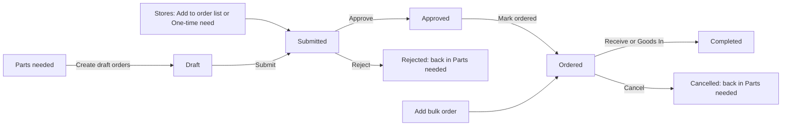

# Orders

:::defaults
persona: Morgan Manager
device: desktop
url: /workshop/manager?tab=orders
state: "Order List: Draft brake pads FKL-900003, Submitted rear tyres FKL-900009, Approved sprockets FKL-900015, Ordered front bumpers FKL-900001 (for Junior 307), Completed tie rods FKL-900005"
:::

Every order line moves through the same stages on the **Order List**. You approve lines, mark them ordered when you place the order with the supplier, and book the parts in when they arrive.

!!! info "What changed from the Workshop App"
    - **Parts Ordered / Order list** and **Parts Received** are now **Order List** and **Goods In** in Workshop Manager.
    - New stage: **approval**. A line must be **Approved** by the hub's manager or an admin before it can be marked ordered.
    - Receiving records the cost: unit cost, currency, invoice reference, freight and tax or duty.
    - Order history from the Workshop App is not moved.

## The pipeline

| Stage | Means | Who moves it on |
|---|---|---|
| **Draft** | Created from Parts needed, not sent yet | The creator or a hub manager: **Submit** |
| **Submitted** | Waiting for approval | The hub's manager or an admin: **Approve** or **Reject** |
| **Approved** | OK to order | Hub manager, admin or Purchasing: **Mark ordered** |
| **Ordered** | Placed with the supplier. Waiting repairs show **On order** | Hub manager, admin or Purchasing: **Receive** |
| **Completed** | Received. Stock and average cost updated | |
| **Cancelled** | Cancelled or rejected. The need shows again in Parts needed | |

## Watch it first

:::clip hm-orders-clip
caption: approving rear tyres in the approval queue and marking sprockets ordered
duration: 60
steps:
  - Open Workshop Manager, Order List
  - Tap Approval queue and show the rear tyres line
  - Tap Approve on rear tyres
  - Find the sprockets line under Approved and tap Mark ordered
  - Show sprockets under Ordered
captions:
  - "Open the Order List."
  - "Lines waiting for you are in the approval queue."
  - "Tap Approve."
  - "When you have placed the order, tap Mark ordered."
  - "The line moves to Ordered."
:::

## Submit a draft

:::shot hm-ord-list
caption: "Steps 1 and 2 on one screen: the Order List with the brake pads Draft line and Submit"
steps:
  - Tap Order List
callouts:
  - [1, "text=Draft", "Brake pads"]
  - [2, "text=Submit", "Send for approval"]
:::

1. Open **Workshop Manager > Order List**. Find the **Draft** line, for example brake pads.

2. Tap **Submit** on the line.

## Approve or reject

:::shot hm-ord-queue
caption: "Steps 1 to 3 on one screen: the Approval queue with Approve and Reject on the rear tyres line"
steps:
  - Tap Approval queue
callouts:
  - [1, "text=Approval queue", "Lines waiting for you"]
  - [2, "text=Approve", "OK to order"]
  - [3, "text=Reject", "Close the line, with a reason"]
:::

1. Tap **Approval queue**. It shows every line **Waiting for approval**.

2. Check the part and quantity. Tap **Approve**.

3. Or tap **Reject**, type a reason in **Reason (optional)** and confirm **Reject order**. The line is closed as Rejected. If the part is still needed it shows again in Parts needed.

## Mark ordered

:::shot hm-ord-mark
caption: "Step 1: Mark ordered on the sprockets line"
steps:
  - Find sprockets under Approved
callouts:
  - [1, "text=Mark ordered", "Placed with the supplier"]
:::

1. Place the order with the supplier. Then find the line under **Approved** and tap **Mark ordered**. Check the **Supplier** and tap **Save**.

2. Repairs waiting for that part now show **On order**, with the supplier and date.

    :::shot hm-ord-onorder
    caption: "Step 2: the 307 repair card showing On order for front bumpers"
    url: /workshop/repairs
    steps:
      - Open Service Queue and find the 307 card
    callouts:
      - [2, "text=On order", "Mechanics see it is coming"]
    :::

!!! warning "Watch out"
    **Mark ordered** only works on **Approved** lines. Lines made with **Add bulk order** go straight to Ordered, so only approvers can make them.

## Bulk and one-time orders

:::shot hm-ord-bulk
caption: "Steps 1 and 2 on one screen: Add bulk order and a one-time line in Submitted"
state: "A one-time need for caliper seal kits exists"
steps:
  - Look at the Order List
callouts:
  - [1, "text=Add bulk order", "Straight to Ordered"]
  - [2, "text=One-time", "From Stores"]
:::

1. For a bulk buy, tap **Add bulk order** on the Order List and add the lines.

2. For a one-off purchase, use **One-time need** in Stores with a reason. It arrives here as **Submitted**, marked one-time.

## Receive the parts (Goods In)

:::clip hm-goodsin-clip
caption: receiving the front bumpers for Junior 307 with Goods In on the Order List
duration: 55
steps:
  - Open Workshop Manager, Order List
  - Tap Goods In on the front bumpers line under Ordered
  - Type the quantity, unit cost, currency, supplier and invoice reference
  - Tap Receive stock
  - Show the 307 repair card in the Service Queue
captions:
  - "Open the Order List."
  - "Tap Goods In on the line that arrived."
  - "Type what arrived and what it cost."
  - "Tap Receive stock."
  - "The waiting repair is ready to do."
:::

:::shot hm-gi-open
caption: "Step 1: Goods In on the front bumpers line under Ordered"
steps:
  - Tap Order List
callouts:
  - [1, "text=Goods In", "Receive this line"]
:::

1. Open **Workshop Manager > Order List**. Find the line under **Ordered**, for example front bumpers, and tap **Goods In** on it.

2. The **Part** is filled in and the line is marked **Against order**. Check it is the part that arrived.

    :::shot hm-gi
    caption: "Steps 2 to 5 on one screen: the Goods In form for the front bumpers order"
    steps:
      - Tap Goods In on the front bumpers line
      - Type 2, 45.00, GBP, the supplier and DEMO-INV-001
    callouts:
      - [2, "text=Against order", "Part and its order"]
      - [3, "text=Unit cost", "Quantity, cost, currency"]
      - [4, "text=Invoice reference", "From the delivery note"]
      - [5, "text=Receive stock", "Book it in"]
    :::

3. Type the **Quantity** and the **Unit cost**, and check the **Currency** (for example GBP).

4. Fill in **Supplier** and **Invoice reference**.

5. Tap **Receive stock**. Stock and the average cost update straight away, and waiting repairs move to **Ready to repair**.

!!! tip "Tip"
    Tap **Receive** instead of **Goods In** on an Ordered line to add **Freight** and **Tax / duty**, then tap **Book in**. Parts that arrive without an order go in through the **Goods In** tab of Workshop Manager. Partial deliveries are fine: receive what came, the rest stays Ordered.

!!! abstract "Coming with your hub's switch-over"
    Open orders in the Workshop App are not copied. Re-enter each one in KART (Stores) so it can be received here.
