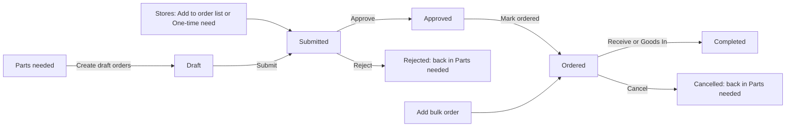

# Orders

:::defaults
persona: Morgan Manager
device: desktop
url: /workshop/manager?tab=orders
state: "Order List: Draft brake pads FKL-900001, Submitted rear tyres FKL-900002, Approved sprockets FKL-900003, Ordered front bumpers FKL-900004 (for Junior 307), Completed tie rods FKL-900005"
:::

Every order line moves through the same stages on the **Order List**. You approve lines, mark them ordered when you place the order with the supplier, and book the parts in when they arrive.

!!! info "What changed from the Workshop App"
    - **Parts Ordered / Order list** and **Parts Received** are now **Order List** and **Goods In** in Workshop Manager.
    - New stage: **approval**. A line must be **Approved** by the hub's manager or an admin before it can be marked ordered.
    - Receiving records the cost: unit cost, currency, invoice reference, freight and tax or duty.
    - Order history from the Workshop App is not moved.

## The pipeline

| Stage | Means | Who moves it on |
|---|---|---|
| **Draft** | Created from Parts needed, not sent yet | The creator or a hub manager: **Submit** |
| **Submitted** | Waiting for approval | The hub's manager or an admin: **Approve** or **Reject** |
| **Approved** | OK to order | Hub manager, admin or Purchasing: **Mark ordered** |
| **Ordered** | Placed with the supplier. Waiting repairs show **On order** | Hub manager, admin or Purchasing: **Receive** |
| **Completed** | Received. Stock and average cost updated | |
| **Cancelled** | Cancelled or rejected. The need shows again in Parts needed | |

## Watch it first

:::clip hm-orders-clip
caption: approving rear tyres in the approval queue and marking sprockets ordered
duration: 60
steps:
  - Open Workshop Manager, Order List
  - Tap Approval queue and show the rear tyres line
  - Tap Approve on rear tyres
  - Find the sprockets line under Approved and tap Mark ordered
  - Show sprockets under Ordered
captions:
  - "Open the Order List."
  - "Lines waiting for you are in the approval queue."
  - "Tap Approve."
  - "When you have placed the order, tap Mark ordered."
  - "The line moves to Ordered."
:::

## Submit a draft

1. Open **Workshop Manager > Order List**. Find the **Draft** line, for example brake pads.

    :::shot hm-ord-list
    caption: The Order List with lines in every stage
    steps:
      - Tap Order List
    callouts:
      - [1, "text=Draft", "Brake pads"]
      - [2, "text=Submitted", "Rear tyres"]
      - [3, "text=Approved", "Sprockets"]
      - [4, "text=Ordered", "Front bumpers"]
    :::

2. Tap **Submit** on the line.

    :::shot hm-ord-submit
    caption: Submit on the brake pads Draft line
    steps:
      - Tap Submit on brake pads
    callouts:
      - [1, "text=Submit", "Send for approval"]
    :::

## Approve or reject

1. Tap **Approval queue**. It shows every line **Waiting for approval**.

    :::shot hm-ord-queue
    caption: Approval queue with the rear tyres line waiting for approval
    steps:
      - Tap Approval queue
    callouts:
      - [1, "text=Approval queue", "Lines waiting for you"]
    :::

2. Check the part and quantity. Tap **Approve**.

    :::shot hm-ord-approve
    caption: Approve on the rear tyres line
    steps:
      - Tap Approve on rear tyres
    callouts:
      - [1, "text=Approve", "OK to order"]
    :::

3. Or tap **Reject**, type a reason in **Reason (optional)** and confirm **Reject order**. The line is closed as Rejected. If the part is still needed it shows again in Parts needed.

    :::shot hm-ord-reject
    caption: The Reject order dialog with a reason
    steps:
      - Tap Reject on a Submitted line
      - Type "Wrong size, see new request"
    callouts:
      - [1, "text=Reject order", "Close the line"]
      - [2, "text=Reason (optional)", "Say why"]
    :::

## Mark ordered

1. Place the order with the supplier. Then find the line under **Approved** and tap **Mark ordered**.

    :::shot hm-ord-mark
    caption: Mark ordered on the sprockets line
    steps:
      - Tap Mark ordered on sprockets
    callouts:
      - [1, "text=Mark ordered", "Placed with the supplier"]
    :::

2. Repairs waiting for that part now show **On order**, with the supplier and date.

    :::shot hm-ord-onorder
    caption: The 307 repair card showing On order for front bumpers
    url: /workshop/repairs
    steps:
      - Open Service Queue and find the 307 card
    callouts:
      - [1, "text=On order", "Mechanics see it is coming"]
    :::

!!! warning "Watch out"
    **Mark ordered** only works on **Approved** lines. Lines made with **Add bulk order** go straight to Ordered, so only approvers can make them.

## Bulk and one-time orders

1. For a bulk buy, tap **Add bulk order** on the Order List and add the lines.

    :::shot hm-ord-bulk
    caption: The Add bulk order button
    steps:
      - Tap Add bulk order
    callouts:
      - [1, "text=Add bulk order", "Straight to Ordered"]
    :::

2. For a one-off purchase, use **One-time need** in Stores with a reason. It arrives here as **Submitted**, marked one-time.

    :::shot hm-ord-onetime
    caption: A one-time need line in Submitted
    state: "A one-time need for caliper seal kits exists"
    steps:
      - Look at the Submitted column
    callouts:
      - [1, "text=One-time", "From Stores"]
    :::

## Receive the parts (Goods In)

:::clip hm-goodsin-clip
caption: receiving the front bumpers for Junior 307 in Goods In
duration: 55
steps:
  - Open Workshop Manager, Goods In
  - Choose the front bumper part and the open order in Against order
  - Type the quantity, unit cost, currency, supplier and invoice reference
  - Tap Receive stock
  - Show the 307 repair card now ready to repair
captions:
  - "Open Goods In."
  - "Pick the part and its order."
  - "Type what arrived and what it cost."
  - "Tap Receive stock."
  - "The waiting repair is ready to do."
:::

1. Open **Workshop Manager > Goods In**.

    :::shot hm-gi-tab
    caption: Goods In for Demo Hub
    url: /workshop/manager?tab=goods-in
    steps:
      - Tap Goods In
    callouts:
      - [1, "text=Goods In", "Record parts received"]
    :::

2. Choose the **Part**, for example front bumper, and the order in **Against order**.

    :::shot hm-gi-part
    caption: Part front bumper and Against order chosen
    url: /workshop/manager?tab=goods-in
    steps:
      - Choose front bumper FKL-900004 in Part
      - Choose the open order in Against order
    callouts:
      - [1, "text=Part", "What arrived"]
      - [2, "text=Against order", "Which order it belongs to"]
    :::

3. Type the **Quantity** and the **Unit cost**, and choose the **Currency**.

    :::shot hm-gi-cost
    caption: Quantity, Unit cost and Currency filled in
    url: /workshop/manager?tab=goods-in
    steps:
      - Type 2 in Quantity, 45.00 in Unit cost, choose GBP
    callouts:
      - [1, "text=Quantity", "How many arrived"]
      - [2, "text=Unit cost", "Price per part"]
    :::

4. Fill in **Supplier** and **Invoice reference**.

    :::shot hm-gi-invoice
    caption: Supplier and Invoice reference filled in
    url: /workshop/manager?tab=goods-in
    steps:
      - Type the supplier and invoice reference DEMO-INV-001
    callouts:
      - [1, "text=Invoice reference", "From the delivery note"]
    :::

5. Tap **Receive stock**. Stock and the average cost update straight away, and waiting repairs move to **Ready to repair**.

    :::shot hm-gi-done
    caption: The 307 repair now in Requires reliability actions
    url: /workshop/repairs
    state: After front bumpers are received
    steps:
      - Tap Receive stock
      - Open Service Queue
    callouts:
      - [1, "text=307", "Ready to repair now"]
    :::

!!! tip "Tip"
    You can also tap **Receive** on an Ordered line in the Order List and fill in **Book in** with freight and tax or duty. Partial deliveries are fine: receive what came, the rest stays Ordered.

!!! abstract "Coming with your hub's switch-over"
    Open orders in the Workshop App are not copied. Re-enter each one in KART (Stores) so it can be received here.
