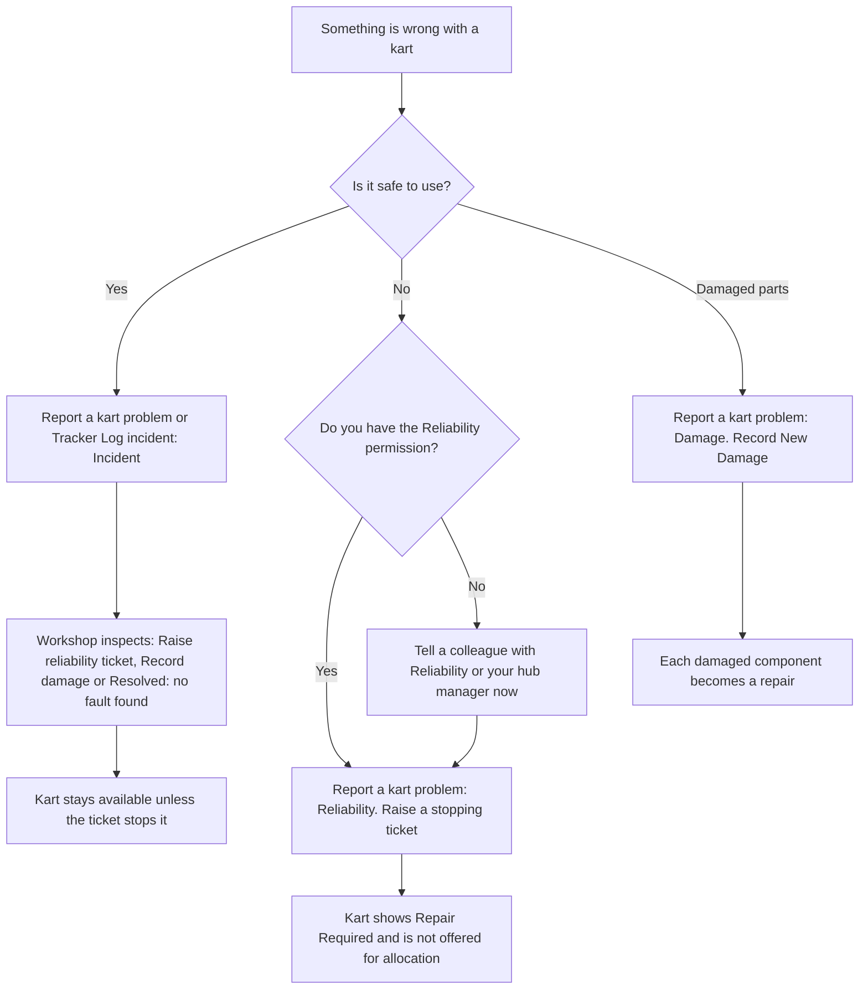

# Incidents, tickets and repairs

:::defaults
persona: Casey Mechanic
device: tablet
url: /workshop
state: Demo Hub as seeded (106 Repair Needed after an incident, 207 stopping ticket, 307 broken front bumper)
:::

KART uses three words for problems with a kart. Knowing the difference saves you from taking good karts out of use, or leaving unsafe karts in.

!!! info "What changed from the Workshop App"
    - In the Workshop App an incident could make a kart Repair Required. **In KART, incidents are information only.** They never make a kart Repair Required or unavailable.
    - **Only a stopping reliability ticket (or a blocking open repair) takes a kart out of use.**
    - "Create New Kart Report" is now **Report a kart problem**.

## The three words

| | What it is | Who raises it | Does it stop the kart? | Example at Demo Hub |
|---|---|---|---|---|
| **Incident** | Something that happened to the kart or what a driver reported. Tells the workshop to look at the kart. | Any staff member with access to the hub (Workshop: **Report a kart problem**; Technical: **Log incident**) | **No, never** | 106 hit the barrier; the workshop found a loose bumper mount |
| **Reliability ticket** | A fault for engineering to investigate. It has an effect, such as "Cut out not restarted". | Mechanics with the **Reliability** permission | **Yes**, when the effect is anything other than **Performance** | 207 cut out and would not restart |
| **Repair** | The work to fix something. Every damaged component and every stopping ticket becomes a repair. | Created by KART from damage, tickets and failed inspection checks | Only when it belongs to a stopping ticket or is marked as blocking | 307 broken front bumper, waiting on parts |

## Stopping or not stopping

- A **stopping** ticket makes the kart **Repair Required**. It is not offered for allocation (KART does not offer it when karts are handed out for an event) until the ticket is resolved and its repair is completed. Cadet **207** is the example.
- A **non-stopping** problem leaves the kart available. An open repair without a stopping ticket shows as **Repair Needed (usable)**, like Bambino **106**.
- A **Performance** ticket never stops the kart.

!!! warning "Watch out"
    When you add a finding to a failed Power / Performance check, KART asks **Would this stop the kart from being used?** Answering **Yes, it should not be used** does **not** stop the kart by itself. KART reminds you: **This answer does not stop the kart: it stays available. If it must not be used, raise a reliability ticket for it.**

## Which one do I raise?

## See the difference on screen

1. Open **Overview** and look at the tile of Bambino **106**. **Available** is still ticked: an older incident left a repair for a loose bumper mount, and the kart can still be used. On the Readiness board and on its kart page it counts as **Repair Needed (usable)**.

    :::shot start-problem-106
    caption: Bambino 106 after an incident, still Available on its tile
    steps:
      - Open the Workshop Overview
      - Scroll to the Bambino Karts tiles
    callouts:
      - [1, "text=#106", "Bambino 106"]
      - [2, "css=[data-kart='106'] input[type=checkbox]", "Available stays ticked"]
    :::

2. Look at Cadet **207**. It shows **Repair Required** because of a stopping reliability ticket: it cut out and would not restart.

    :::shot start-problem-207
    caption: Cadet 207 showing Repair Required and not available
    steps:
      - Scroll to the Cadet Karts tiles
    callouts:
      - [1, "text=#207", "Cadet 207"]
      - [2, "text=Reliability", "Stopping reliability ticket"]
    :::

3. Open the **Service Queue**. The repairs for 106, 207 and 307 are cards in the exception lanes (the three lanes under the red **Exceptions** bar). Repair cards name a kart by class and its number in the class: **Junior 7** is kart 307, **Bambino 6** is kart 106.

    :::shot start-problem-queue
    caption: Repair cards for 106, 207 and 307 in the Service Queue exception lanes
    url: /workshop/repairs
    steps:
      - Tap Service Queue
      - Scroll to the exception lanes
    callouts:
      - [1, "text=Requires reliability actions", "Repairs ready to do"]
      - [2, "text=Requires part", "Repairs waiting on parts, such as 307"]
    :::

!!! note "Remember"
    Root cause (why it failed) stays on the reliability ticket. The remedy (what you did) goes on the repair. When the fault is fixed, someone with the Reliability permission sets the ticket to **Resolved**. See [Reliability tickets](../mechanic/reliability-ticket.md).

## Where next

- [Report a problem](../mechanic/report-a-problem.md) for incidents, driver feedback and following an incident up.
- [Reliability tickets](../mechanic/reliability-ticket.md) to stop a kart.
- [Repairs and parts used](../mechanic/repairs-and-parts.md) to fix it.
