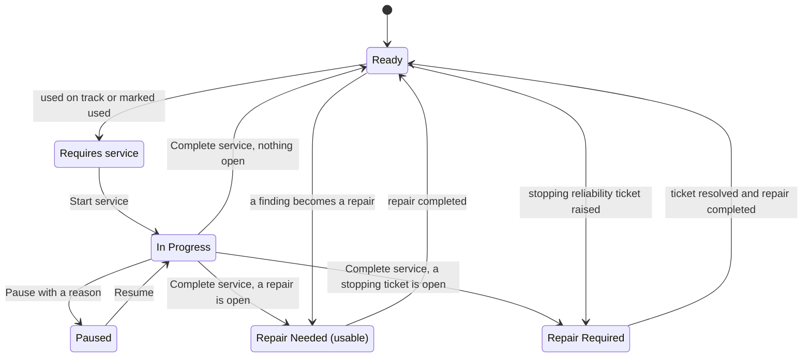

# Kart statuses

:::defaults
persona: Alex Mechanic
device: tablet
url: /workshop
state: Demo Hub fleet as seeded (103, 203, 204, 303 Requires service; 205 in progress; 304 paused; 106 Repair Needed; 207 and 307 Repair Required; Juniors with campaign tasks)
:::

Every kart in KART has one workshop status. The status decides whether the kart can be used and what the workshop does next. You see it on the **Readiness board** on **Overview**, in the **Service Queue** and on the kart page.

!!! info "What changed from the Workshop App"
    - **"Turn Required" is now "Requires service".** Same meaning: the kart has been used since its last service and needs one. KART never shows the words "Turn Required".
    - **Campaign Required** is new on the board. It shows karts with open campaign work. The kart stays usable.
    - Logging an incident no longer makes a kart Repair Required on its own. See [Incidents, tickets and repairs](problems-explained.md).

## All statuses at a glance

| Colour | Status in KART | What it means | What makes it change | Workshop App name |
|---|---|---|---|---|
|  green | **Ready** | Serviced and nothing open. The kart can race. | A service is completed with nothing open, or the last repair is finished. | Ready |
|  amber | **Requires service** | The kart has been used and needs a service. | It goes on track (Race to Chassis on the event day), or a hub manager marks it used. Completing the service ends it. | Turn Required (Ready to Turn) |
|  sky blue | **In Progress** (part of Requires service) | A mechanic has started the service. | **Start service**. It ends with **Complete service**. | In Progress |
|  slate grey | **Paused** (part of Requires service) | The service was paused with a reason. | **Pause**. It ends when someone resumes the service. | Paused |
|  purple | **Repair Needed (usable)** | An open repair that does not stop the kart. The kart stays available. | A finding that becomes a repair. It ends when the repair is completed. | Repair Needed (Usable) |
|  red | **Repair Required** | The kart must not be used. It is not offered for allocation. | A stopping reliability ticket, or a repair that blocks the kart. It ends when the ticket is resolved and its repair is completed. | Repair Required |
|  orange | **Ready to repair** (part of Repair Required) | The repair can be done now. | The parts are in the hub, or no parts are needed. | Ready to Repair |
|  dark red | **Waiting on parts** (part of Repair Required) | The repair waits for parts. Once ordered, the card says **On order**. | The parts are received in Goods In, then it becomes Ready to repair. | Waiting on Parts |
|  indigo | **Campaign Required** | The kart has an open task in an active campaign. Its normal status does not change and it stays usable. | The hub manager starts an integrated campaign. It ends when the task is completed or the kart is excluded. | (new) |

!!! note "Remember"
    **Event usable** means Ready or Repair Needed (usable), and available. Only those karts count towards your readiness targets.

## Where you see the status

1. Open **Overview**. The **Readiness board** shows a count for each status group.

    :::shot start-status-board
    caption: The Readiness board with counts for Ready, Requires service, Repair Needed (usable), Repair Required and Campaign Required
    steps:
      - Open the Workshop for Demo Hub
      - Scroll to the Readiness board
    callouts:
      - [1, "text=Readiness board", "Counts per status"]
      - [2, "text=Ready", "Green: can race"]
      - [3, "text=Requires service", "Amber: needs a service"]
      - [4, "text=Repair Required", "Red: must not be used"]
    :::

2. Tap a number to list those karts, for example the **Repair Required** count.

    :::shot start-status-drilldown
    caption: The list of Repair Required karts, 207 and 307
    url: /workshop/readiness/repair_all
    steps:
      - Tap the Repair Required count on the Readiness board
    callouts:
      - [1, "text=207", "Stopping reliability ticket"]
      - [2, "text=307", "Waiting on a front bumper"]
    :::

3. Look under the board for the reason tags, for example **Missing Components** on Junior 308.

    :::shot start-status-tags
    caption: Kart tiles with reason tags such as Missing Components on 308 and Campaign on the Juniors
    steps:
      - Scroll to the Junior Karts tiles
    callouts:
      - [1, "text=#308", "Junior 308"]
      - [2, "text=Missing Components", "A battery is missing"]
      - [3, "text=Campaign", "Open campaign task"]
    :::

## Reason tags

Under the board each kart can carry tags. They tell you why a kart is not simply Ready:

- **Requires service**: used since its last service.
- **Reliability**: an open reliability ticket.
- **Damage ticket**: open damage.
- **Performance**: a performance ticket. The kart stays usable.
- **Missing Components**: fewer batteries fitted than the class needs (Bambino 1, Cadet 2, Junior 3).
- **Campaign work**: an open campaign task.
- **Manual Override**: someone set Available or Preferred by hand.
- **Not available**: the kart is not offered for allocation.

## How a kart moves between statuses

!!! warning "Watch out"
    Do not change a kart's status by hand to make the board look right. If a status looks wrong, report it through KART Comms support with the kart number. See [Troubleshooting](../troubleshooting.md).

!!! tip "Tip"
    A kart with a started or paused service also counts as needing service everywhere in KART, including the Fleet Status card and Race to Chassis colours.

## Other words on the kart page

The kart page can also show **Written off**, **Off site** or **Not ready**. These come from the kart's record, not from the workshop. Ask your hub manager if you see one you do not expect.
