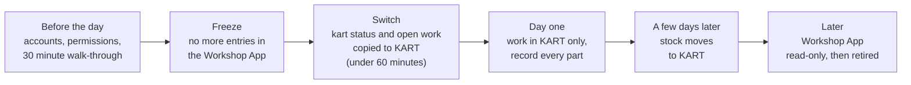

# Switch-over day for your hub

:::defaults
persona: Alex Mechanic
device: tablet
url: /workshop
state: "Demo Hub as seeded (shows what day one looks like; the demo hub has no Workshop App data)"
:::

On your hub's switch-over day, your workshop stops recording in the Workshop App and starts recording everything in KART. This page explains what happens, what you need to do before and on the day, and what comes later.

!!! warning "Watch out"
    **No hub has switched yet.** Dates are proposed and still waiting for approval. **Your hub lead confirms the date and time at least 24 hours before.** Do not plan around a date until your hub lead has confirmed it.

!!! info "What changed from the Workshop App"
    - After the switch time, the Workshop App is for looking things up only. Everything new goes into KART.
    - There is no going back: once your hub works in KART, nothing is copied back to the Workshop App.
    - Some hubs already run their workshop in KART. Past records from other hubs (old services, repairs, incidents and finished campaigns) have already been copied into KART as history.

## The plan at a glance

!!! abstract "Coming with your hub's switch-over"
    Everything below happens when **your** hub switches. Your hub lead tells you the date and time at least 24 hours before, and goes through this page with you.

## Before the day: accounts first

!!! abstract "Coming with your hub's switch-over"
    You need a **KART account** with the **Workshop** permission and **access to your hub** before the day. Without the Workshop permission you can see the karts but cannot start services, raise or update repairs, or record parts.

1. Sign in to KART (see [Signing in and access](../start/sign-in-and-access.md)).

    :::shot so-before-signin
    caption: Signing in to KART before the switch-over day
    url: /auth
    steps:
      - Open /auth and sign in as Alex Mechanic
    callouts:
      - [1, "text=Sign In", "Check you can sign in"]
    :::

2. Choose your hub and check you see the **Workshop** card.

    :::shot so-before-card
    caption: The Workshop card for your hub on Select your Hub
    url: /hub-selection
    steps:
      - Choose Demo Hub
    callouts:
      - [1, "text=Workshop", "You need this card"]
    :::

3. Tap **Workshop** and check you see the **Service Queue** tab. If anything is missing, tell your hub lead **now**, not on the day.

    :::shot so-before-tabs
    caption: The Workshop tabs including Service Queue
    steps:
      - Tap the Workshop card
    callouts:
      - [1, "text=Service Queue", "You can start services"]
    :::

!!! tip "Tip"
    Your hub lead runs a 30 minute walk-through before day one, on a test kart where possible. Bring your questions.

## The cut-off and the Workshop App freeze

!!! abstract "Coming with your hub's switch-over"
    - **From the switch time, nobody enters or changes anything in the Workshop App for your hub.** You can still open it to look things up.
    - **Anything typed in the Workshop App after the switch time is not copied to KART.**
    - Campaign work stops in the Workshop App at the same time.
    - The freeze while records are copied lasts under 60 minutes.
    - **There is no going back.** If something looks wrong in KART afterwards, it is fixed in KART.

## What carries over

!!! abstract "Coming with your hub's switch-over"
    | Carries over at the switch | How it looks in KART |
    |---|---|
    | **Kart status** | Each kart takes its Workshop App status. Karts that are already Repair Required in KART stay that way until their KART ticket or repair is closed, whatever the Workshop App says. Changes someone made in KART after the kart's last Workshop App change are kept. |
    | **Open services** | Moved with **0 active time**: their timer starts from zero at the switch. Finish or cancel them in KART. |
    | **Open repairs and incidents** | Moved as open repairs and incidents, in the Service Queue and on the ICU board. |
    | **Open campaigns** | Continue in **Campaign work**. |
    | **Typed notes** | **Not copied.** Only system texts and short labels come across. Note anything important on paper before the switch. |

## What moves later

!!! abstract "Coming with your hub's switch-over"
    - **Stock, a few days after the switch.** KART sets each part to **the Workshop App count minus what you used in KART since the switch**. So **record every part you use in KART from day one.** Until the stock moves, **Parts needed may list parts that are on the shelf: check the shelf before ordering.**
    - **Open orders** in the Workshop App are not copied. Re-enter each one in KART (**Stores**) so it can be received there. Order history is not moved now.
    - **Checklist answers** of old services move later. Until then, old services show "0 of N checks" in reports.

## Day-one checklist

Print this list, or the [switch-over day card](../cards/index.md).

!!! abstract "Coming with your hub's switch-over"
    Use this checklist on your hub's first day in KART.

1. Before the day: check you can sign in to KART and see Workshop for your hub. If not, tell the hub lead now.

    :::shot so-day-1-access
    caption: The Workshop for your hub open in KART
    steps:
      - Open the Workshop for Demo Hub
    callouts:
      - [1, "text=Overview", "You have access"]
    :::

2. From the switch time: do not open the Workshop App to record anything.

    :::shot so-day-2-freeze
    caption: KART open on the workshop tablet as the only app for recording
    url: /hub-selection
    steps:
      - Show Select your Hub on the tablet
    callouts:
      - [1, "text=Select your Hub", "Record in KART only"]
    :::

3. Open KART > Workshop and check the fleet board against the karts in front of you. Report anything wrong through KART Comms support, with the kart number.

    :::shot so-day-3-board
    caption: The Readiness board to compare with the karts in the workshop
    steps:
      - Scroll to the Readiness board
    callouts:
      - [1, "text=Readiness board", "Compare with the real karts"]
    :::

4. Open **Servicing** and pick up the carried-over services: complete or cancel each one.

    :::shot so-day-4-services
    caption: Servicing with carried-over services in the Paused services bar
    url: /workshop/in-service
    state: "Alex has 304 paused (stands in for a carried-over service)"
    steps:
      - Tap Servicing
    callouts:
      - [1, "text=Paused services", "Carried-over services"]
    :::

5. Work the **Service Queue** for karts showing **Requires service** (the Workshop App said Turn Required).

    :::shot so-day-5-queue
    caption: The Requires service lane in the Service Queue
    url: /workshop/repairs
    steps:
      - Tap Service Queue
    callouts:
      - [1, "text=Requires service", "Was Turn Required"]
    :::

6. Work the open repairs, and record the parts used on each repair.

    :::shot so-day-6-repairs
    caption: Open repair cards in the exception lanes
    url: /workshop/repairs
    steps:
      - Scroll to Requires reliability actions
    callouts:
      - [1, "text=Log remedy / complete repair", "Record the parts too"]
    :::

7. Close any KART stopping ticket whose fault is already fixed.

    :::shot so-day-7-tickets
    caption: Open linked ticket on a repair card to close a fixed ticket
    url: /workshop/repairs
    persona: Casey Mechanic
    steps:
      - Find the 207 card
    callouts:
      - [1, "text=Open linked ticket", "Resolve it if fixed"]
    :::

8. Carry on any open campaign in **Campaign work** and record the fitted parts on the task.

    :::shot so-day-8-campaign
    caption: Campaign work with open tasks
    url: /workshop/campaign-work
    steps:
      - Tap Campaign work
    callouts:
      - [1, "text=Assigned to me", "Carry on here"]
    :::

9. New fault: log an incident (information) and, if the kart must not be used, raise a stopping reliability ticket.

    :::shot so-day-9-report
    caption: Report a kart problem with Incident and Reliability
    steps:
      - Tap Report a kart problem
    callouts:
      - [1, "text=What are you reporting?", "Incident or Reliability"]
    :::

10. Re-enter any open Workshop App order in **Stores**.

    :::shot so-day-10-order
    caption: Add to order list in Stores
    url: /workshop/parts
    steps:
      - Tap Stores
    callouts:
      - [1, "text=Add to order list", "Re-enter the order"]
    :::

## If KART is down

!!! warning "Watch out"
    **Write it on paper; enter it in KART when it is back. Do not use the Workshop App.** Note the kart number, what you did, the parts you used, the time and your initials.

## Who to contact

| Question | Ask |
|---|---|
| Cannot sign in, no Workshop access, wrong hub | Your **hub lead**, who asks a KART admin to give the Workshop permission and hub access |
| Fleet board or kart status looks wrong, a moved record is missing | **KART Comms support** (remote support). Include the kart number |
| Part missing from the parts list, wrong part number, supplier | **FKL Central** (parts catalogue), through your hub lead |
| Process questions, the SOP | Your **hub lead**, then the **KART product owner** |
| KART unavailable | Paper, then enter it in KART later. Never the Workshop App |

## Later: the Workshop App is retired

!!! abstract "Coming with your hub's switch-over"
    After every hub has switched, the Workshop App becomes read-only and is later switched off. Old kart QR labels will be redirected to KART. Your hub lead tells you when.

!!! note "Remember"
    Record every part in KART from day one, check the shelf before ordering until the stock moves, and never use the Workshop App to record anything after your switch time.
