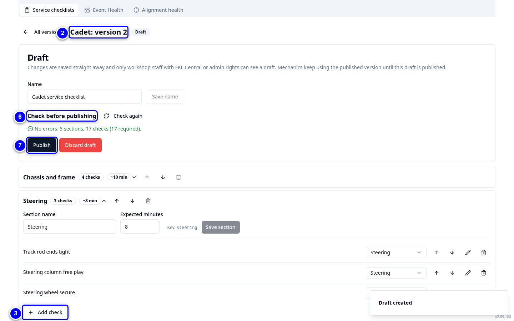
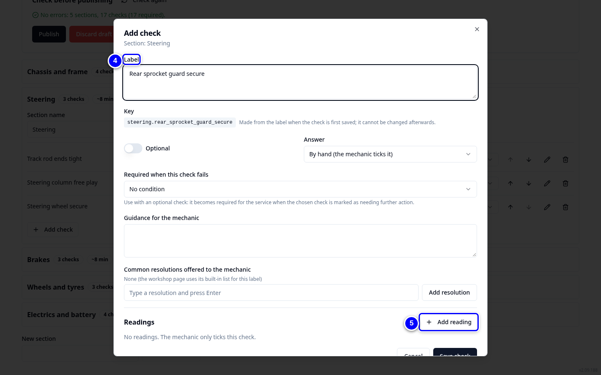
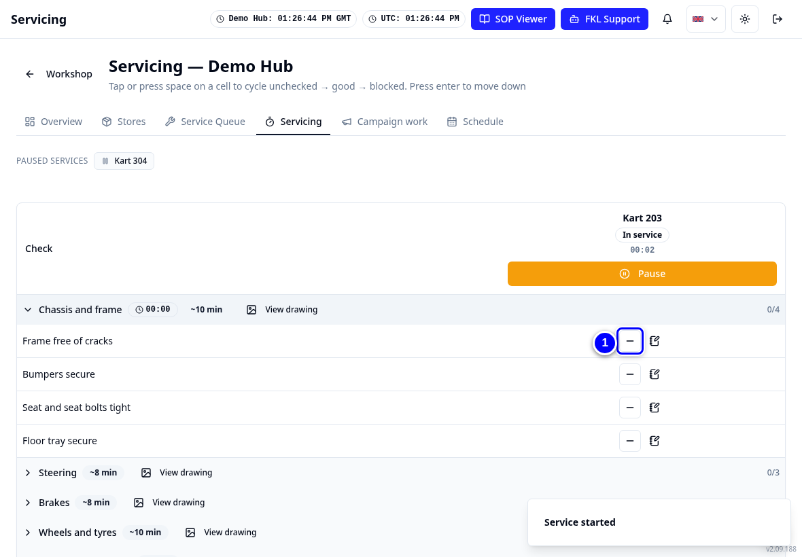

# Service checklists

Every kart class has one master service checklist: Bambino, Cadet and Junior. You change a checklist by making a draft, editing it, checking it and publishing it with a note of what changed. New services use the new version straight away.

!!! info "What changed from the Workshop App"
    - The Workshop App's **Checklists** are now **FKL Central > Service checklists**.
    - One versioned master per kart class (v1: 15 sections, 102 checks each), plus the driver feedback **Power / Performance inspection** checklist.
    - An open service keeps the version it started with.

## Make and publish a change

<figure class="clip"><video controls preload="none" playsinline poster="../assets/video/fc-checklist-clip.jpg" width="1440">
<source src="../assets/video/fc-checklist-clip.mp4" type="video/mp4"><source src="../assets/video/fc-checklist-clip.webm" type="video/webm">
<track kind="captions" src="../assets/video/fc-checklist-clip.vtt" srclang="en" label="English" default></video>
<figcaption>Watch: making a draft of the Cadet checklist, adding a check and publishing it (about 50 seconds, with captions)</figcaption></figure>

{ loading=lazy }

1. Open **FKL Central > Service checklists**. Choose the kart class at the top: **Bambino**, **Cadet**, **Junior** or **Shared checklist**. The **Published** box shows the version in use.

2. Tap **New draft**, for example on Cadet. If a draft exists, tap **Continue editing**. The editor opens on the draft.

3. Tap a section to open it, then tap **Add check** at the bottom of the section (or type a name under **New section** and tap **Add section**).

4. Type the **Label**. Choose the **Answer**: **By hand (the mechanic ticks it)** or from readings. Switch on **Optional** if it may be skipped.

    { loading=lazy }

5. For a measured check, add readings with **Add reading**. Then tap **Save check** at the bottom of the dialog.

6. Look at **Check before publishing**. It checks the draft by itself and says **No errors** or lists what to fix. Tap **Check again** after a change.

7. Tap **Publish**. Type a note in **What changed (required)** and tap **Publish** in the dialog.

!!! warning "Watch out"
    Publishing changes the checklist for every hub with that kart class from the next service. Tell hub managers before you publish. Tap **Discard draft** to throw a draft away.

!!! tip "Tip"
    **Copy from another class** starts a draft from another class's checklist.

## In a cell: what mechanics see

1. Mechanics tap each cell to cycle it **Unchecked**, **Good**, **Blocked**. Keep labels short so they fit the cell.

    { loading=lazy }

!!! abstract "Coming soon"
    The old 4-box front alignment entry will be removed where the check is answered by hand (planned around 23 October, still to be approved). Until then it stays on the Bambino, Cadet and Junior checklists. Alignment readings already use the **Setdown / setup** dialog under the front spindle alignment cell.

!!! abstract "Coming with your hub's switch-over"
    Checklist answers of old Workshop App services are moved later. Until then those services show "0 of N checks" in reports.
