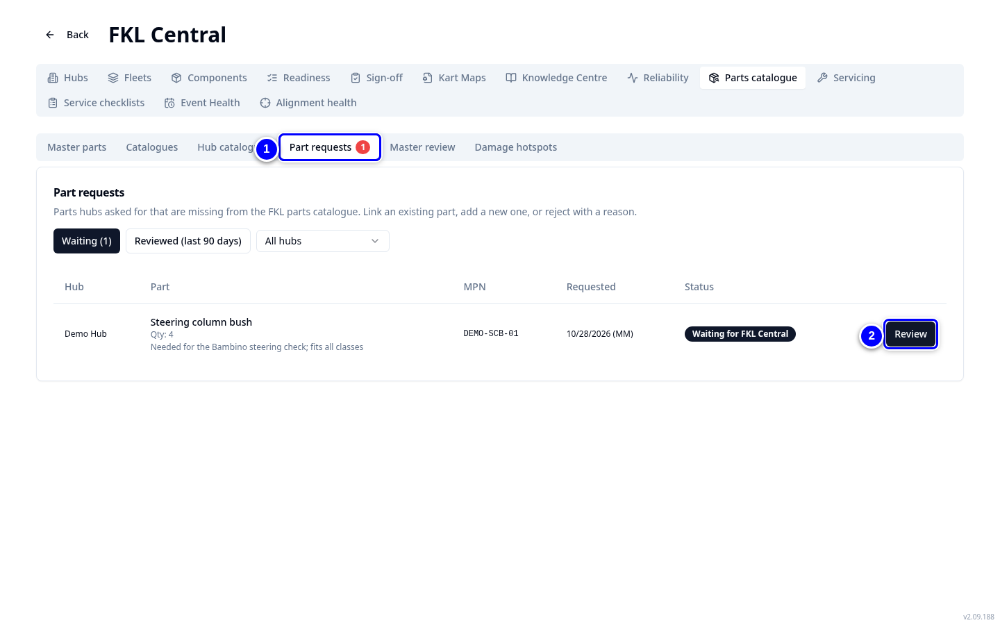
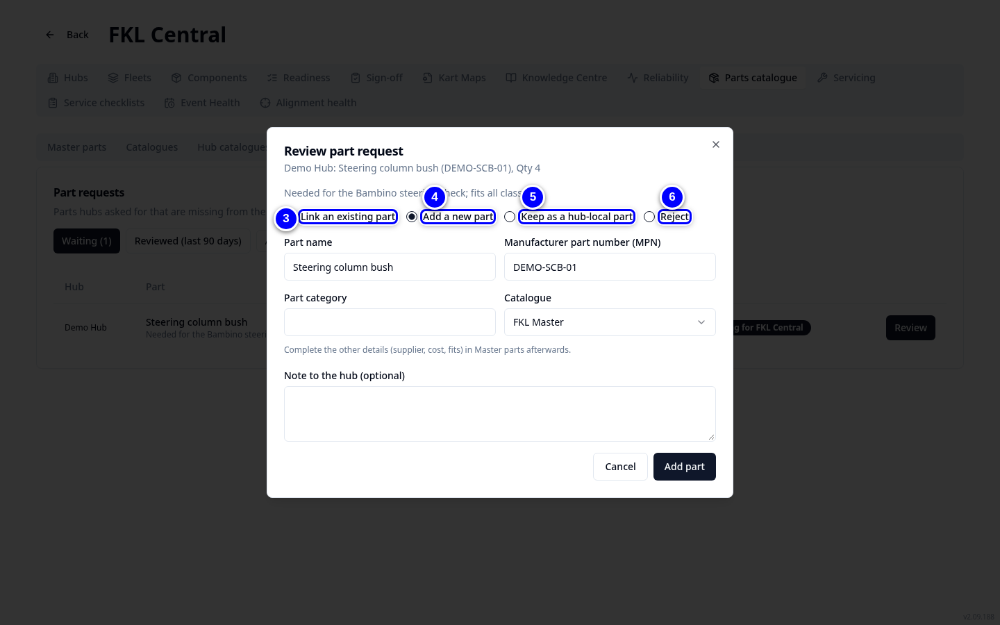

# Part requests

When a hub needs a part that is not in the catalogue, the hub manager sends a request. You get a push notification (FKL Central and purchasing users, if notifications are switched on), and, for FKL Central users, the request also appears under **Part requests** in the bell at the top of the page. Tap it there to open the request. You review it: link an existing part, add a new master part, or reject it with a reason the hub sees. Every part is on the FKL master list: hubs cannot add parts of their own.

!!! info "What changed from the Workshop App"
    - **Catalog Requests** are now **Part requests** in **FKL Central > Parts catalogue**, with a badge showing how many wait.
    - A request carries the manufacturer, MPN, supplier, supplier part number, a link, the compatible kart types and generations, and an optional related part (**Same as** or **Alternative to**). It has no quantity.
    - **Keep as a hub-local part** is gone: link the part, add it to the master list, or reject the request.

## Review a request

<figure class="clip"><video controls preload="none" playsinline poster="../assets/video/fc-review-clip.jpg" width="1440">
<source src="../assets/video/fc-review-clip.mp4" type="video/mp4"><source src="../assets/video/fc-review-clip.webm" type="video/webm">
<track kind="captions" src="../assets/video/fc-review-clip.vtt" srclang="en" label="English" default></video>
<figcaption>Watch: reviewing the Steering column bush request from Demo Hub (about 25 seconds, with captions)</figcaption></figure>

{ loading=lazy }

1. Open **Parts catalogue** and tap **Part requests**, or tap the request in the bell: it opens here with the request highlighted and its review open if it is still waiting and you can review it. Requests waiting are under **Waiting**. Each row shows what the hub sent: manufacturer, supplier, which karts it fits, a related part and a **Product link**.

2. Tap **Review** on the request.

{ loading=lazy }

3. If the part already exists, choose **Link an existing part**, search for it and tap **Link part**. When the hub marked it **Same as** an existing part, that part is already chosen.

4. If it is new, choose **Add a new part** (chosen at the start). Check the **Part name**, the **Manufacturer part number (MPN)** and the **Part category**. **Part fit (from the request)** is ticked with the kart types and generations the hub gave; change them if needed. The **Supplier** and **Supplier part number** come from the request: add a **Unit cost** if you know it. Tap **Add part**. The supplier goes into the new part's supplier list and becomes the requesting hub's preferred supplier.

5. To refuse, choose **Reject**, type the **Reason (shown to the hub)** and tap **Reject request**.

!!! warning "Watch out"
    If the requested MPN already belongs to a hub-local part of another hub, adopt that part into the master list in **Master review** first, then link it here.

!!! tip "Tip"
    After adding a new part, complete the other details (cost, assembly) in **Master parts**.

!!! note "Remember"
    **Reviewed (last 90 days)** lists what you have already decided. **Master review** is where you check hub-local parts and merge them into a matching master part.
