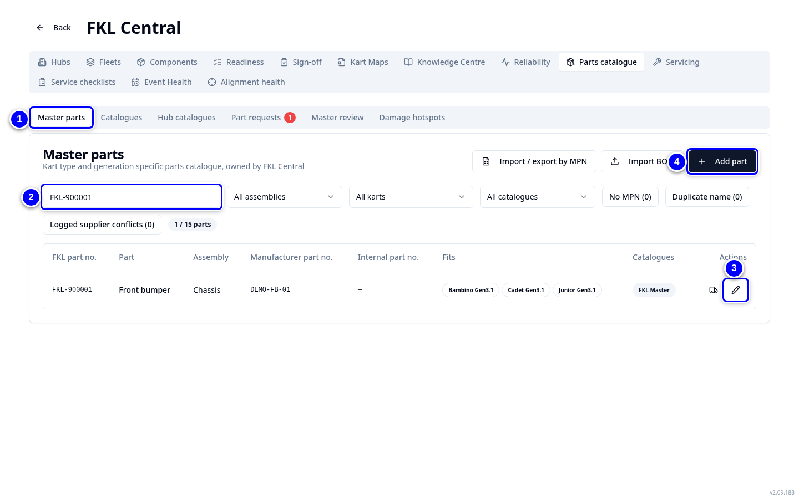
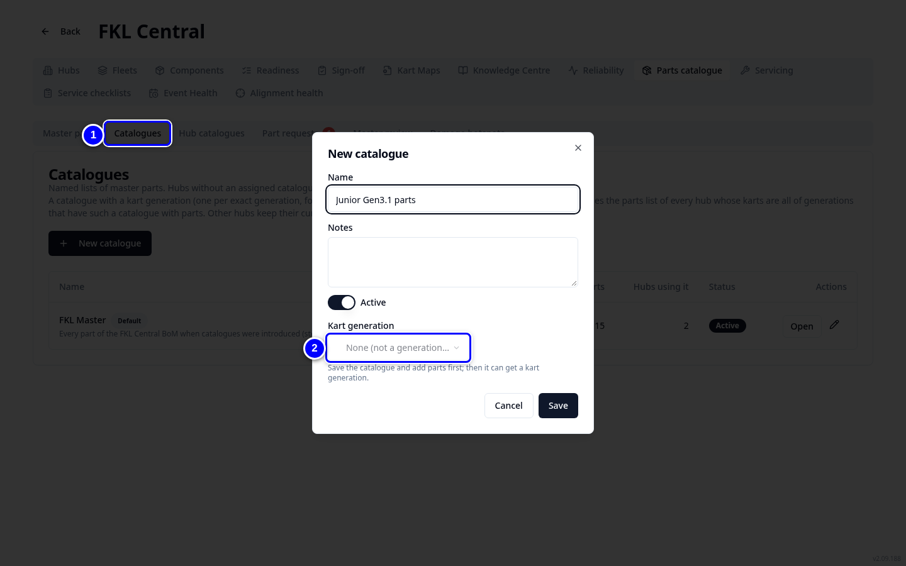
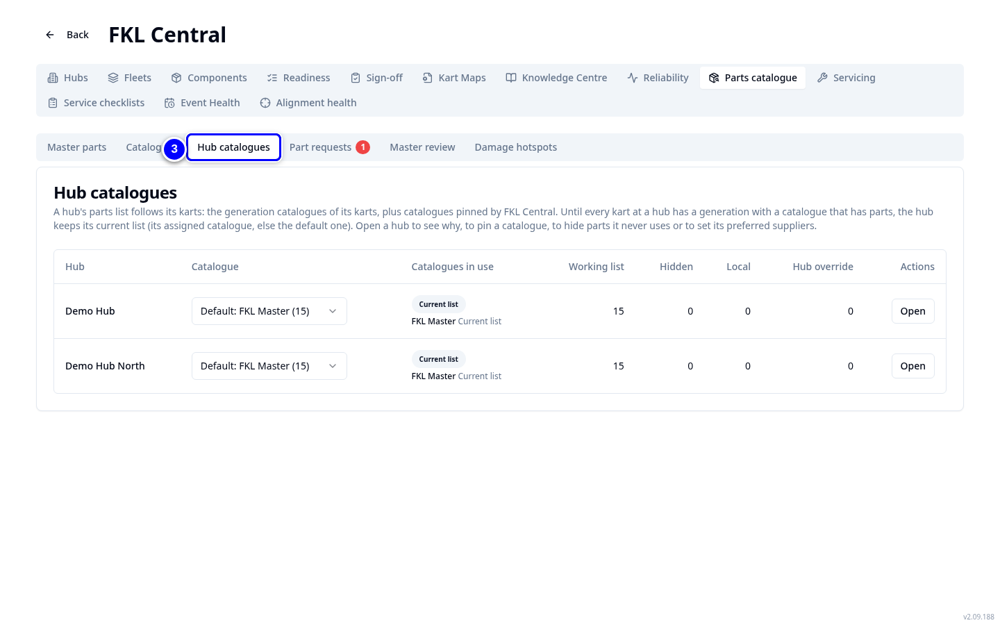

# Parts catalogue

The FKL Central parts catalogue is the single master list of parts. Every part has an FKL part number and a manufacturer part number (MPN). Catalogues decide which parts each hub sees.

!!! info "What changed from the Workshop App"
    - One master list for all hubs, with FKL part numbers and a supplier list per part.
    - Workshop App parts were already moved: new parts were added and others matched to existing parts by MPN.
    - Catalogues can be tied to an exact kart generation, for example Gen3.1.

## Master parts

1. Open **FKL Central** and tap **Parts catalogue**. You land on **Master parts**.

    { loading=lazy }

2. Search by name, FKL number or MPN, for example "FKL-900004".

    { loading=lazy }

3. Tap **Edit part** to change a part, or **Suppliers** to manage its supplier list.

    { loading=lazy }

4. To add a part, tap **Add part**. An MPN is required.

    { loading=lazy }

!!! tip "Tip"
    **Import / export by MPN** and **Import BOM** handle many parts at once.

## Catalogues and generations

1. Tap **Catalogues**. Each catalogue is a set of parts. The default is FKL Master.

    { loading=lazy }

2. Open a catalogue and set its **Kart generation** to make it a generation catalogue.

    { loading=lazy }

3. Tap **Hub catalogues** to see which catalogue each hub works from.

    { loading=lazy }

!!! note "Remember"
    A generation catalogue is exact: Gen3.1 does not include Gen3.0 or Gen3.2. A hub whose karts are all of generations with such a catalogue works from those catalogues; other hubs keep their current list.

!!! abstract "Coming soon"
    FKL Central will set UK and US default suppliers through the supplier list in the part form and the BoM import.
