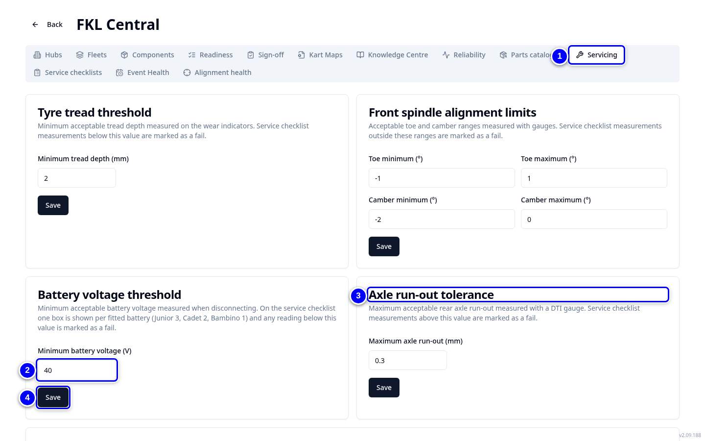

# Servicing thresholds

**FKL Central > Servicing** holds the limits KART uses when mechanics type readings: minimum tyre tread, front spindle alignment, minimum battery voltage and maximum axle run-out. A reading outside the limit is flagged.

!!! info "What changed from the Workshop App"
    - The limits are global and set in one place by FKL Central admins.
    - Alignment specs are set per kart class, with an optional hub override and an explicit unit (degrees or mm). Out-of-spec readings show "action required".
    - Everyone else can see the values but not change them.

## Change a threshold

{ loading=lazy }

1. Open **FKL Central** and tap **Servicing**. You see **Tyre tread threshold**, **Front spindle alignment limits**, **Battery voltage threshold** and **Axle run-out tolerance**.

2. Change the value, for example **Minimum battery voltage (V)** under **Battery voltage threshold**.

3. Check the other boxes as well, for example **Axle run-out tolerance**.

4. Tap **Save** in the box you changed. Each box has its own **Save**.

!!! note "Remember"
    Without admin rights you see **Only admins can change these settings. You can see the current values.**

!!! warning "Watch out"
    A new limit applies to every hub from the next reading. Agree changes with engineering and tell the hubs.
