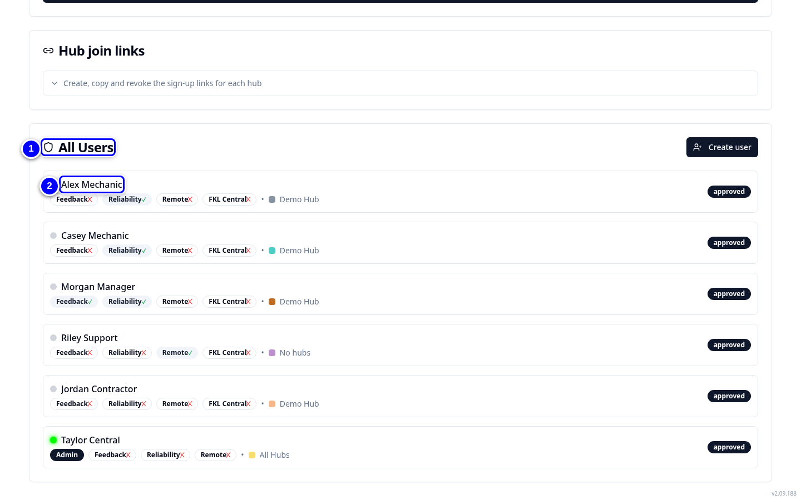
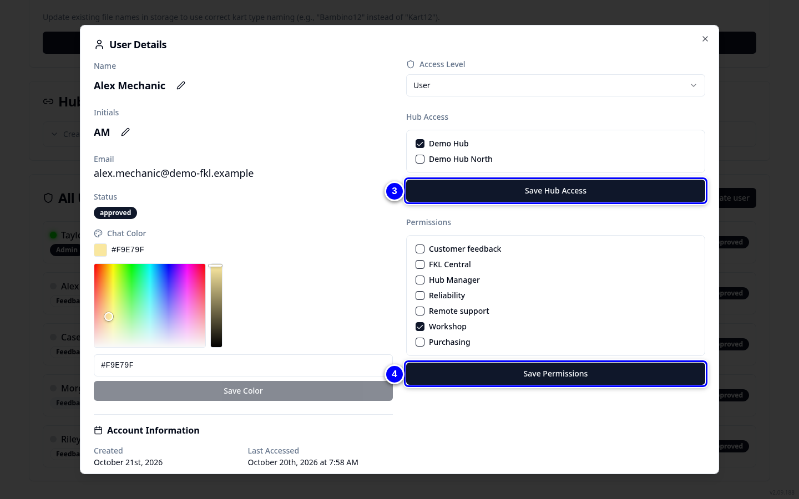
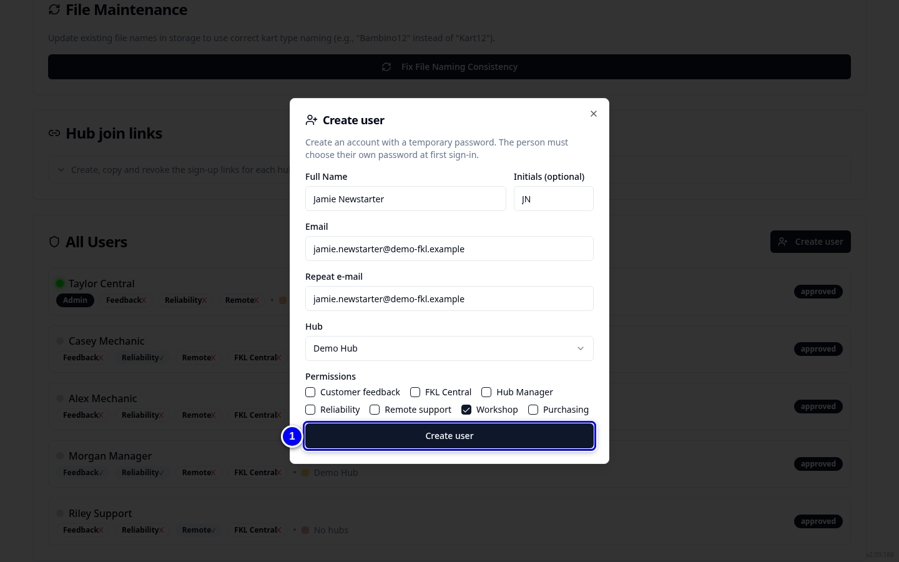
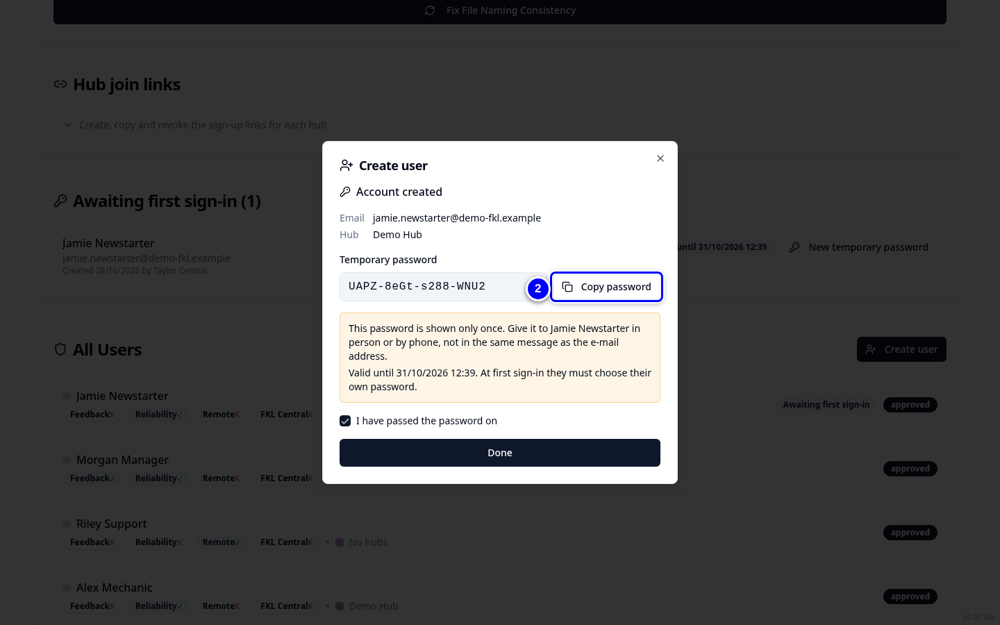
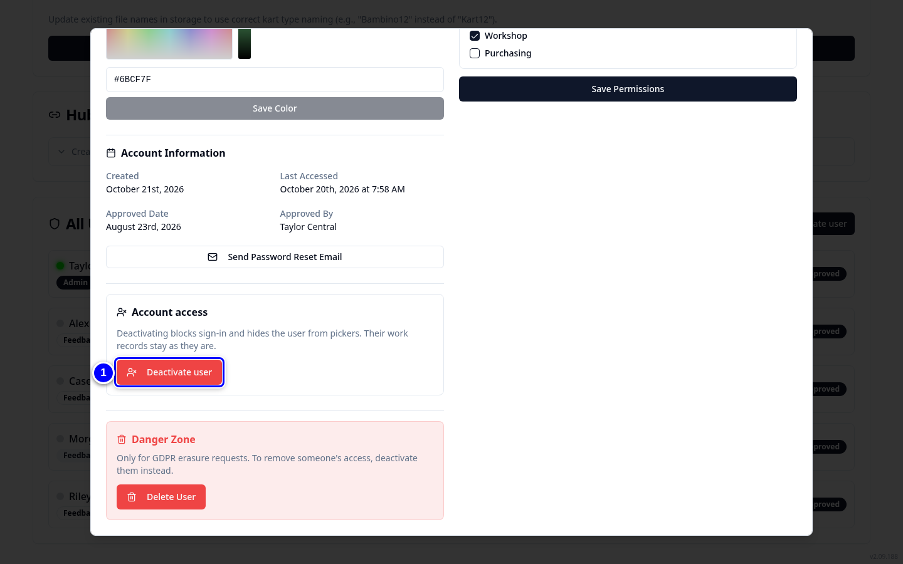
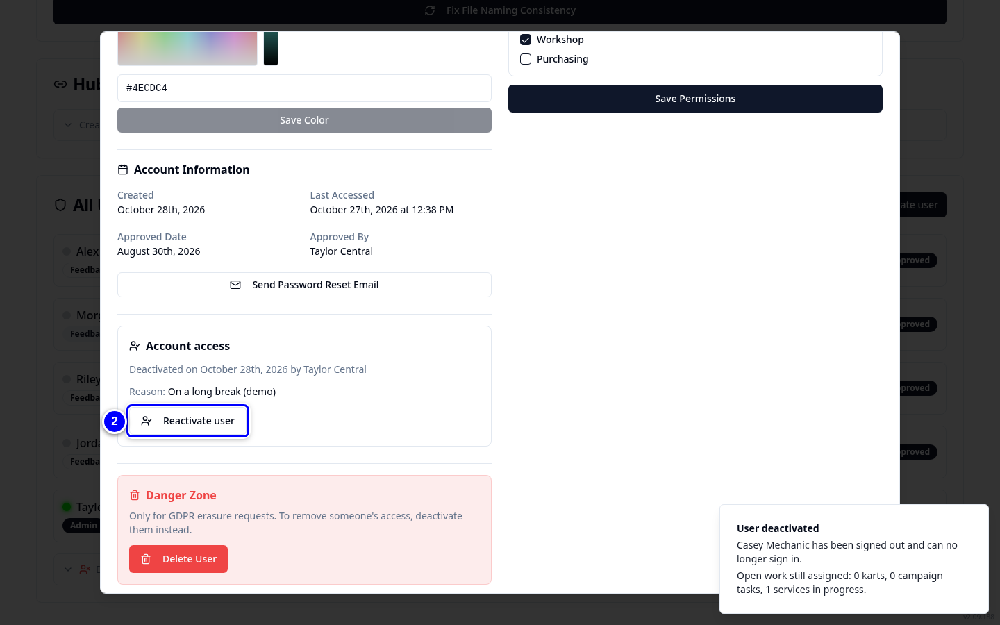

# Users and permissions (admins)

Admins manage every KART account on the **Admin** page: approvals, join links, new users, hub access, permissions and deactivation. Hub managers do the same for their own hubs in **Pending approvals** (see [Approvals](../hub-manager/approvals.md)).

!!! info "What changed from the Workshop App"
    - **Manage Users** is now **Admin Access > User Administration**.
    - Workshop App roles became KART permissions: mechanic is **Workshop**; purchaser is **Workshop** plus **Purchasing**; parts_catalog_manager is **FKL Central**; hub_manager is **Hub Manager**; admin is the **Admin** access level.
    - Deactivating is a soft switch-off: the account and its history stay and can be reactivated.

## Permissions in plain words

| Permission | What it lets the person do |
|---|---|
| **Workshop** | Use the Workshop: start services, raise and update repairs, record parts, campaign work, Stores, Schedule. Needs access to the hub too. Includes **Reliability**: ticking Workshop ticks Reliability, and KART adds Reliability whenever Workshop is given. |
| **Reliability** | Raise and edit reliability tickets and damage, and tick Available or Preferred on karts. |
| **Hub Manager** | Everything in the Workshop plus Workshop Manager, the Hub Manager dashboard, approvals for their hubs, adjusting stock, marking karts used and approving orders. Ticking it also ticks Reliability, Customer feedback and Workshop. Hub managers can give Workshop and Reliability to people at their hubs. |
| **Purchasing** | Order actions: submit, mark ordered, receive and cancel. Not approve. Only admins give it. |
| **FKL Central** | All FKL Central tabs and reading all hubs. |
| **Remote support** | The Remote Support dashboard, the Support view of KART Comms and reading all hubs. Only remote support holders can be set as support cover. |
| **Customer feedback** | The customer feedback screens. |

The **Access Level** is **User** or **Admin**. Admins can do everything and see every hub.

## Find a user and change permissions

{ loading=lazy }

1. On **Select your Hub**, tap **Admin Access**. **User Administration** opens. **Pending User Approvals** lists sign-ups waiting. Scroll down to **All Users**.

2. In **All Users**, tap the person, for example Alex Mechanic. **User Details** opens.

3. Under **Hub Access**, tick the hubs and tap **Save Hub Access**.

    { loading=lazy }

4. Under **Permissions**, tick what they need and tap **Save Permissions**. The **Access Level** above is **User** or **Admin**.

## Create a user

{ loading=lazy }

1. Under **All Users**, tap **Create user**. Fill in the name, initials, e-mail twice, hub and permissions, then tap **Create user**.

2. Copy the **Temporary password** and pass it on privately. Tick **I have passed the password on** and tap **Done**. At the first sign-in the person sets their own password.

    { loading=lazy }

## Deactivate a user

{ loading=lazy }

1. Open the user and tap **Deactivate user** under **Account access**. Type the **Reason for deactivation** and tap **Deactivate user** again to confirm. They can no longer sign in, and they are hidden from pickers. Their work records stay.

2. To undo it, open the user again, tap **Reactivate user** and confirm. They can sign in again with their existing permissions and hub access.

    { loading=lazy }

!!! warning "Watch out"
    **Delete User** under **Danger Zone** is only for GDPR erasure requests. To remove someone's access, deactivate them instead.

!!! tip "Tip"
    **Send Password Reset Email** helps someone who forgot their password. **Hub join links** creates and revokes sign-up links for any hub.

!!! warning "Watch out"
    Before a hub's switch-over, check every workshop person at that hub has a KART account, the **Workshop** permission and access to the hub.
