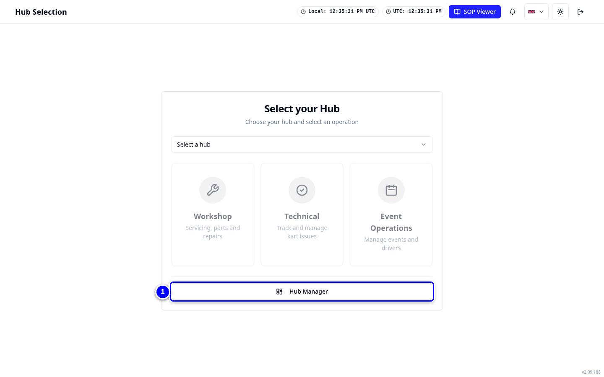
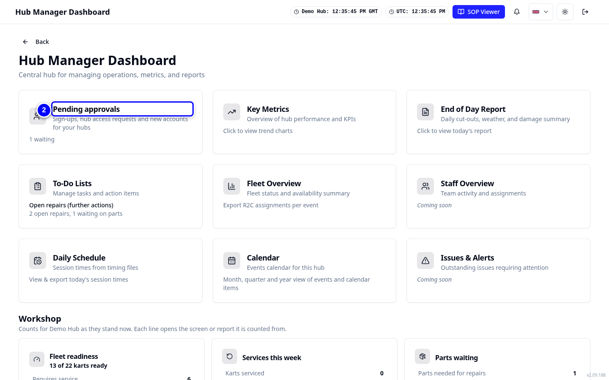
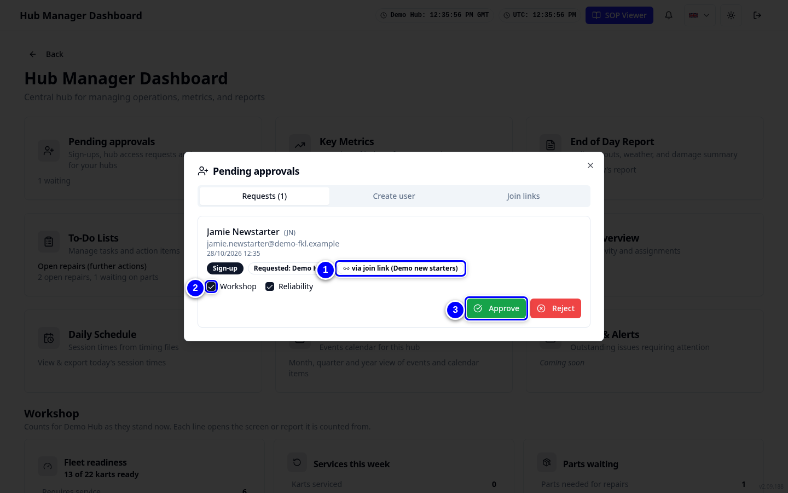
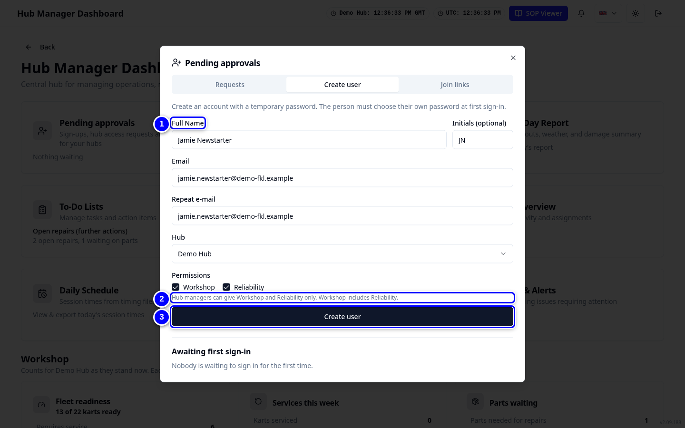
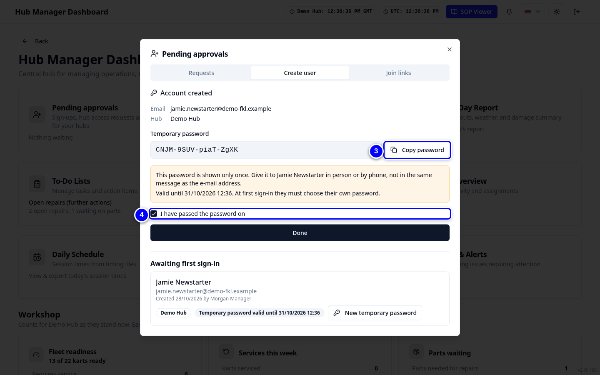

# Approvals: join links and new users

New people get into your hub in one of two ways: they sign up with your join link and you approve them, or you create the account yourself with a temporary password. Both happen in **Pending approvals** on the **Hub Manager** dashboard.

!!! info "What changed from the Workshop App"
    - The Workshop App's **Manage Users** is split: hub managers handle their own hubs in **Pending approvals**; admins handle everything on the Admin page. See [Users and permissions](../fkl-central/users.md).
    - Hub managers can give the **Workshop** and **Purchasing** permissions only.
    - You approve only for hubs you hold access to.

## Open Pending approvals

1. On **Select your Hub**, tap **Hub Manager**.

    { loading=lazy }

2. Tap the **Pending approvals** tile.

    { loading=lazy }

## Approve a sign-up

<figure class="clip"><video controls preload="none" playsinline poster="../assets/video/hm-approve-clip.jpg" width="1440">
<source src="../assets/video/hm-approve-clip.mp4" type="video/mp4"><source src="../assets/video/hm-approve-clip.webm" type="video/webm">
<track kind="captions" src="../assets/video/hm-approve-clip.vtt" srclang="en" label="English" default></video>
<figcaption>Watch: approving Jamie Newstarter's join request (about 40 seconds, with captions)</figcaption></figure>

1. On **Requests**, find the person. The row says **Sign-up** or **Extra hub**, the hub, and **via join link** if they used one.

    { loading=lazy }

2. Tap **Approve**.

    { loading=lazy }

3. Then give them the permissions they need (see below). A new mechanic needs **Workshop**.

    { loading=lazy }

!!! warning "Watch out"
    To refuse, tap **Reject** and type a **Reason**. **The applicant sees this reason.** Keep it short and polite.

## Create a join link

1. Open the **Join links** tab and tap **Create join link**.

    { loading=lazy }

2. Set **Valid for (days)** (1 to 90), and optionally **Maximum uses (optional)** and **Label (optional)**.

    { loading=lazy }

3. Tap **Create join link**, then **Copy link** and send it to the new person.

    { loading=lazy }

!!! tip "Tip"
    Tap **Revoke** to stop a link working. People who already signed up with it keep their request.

## Create a user with a temporary password

1. Open the **Create user** tab. Fill in **Full Name**, **Initials (optional)**, **Email** and **Repeat e-mail**.

    { loading=lazy }

2. Choose the **Hub** and tick **Permissions**: Workshop, and Purchasing if they place orders.

    { loading=lazy }

3. Tap **Create user**. KART shows a **Temporary password**. Tap **Copy password** and give it to the person in private.

    { loading=lazy }

4. Tick **I have passed the password on** and tap **Done**. They must choose their own password at first sign-in.

    { loading=lazy }

!!! note "Remember"
    **Awaiting first sign-in** lists accounts whose owner has not signed in yet.

## Extra hub requests

People from another hub can ask for access to yours with **Request Access**. Their row says **Extra hub**. Approve it the same way.

!!! abstract "Coming with your hub's switch-over"
    Before your hub's switch-over day, every mechanic needs a KART account with the **Workshop** permission and access to your hub. Mechanics with an account but no Workshop permission can see the karts but cannot start services, raise or update repairs, or record parts. Check your team list with a KART admin well before the day.
