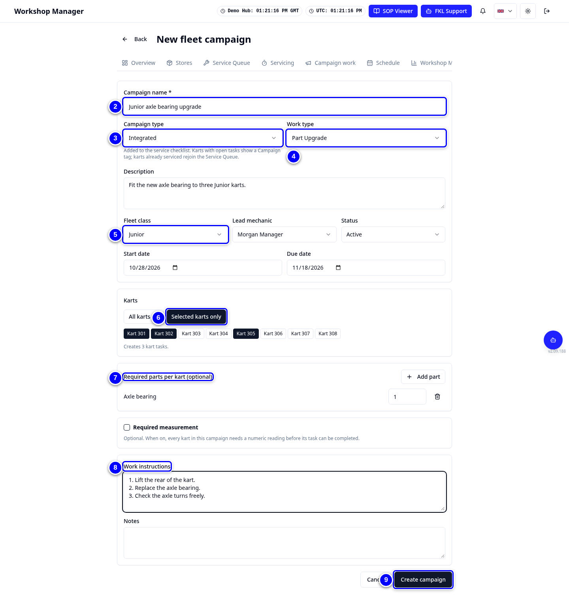
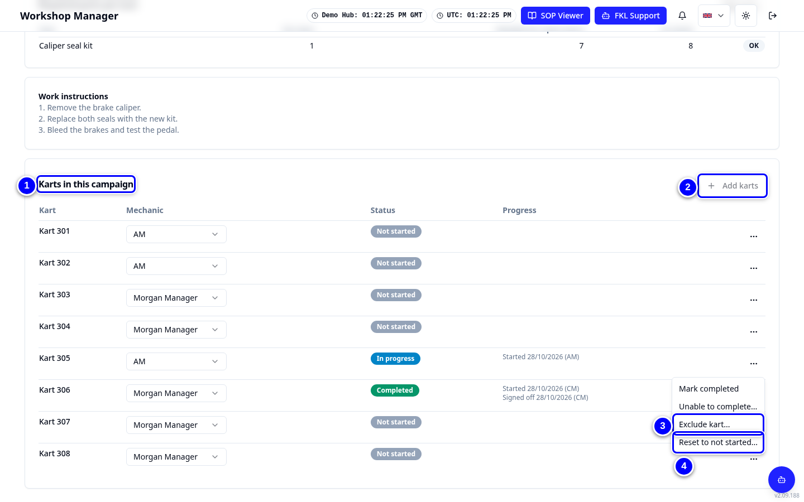

# Campaigns

A fleet campaign is one job done on many karts: a part upgrade, a software update, an inspection. You create it, choose the karts, and mechanics work through the tasks on **Campaign work**.

!!! info "What changed from the Workshop App"
    - The Workshop App's campaign list and forms are now in **Workshop Manager > Campaigns**.
    - Two types: **Integrated** (added to the service checklist; karts with open tasks show a Campaign tag and karts already serviced rejoin the Service Queue) and **Standalone** (tracked in the campaign only).
    - Finished Workshop App campaigns already show in campaign history.

## Create a campaign

<figure class="clip"><video controls preload="none" playsinline poster="../assets/video/hm-campaign-clip.jpg" width="1440">
<source src="../assets/video/hm-campaign-clip.mp4" type="video/mp4"><source src="../assets/video/hm-campaign-clip.webm" type="video/webm">
<track kind="captions" src="../assets/video/hm-campaign-clip.vtt" srclang="en" label="English" default></video>
<figcaption>Watch: creating an integrated campaign for Juniors and adding karts (about 75 seconds, with captions)</figcaption></figure>

{ loading=lazy }

1. Open **Workshop Manager > Campaigns**. You see **Fleet campaigns**. Tap **New campaign**.

2. Type the **Campaign name**, for example "Junior axle bearing upgrade".

    { loading=lazy }

3. Choose the **Campaign type**: **Integrated** or **Standalone**.

4. Choose the **Work type**, for example Part Upgrade, and type a **Description**.

5. Choose the **Fleet class** and the **Lead mechanic**, then the **Start date** and **Due date**.

6. Under **Karts**, choose all karts of the class or **Selected karts only** and tap the karts you want.

7. Under **Required parts per kart (optional)**, tap **Add part** and choose the part, for example the axle bearing, then set how many each kart needs.

8. Write the **Work instructions** for the mechanics.

9. Set the **Status** to Active when the work may start, and tap **Create campaign**.

!!! note "Remember"
    Campaign parts count in **Parts needed**, so they get ordered with everything else.

## Manage the karts in a campaign

{ loading=lazy }

1. Open the campaign from **Fleet campaigns**. Scroll to **Karts in this campaign**.

2. To add karts, tap **Add karts** and tick them.

3. To leave a kart out, open the actions menu (**...**) on its row, tap **Exclude kart...** and give a reason.

4. To start a task again, open the same menu, tap **Reset to not started...** and give a reason. This shows only for a task that was started, completed or excluded.

## Pause or close a campaign

{ loading=lazy }

1. On the detail page, change **Campaign status** to Paused, Completed or Cancelled.

!!! warning "Watch out"
    Tasks only move while the campaign is **Active**. Pausing a campaign stops mechanics from starting or completing its tasks. Close it as **Completed** only when every kart is done or excluded.

!!! tip "Tip"
    Use **Edit campaign** to change dates, instructions or the lead mechanic.
