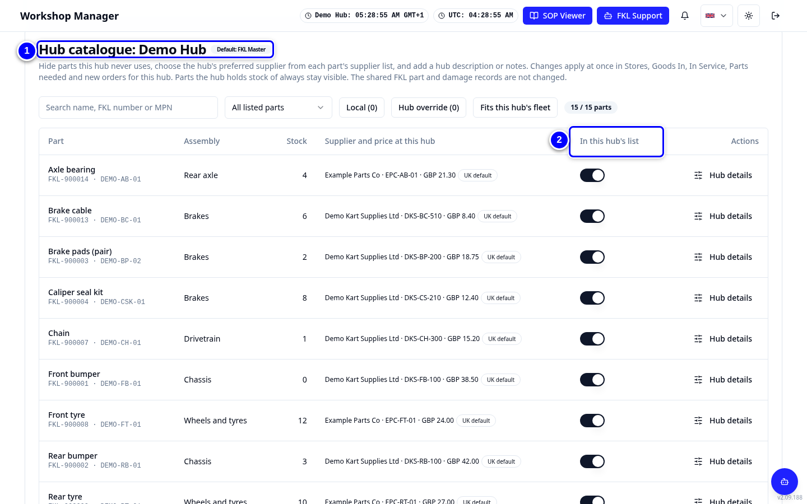
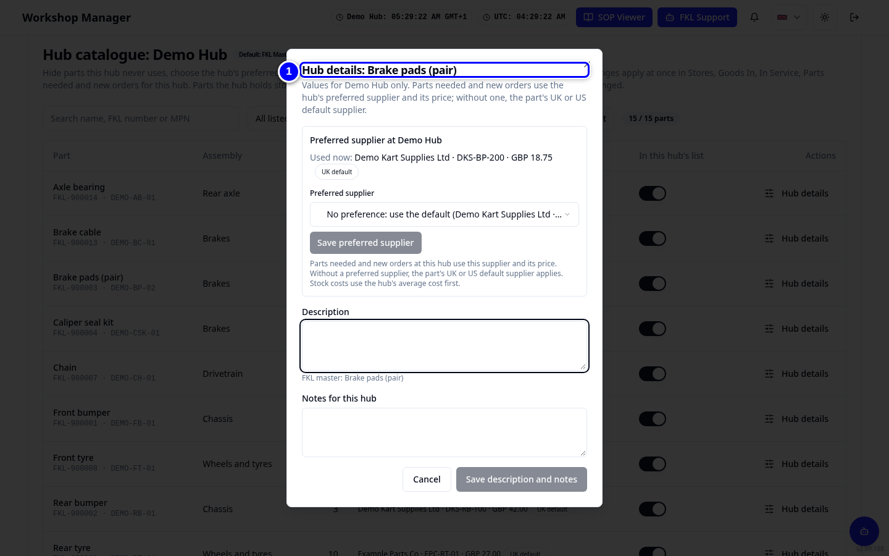
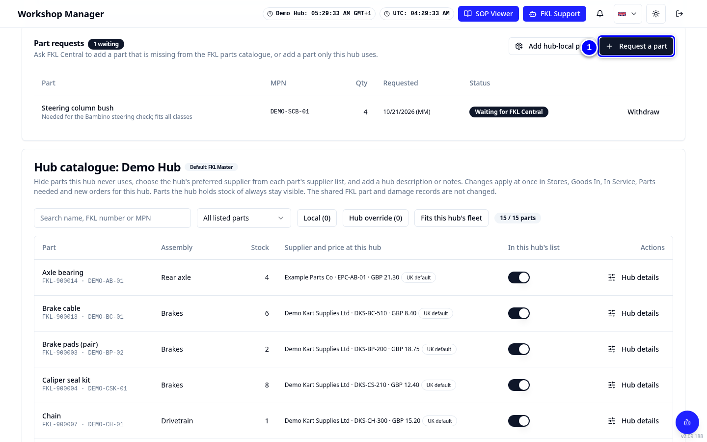
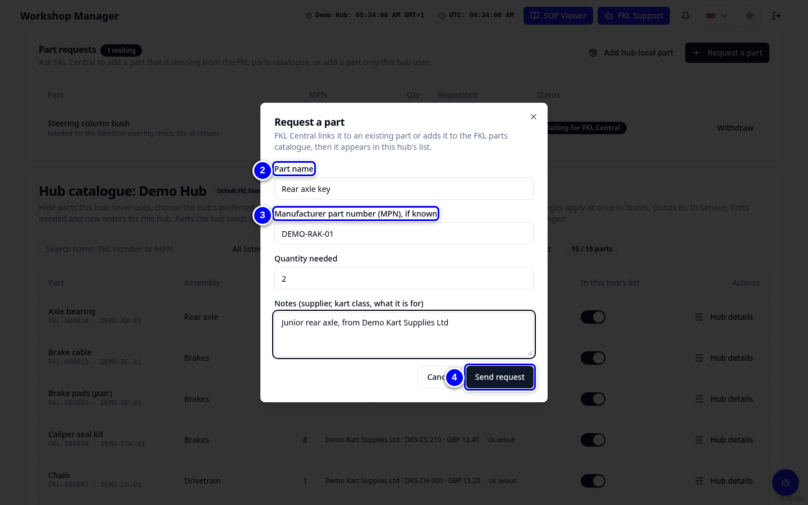
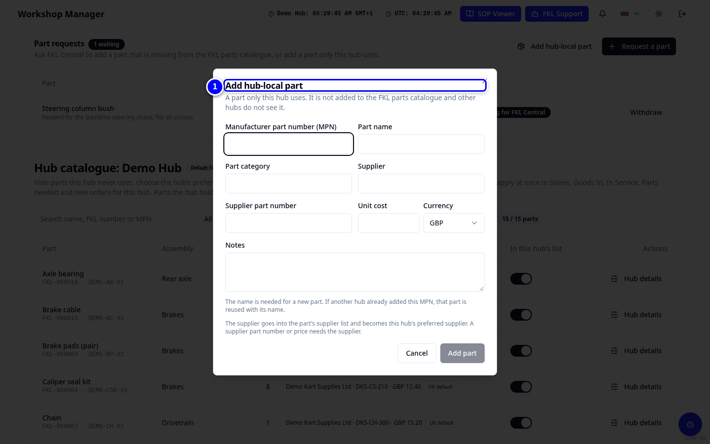

# Hub catalogue and part requests

The parts list for every hub comes from FKL Central's master catalogue. In **Hub catalogue** you tailor it for your hub: hide parts you never use, choose your preferred supplier, ask FKL Central for a missing part, or add a part that only your hub uses.

!!! info "What changed from the Workshop App"
    - The Workshop App's **Parts Catalog** is now the FKL Central master catalogue. Your hub's view of it is **Workshop Manager > Hub catalogue**.
    - **Catalog Requests** are now **Request a part**. FKL Central reviews them.
    - **Add local part** is now **Add hub-local part**. A manufacturer part number (MPN) is required.

## Hide or show a part

{ loading=lazy }

1. Open **Workshop Manager > Hub catalogue**. Scroll down past **Catalogues in use** and **Part requests** to the list called **Hub catalogue** with your hub's name. Find the part.

2. For a part your hub never uses, turn off its switch in the **In this hub's list** column. KART asks if you want to hide it: add a reason if you like and tap **Hide at this hub**. It disappears from Stores (a part you still hold stock of stays until the stock is used). Turn the switch back on to show it again.

## Choose the preferred supplier

{ loading=lazy }

1. Tap **Hub details** on the part. Choose the supplier your hub buys from in **Preferred supplier** and tap **Save preferred supplier**.

## Request a part from FKL Central

{ loading=lazy }

1. In the **Part requests** card, tap **Request a part**.

2. Type the **Part name**.

    { loading=lazy }

3. Add the **Manufacturer part number (MPN), if known** and the **Quantity needed**.

4. Add notes (supplier, kart class, what it is for) and tap **Send request**.

<figure class="clip"><video controls preload="none" playsinline poster="../assets/video/hm-request-part-clip.jpg" width="1440">
<source src="../assets/video/hm-request-part-clip.mp4" type="video/mp4"><source src="../assets/video/hm-request-part-clip.webm" type="video/webm">
<track kind="captions" src="../assets/video/hm-request-part-clip.vtt" srclang="en" label="English" default></video>
<figcaption>Watch: requesting a part from FKL Central in the Hub catalogue (about 40 seconds, with captions)</figcaption></figure>

!!! note "Remember"
    The request shows as **Waiting for FKL Central** until it is reviewed. Then it says **Linked to an existing part**, **Added as a new part**, **Added as a hub-local part** or **Rejected** with the reason. Tap **Withdraw** if you no longer need it.

## Add a hub-local part

{ loading=lazy }

1. Tap **Add hub-local part**, fill in the part with its MPN and save. It appears only in your hub's Stores.

!!! warning "Watch out"
    Check Stores and ask FKL Central first: a hub-local part that duplicates a master part makes ordering and reports harder.

!!! abstract "Coming soon"
    The supplier fields are changing. **Add hub-local part** will save the supplier into the shared supplier list, the Stores badge **Hub price** becomes **Hub description**, and the separate hub override columns go away. This guide will be updated when it goes live.
