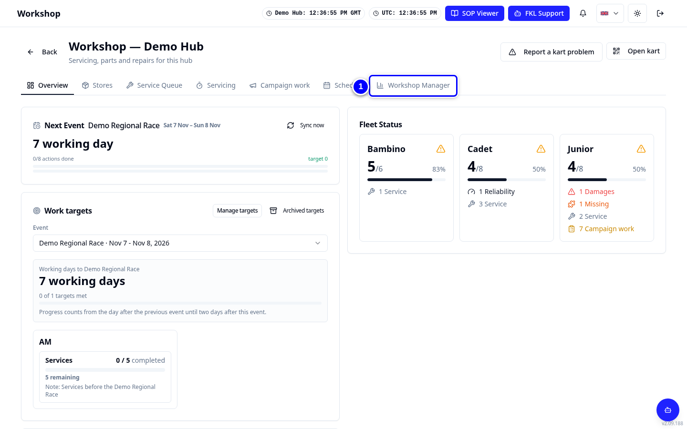

# Hub manager: your path

As a hub manager you can do **everything a mechanic does, plus** run the workshop: allocate karts, plan campaigns, set targets, keep the stock right, approve and place orders and let new people in.

!!! info "What changed from the Workshop App"
    - The Workshop App's **Management** menu (Dashboard, Reports, Workshop Planning) and most of **Parts & Consumables** are now the **Workshop Manager** tab in the Workshop.
    - **Manage Users** is now **Pending approvals** on the **Hub Manager** dashboard for your own hubs.
    - The Workshop App role "hub_manager" is the KART permission **Hub Manager**. Ticking it also gives Workshop, Reliability and Customer feedback.

{ loading=lazy }

## First, the mechanic pages

Read the [mechanic path](../mechanic/index.md) first. As a hub manager you also:

- mark a kart used by hand with **Requires service** on its Overview tile ([Marking karts used](../mechanic/mark-used.md));
- drag repairs into priority order in the Service Queue;
- re-allocate a service that another mechanic paused, and see who took over a service and why (any mechanic of the hub can **Take over** with a reason).

## Then, in order

1. [Workshop Manager tour](workshop-manager.md): every tab in one place.
2. [Kart allocation](kart-allocation.md): who works on which kart.
3. [Campaigns](campaigns.md): create, add karts, exclude, reset, close.
4. [Schedules and targets](schedules-and-targets.md): schedule settings, work targets, readiness targets.
5. [Stock and parts needed](stock-and-parts-needed.md): what to order and why.
6. [Orders](orders.md): Draft to Goods In.
7. [Hub catalogue](hub-catalogue.md): your hub's parts and part requests.
8. [Approvals](approvals.md): join links, sign-ups, new users.
9. [Reports](reports.md): the Workshop App reports in KART.

!!! tip "Tip"
    Print the [hub manager quick reference card](../cards/index.md).

!!! note "Remember"
    Changes that affect event or workshop staff's daily work need the approvers' sign-off and updated SOPs and training first. Bug fixes are exempt. Talk to the KART product owner before changing how your team works.
