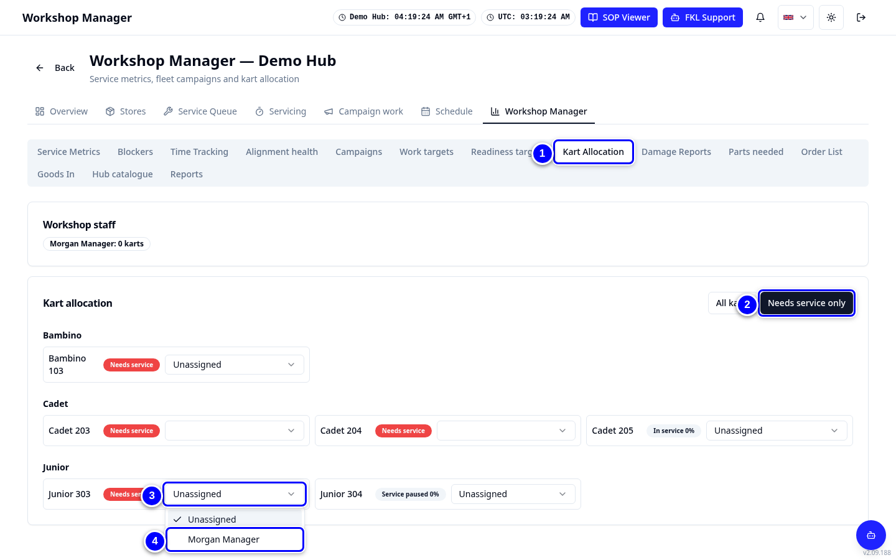

# Kart allocation

**Kart Allocation** lets you give karts to mechanics. A mechanic sees their karts with a blue ring in the Service Queue and first under **Assigned to me** in Campaign work.

!!! info "What changed from the Workshop App"
    - Allocation is a tab in **Workshop Manager**. Pick a mechanic per kart from a list.
    - The list shows the Workshop staff KART lets you see. A KART admin sees everybody with the **Workshop** permission at the hub.

## Allocate a kart

{ loading=lazy }

1. Open **Workshop Manager** and tap **Kart Allocation**.

2. Tap **Needs service only** to see only karts that need a service. **All karts** shows them all again.

3. On the kart's row, open the list (it says **Unassigned** when nobody has it), for example for **303**.

4. Choose the mechanic. It saves straight away.

!!! warning "Watch out"
    If a mechanic is missing from the list, or a kart's list is blank, the kart may belong to somebody KART does not show you. Ask a KART admin to allocate it.

!!! warning "Watch out"
    If KART says there are no mechanics yet, nobody at your hub has the **Workshop** permission. Ask a KART admin to give it, with access to your hub. See [Approvals](approvals.md).

!!! tip "Tip"
    If a mechanic paused a service and left, you can re-allocate the kart here so somebody else can carry on.
