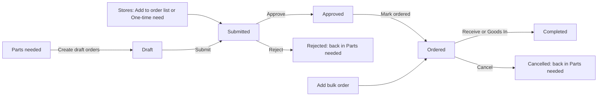

# Orders

Every order line moves through the same stages on the **Order List**. You approve lines, mark them ordered when you place the order with the supplier, and book the parts in when they arrive.

!!! info "What changed from the Workshop App"
    - **Parts Ordered / Order list** and **Parts Received** are now **Order List** and **Goods In** in Workshop Manager.
    - New stage: **approval**. A line must be **Approved** by the hub's manager or an admin before it can be marked ordered.
    - Receiving records the cost: unit cost, currency, invoice reference, freight and tax or duty.
    - Order history from the Workshop App is not moved.

## The pipeline

| Stage | Means | Who moves it on |
|---|---|---|
| **Draft** | Created from Parts needed, not sent yet | The creator or a hub manager: **Submit** |
| **Submitted** | Waiting for approval | The hub's manager or an admin: **Approve** or **Reject** |
| **Approved** | OK to order | Hub manager, admin or Purchasing: **Mark ordered** |
| **Ordered** | Placed with the supplier. Waiting repairs show **On order** | Hub manager, admin or Purchasing: **Receive** |
| **Completed** | Received. Stock and average cost updated | |
| **Cancelled** | Cancelled or rejected. The need shows again in Parts needed | |

## Watch it first

<figure class="clip"><video controls preload="none" playsinline poster="../assets/video/hm-orders-clip.jpg" width="1440">
<source src="../assets/video/hm-orders-clip.mp4" type="video/mp4"><source src="../assets/video/hm-orders-clip.webm" type="video/webm">
<track kind="captions" src="../assets/video/hm-orders-clip.vtt" srclang="en" label="English" default></video>
<figcaption>Watch: approving rear tyres in the approval queue and marking sprockets ordered (about 60 seconds, with captions)</figcaption></figure>

## Submit a draft

1. Open **Workshop Manager > Order List**. Find the **Draft** line, for example brake pads.

    { loading=lazy }

2. Tap **Submit** on the line.

    { loading=lazy }

## Approve or reject

1. Tap **Approval queue**. It shows every line **Waiting for approval**.

    { loading=lazy }

2. Check the part and quantity. Tap **Approve**.

    { loading=lazy }

3. Or tap **Reject**, type a reason in **Reason (optional)** and confirm **Reject order**. The line is closed as Rejected. If the part is still needed it shows again in Parts needed.

    { loading=lazy }

## Mark ordered

1. Place the order with the supplier. Then find the line under **Approved** and tap **Mark ordered**.

    { loading=lazy }

2. Repairs waiting for that part now show **On order**, with the supplier and date.

    { loading=lazy }

!!! warning "Watch out"
    **Mark ordered** only works on **Approved** lines. Lines made with **Add bulk order** go straight to Ordered, so only approvers can make them.

## Bulk and one-time orders

1. For a bulk buy, tap **Add bulk order** on the Order List and add the lines.

    { loading=lazy }

2. For a one-off purchase, use **One-time need** in Stores with a reason. It arrives here as **Submitted**, marked one-time.

    { loading=lazy }

## Receive the parts (Goods In)

<figure class="clip"><video controls preload="none" playsinline poster="../assets/video/hm-goodsin-clip.jpg" width="1440">
<source src="../assets/video/hm-goodsin-clip.mp4" type="video/mp4"><source src="../assets/video/hm-goodsin-clip.webm" type="video/webm">
<track kind="captions" src="../assets/video/hm-goodsin-clip.vtt" srclang="en" label="English" default></video>
<figcaption>Watch: receiving the front bumpers for Junior 307 in Goods In (about 55 seconds, with captions)</figcaption></figure>

1. Open **Workshop Manager > Goods In**.

    { loading=lazy }

2. Choose the **Part**, for example front bumper, and the order in **Against order**.

    { loading=lazy }

3. Type the **Quantity** and the **Unit cost**, and choose the **Currency**.

    { loading=lazy }

4. Fill in **Supplier** and **Invoice reference**.

    { loading=lazy }

5. Tap **Receive stock**. Stock and the average cost update straight away, and waiting repairs move to **Ready to repair**.

    { loading=lazy }

!!! tip "Tip"
    You can also tap **Receive** on an Ordered line in the Order List and fill in **Book in** with freight and tax or duty. Partial deliveries are fine: receive what came, the rest stays Ordered.

!!! abstract "Coming with your hub's switch-over"
    Open orders in the Workshop App are not copied. Re-enter each one in KART (Stores) so it can be received here.
