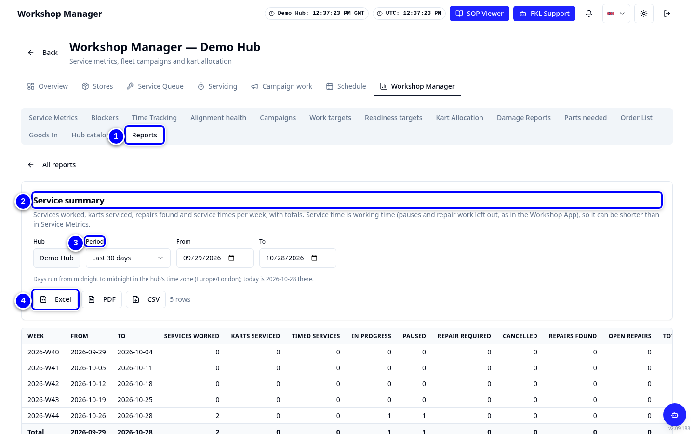

# Reports

**Workshop Manager > Reports** has the reports you used in the Workshop App, for your hub, exported to Excel, PDF or CSV.

!!! info "What changed from the Workshop App"
    - All eight Workshop App reports are here, grouped as Workshop & productivity, Parts & inventory, Fleet and Event operations.
    - Fleet Alignment Health is the **Alignment health** tab. The Incident Report is the per-event incidents view in the detailed reliability report.

| Workshop App report | In KART |
|---|---|
| Weekly Turn Summary | **Service summary** |
| Kart Turn Detail | **Kart service detail** |
| Workshop Activity | **Workshop activity** |
| Parts Usage | **Parts usage** |
| Inventory Status | **Inventory status** |
| Fleet Campaigns | **Fleet campaigns** |
| Chassis Reassignments | **Chassis reassignments** |
| Track Use Overrides | **Track use overrides** |

## Run a report

{ loading=lazy }

1. Open **Workshop Manager > Reports**.

2. Pick a report, for example **Service summary**.

3. Set the **Period** (**From** and **To**) or choose an **Event**.

4. Tap **Excel**, **PDF** or **CSV** to download it.

!!! tip "Tip"
    The screen shows the first rows only. The exports contain all of them.

!!! abstract "Coming with your hub's switch-over"
    Checklist answers of old Workshop App services are moved later. Until then, old services show "0 of N checks" in reports.
