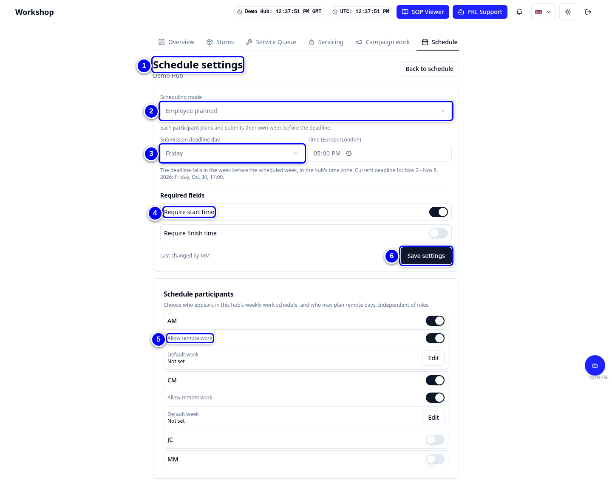
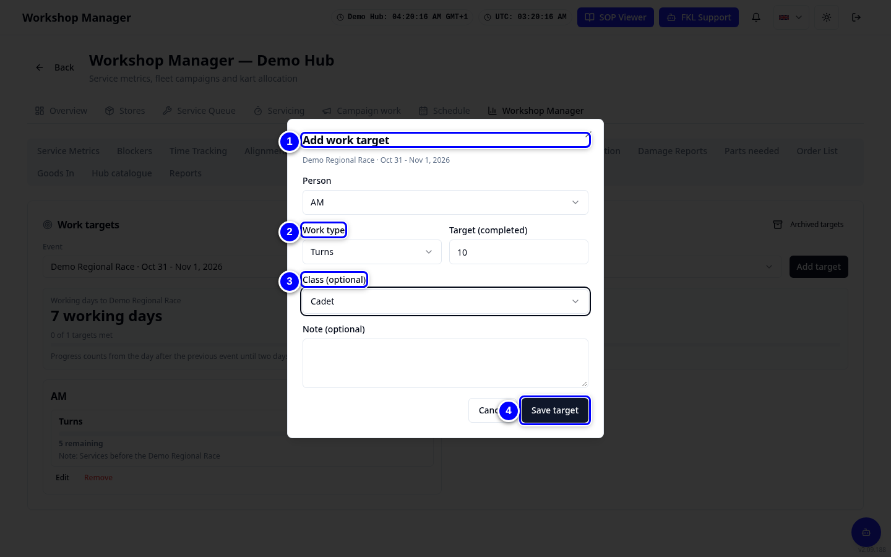

# Schedules and targets

This page covers three things: how your hub's weekly schedule works (**Schedule settings**), targets for each person (**Work targets**) and how many karts each class must have ready for an event (**Readiness targets**).

!!! info "What changed from the Workshop App"
    - **Schedule Settings** is now **Schedule settings** on the Schedule tab.
    - **Workshop Planning** is now two Workshop Manager tabs: **Work targets** and **Readiness targets**.
    - Readiness targets are set per **planning event**. Admins create planning events for now.

## Schedule settings

{ loading=lazy }

1. Open **Schedule** and tap **Schedule settings**.

2. Choose the **Scheduling mode**: **Employee planned** (mechanics plan their own week) or **Manager assigned** (you plan it).

3. Set the **Submission deadline day** and the time.

4. Turn on **Require start time** and **Require finish time** if you need them.

5. Under **Schedule participants**, turn on the switch next to each person who is included. Turn on **Allow remote work** for people who may work remotely. People are shown by their initials.

6. Tap **Save settings**.

### Default week for each person

Each included person has a **Default week** line under their switches. It shows their usual days and times, for example **Mon 08:00-16:30 · Fri 08:00-13:00**. If they have none, it shows **Not set**. When the person taps **Plan my week** for a week with nothing planned yet, their default week fills it in. They can still change it, and nothing is saved until they save or submit.

1. Tap **Edit** on the person's **Default week** line.

2. For each day they usually work, switch the day on. Set the **Start** time and, if you want, the **Finish** time. If remote work is allowed for them, you can also choose the **Work location**.

3. Tap **Save default week**. To remove it, tap **Clear default week**.

!!! info "Good to know"
    - The default week is saved straight away. It does not need **Save settings**.
    - It never fills a week that the person has already saved, and it never submits anything for them.
    - It also fills **Set week** when you plan a week for someone with nothing planned yet.
    - The finish time must be after the start time. Remote days are only possible when **Allow remote work** is on.

## Work targets

{ loading=lazy }

1. Open **Workshop Manager > Work targets** and tap **Add target**.

2. Choose the **Person** (shown by initials, for example **AM**) and the **Work type**: Readiness, Turns, Repairs or Campaign tasks.

3. Type the target number, optionally a class and a note.

4. Tap **Save target**. The target shows on the mechanic's **Work targets** card on Overview.

!!! tip "Tip"
    Old targets move to **Archived targets**, so the list stays short.

## Readiness targets

{ loading=lazy }

1. Open **Workshop Manager > Readiness targets**. Find the planning event, for example **Demo Regional Race**.

2. Tap **Set target** (or **Edit target**) for the event.

3. Type how many event-usable karts each class needs. Use whole numbers from 0 to 1000.

4. Save. Overview's **Event readiness** card shows **Target met** or **Remaining** for each class.

    { loading=lazy }

!!! abstract "Coming soon"
    Hub managers will be able to create planning events themselves. For now an admin creates them.
