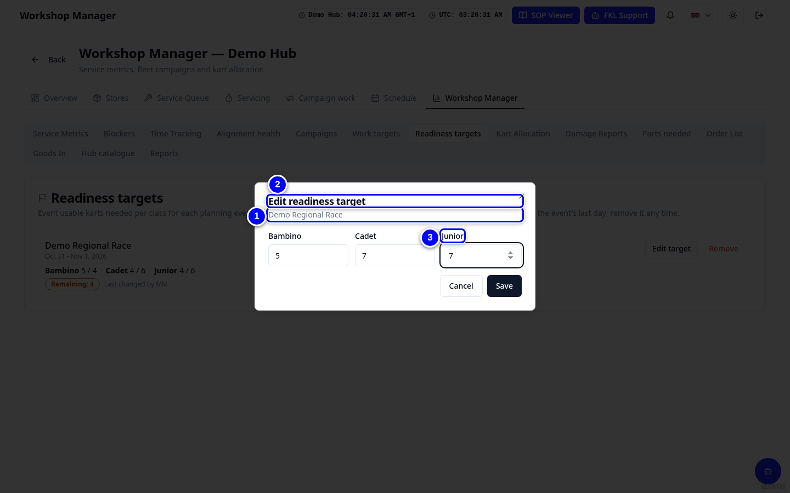
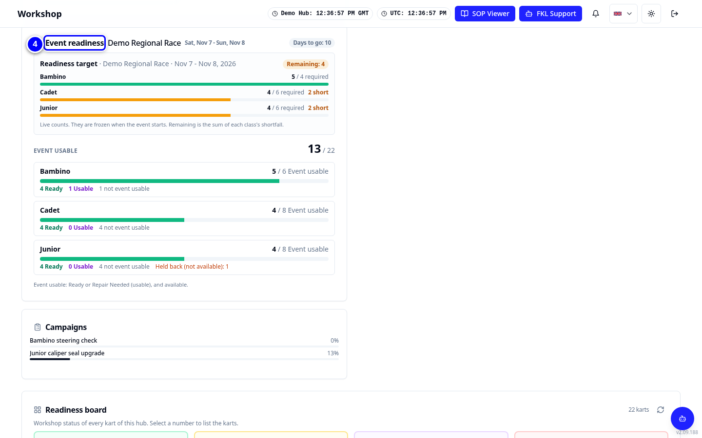

# Schedules and targets

This page covers three things: how your hub's weekly schedule works (**Schedule settings**), targets for each person (**Work targets**) and how many karts each class must have ready for an event (**Readiness targets**).

!!! info "What changed from the Workshop App"
    - **Schedule Settings** is now **Schedule settings** on the Schedule tab.
    - **Workshop Planning** is now two Workshop Manager tabs: **Work targets** and **Readiness targets**.
    - Readiness targets are set per **planning event**. Admins create planning events for now.

## Schedule settings

1. Open **Schedule** and tap **Schedule settings**.

    { loading=lazy }

2. Choose the **Scheduling mode**: **Employee planned** (mechanics plan their own week) or **Manager assigned** (you plan it).

    { loading=lazy }

3. Set the **Submission deadline day** and the time.

    { loading=lazy }

4. Tick **Require start time** and **Require finish time** if you need them.

    { loading=lazy }

5. Under **Schedule participants**, tick who is included and whether they may work remotely (**Allow remote work**).

    { loading=lazy }

6. Tap **Save settings**.

    { loading=lazy }

## Work targets

1. Open **Workshop Manager > Work targets** and tap **Add target**.

    { loading=lazy }

2. Choose the **Person** and the **Work type**: Readiness, Turns, Repairs or Campaign tasks.

    { loading=lazy }

3. Type the target number, optionally a class and a note.

    { loading=lazy }

4. Tap **Save target**. The target shows on the mechanic's **Work targets** card on Overview.

    { loading=lazy }

!!! tip "Tip"
    Old targets move to **Archived targets**, so the list stays short.

## Readiness targets

1. Open **Workshop Manager > Readiness targets**. Find the planning event, for example **Demo Regional Race**.

    { loading=lazy }

2. Tap **Set target** (or **Edit target**) for the event.

    { loading=lazy }

3. Type how many event-usable karts each class needs. Use whole numbers from 0 to 1000.

    { loading=lazy }

4. Save. Overview's **Event readiness** card shows **Target met** or **Remaining** for each class.

    { loading=lazy }

!!! abstract "Coming soon"
    Hub managers will be able to create planning events themselves. For now an admin creates them.
