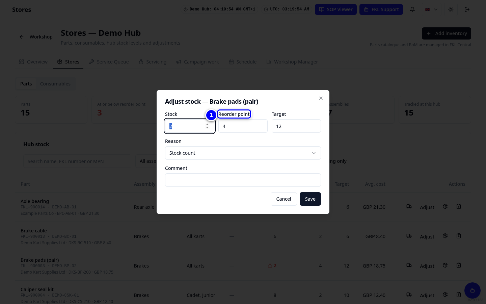

# Stock and parts needed

**Parts needed** works out what your hub must order. It adds up repairs waiting on parts, open campaign tasks and stock at or below its reorder point, minus what is already on the Order List or ordered. One row per part.

!!! info "What changed from the Workshop App"
    - **Parts Needed** is now **Workshop Manager > Parts needed**, one list instead of separate buckets.
    - You turn it into orders with **Create draft orders**. Nothing is sent to a supplier until the order is approved and marked ordered.
    - Stock levels, reorder points and targets are set per part in **Stores**.

## Read the list

1. Open **Workshop Manager > Parts needed**.

    { loading=lazy }

2. Read the columns: **Stock**, **Demand**, **On order**, **Still needed** and **Order qty**.

    { loading=lazy }

3. Change **Order qty** if you want to order more or less.

    { loading=lazy }

4. Tap **Create draft orders**. The lines go on the Order List as **Draft**.

    { loading=lazy }

!!! tip "Tip"
    Use **Print** or **Export CSV** to take the list to a supplier call.

## Set reorder points in Stores

1. Open **Stores** and tap **Adjust** on a part. Set **Reorder point** and **Target**, choose a **Reason** and tap **Save**.

    { loading=lazy }

!!! abstract "Coming with your hub's switch-over"
    Your hub's stock moves from the Workshop App a few days after the switch: each part is set to the Workshop App count minus what was used in KART since the switch. Until then **Parts needed may list parts that are on the shelf: check the shelf before ordering.** Make sure your team records every part used in KART from day one.
