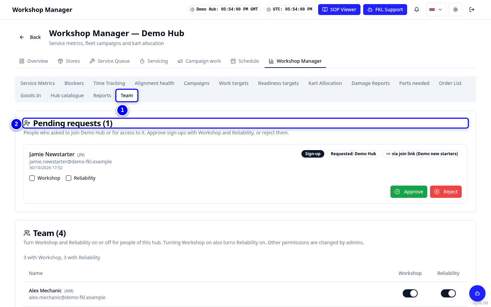
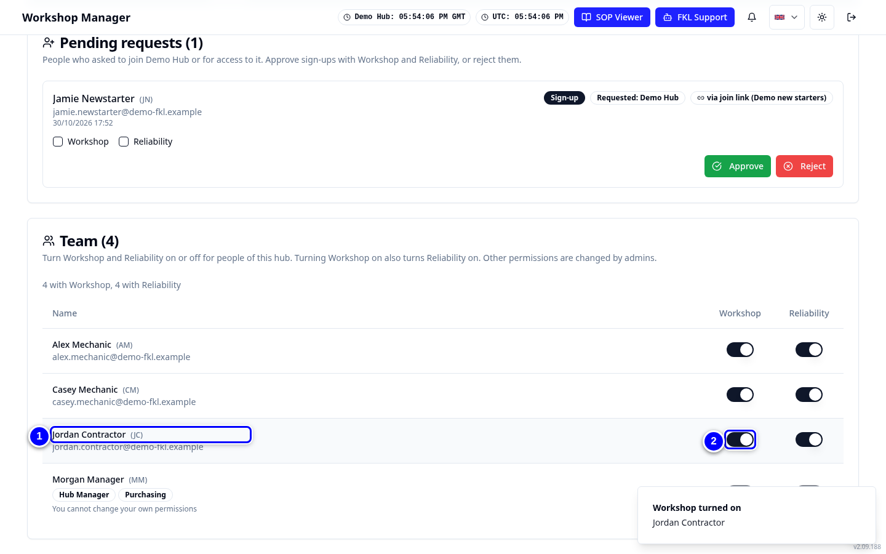

# Team: who can do what

The **Team** tab on **Workshop Manager** lists the people of your hub. You can turn **Workshop** and **Reliability** on or off for them, and approve or reject people who asked to join.

!!! info "What changed"
    - Before, hub managers could tick permissions only when approving someone. Now you can change **Workshop** and **Reliability** for anyone already on your team.
    - **Workshop includes Reliability**: turning Workshop on turns Reliability on too. Turning Workshop off leaves Reliability on.
    - Only admins change **Purchasing**, **Hub Manager**, **FKL Central** and admin accounts. You cannot change your own permissions or another hub manager's.
    - Permissions belong to the person, not the hub: a change applies on every hub they work at.

## Open the Team tab

{ loading=lazy }

1. Tap **Workshop Manager** in the Workshop tab strip, then tap **Team**.

2. **Pending requests** lists people who asked to join your hub or for access to it. Below it, **Team** lists the approved staff with access to your hub.

## Give someone Workshop or Reliability

{ loading=lazy }

1. Find the person in **Team**.

2. Turn **Workshop** on. **Reliability** turns on too. KART shows **Workshop turned on**.

3. To take a permission away, turn its switch off. KART shows **Workshop turned off** or **Reliability turned off**.

!!! note "Remember"
    A switch you cannot move shows why under the name, for example **Admins are managed by admins** or **You cannot change your own permissions**. Ask an admin for those.

## Approve someone who asked to join

1. In **Pending requests**, find the person. The row says **Sign-up** or **Extra hub**, and **via join link** if they used one.

2. For a sign-up, tick **Workshop** (Reliability ticks too). Tap **Approve**.

3. They appear in **Team** straight away. To refuse, tap **Reject** and type a **Reason**. **The applicant sees this reason.**

This works the same as **Pending approvals** on the Hub Manager dashboard. See [Approvals](approvals.md).
