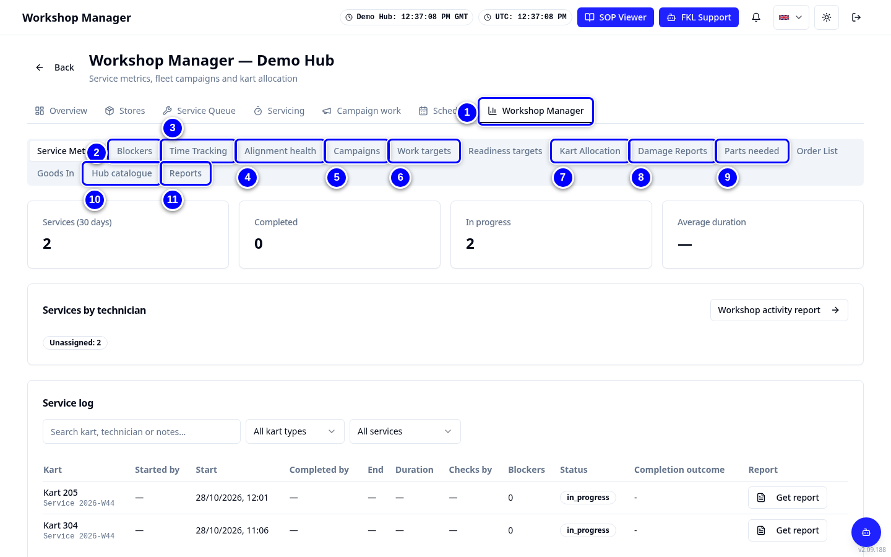

# Workshop Manager tour

**Workshop Manager** is the last tab in the Workshop strip. Only hub managers and admins see it. Its own tabs wrap onto two lines on smaller screens.

!!! info "What changed from the Workshop App"
    - Workshop App **Dashboard**, **Workshop Planning**, **Parts Needed**, **Parts Ordered / Order list**, **Reports** and the hub side of **Parts Catalog** are all tabs here.
    - Each tab has its own address (for example `?tab=orders`), so you can bookmark it.

## The tabs, one by one

{ loading=lazy }

1. Tap **Workshop Manager** in the Workshop tab strip. It opens on **Service Metrics**: services done, time per service and the service report.

2. Tap **Blockers**: what is stopping karts from being ready.

3. Tap **Time Tracking**: service, pause and repair time per mechanic.

4. Tap **Alignment health**: alignment readings across the fleet.

5. Tap **Campaigns**: fleet campaigns. See [Campaigns](campaigns.md).

6. Tap **Work targets** and **Readiness targets**. See [Schedules and targets](schedules-and-targets.md).

7. Tap **Kart Allocation**. See [Kart allocation](kart-allocation.md).

8. Tap **Damage Reports**: damage recorded on your karts.

9. Tap **Parts needed**, **Order List** and **Goods In**. See [Stock and parts needed](stock-and-parts-needed.md) and [Orders](orders.md).

10. Tap **Hub catalogue**. See [Hub catalogue](hub-catalogue.md).

11. Tap **Reports**. See [Reports](reports.md).

12. Tap **Team**: your hub's people, their **Workshop** and **Reliability**, and pending requests. See [Team](team.md).

!!! tip "Tip"
    The **Hub Manager** dashboard (button on **Select your Hub**) has workshop tiles too: **Fleet readiness**, **Services this week**, **Parts waiting**, **Stock**, **Fleet campaigns**, **Track use overrides**, **Weekly schedule** and **Work targets**. Tap a tile to jump to the screen. **Fleet readiness** uses the Fleet board's colours: karts ready (green) of the active karts, **Needs attention** (amber), **Blocked** (red) and **Event usable**.

!!! note "Remember"
    In the service report (from Service Metrics or the kart page history) hub managers can cancel a service or correct its times, always with a reason.
