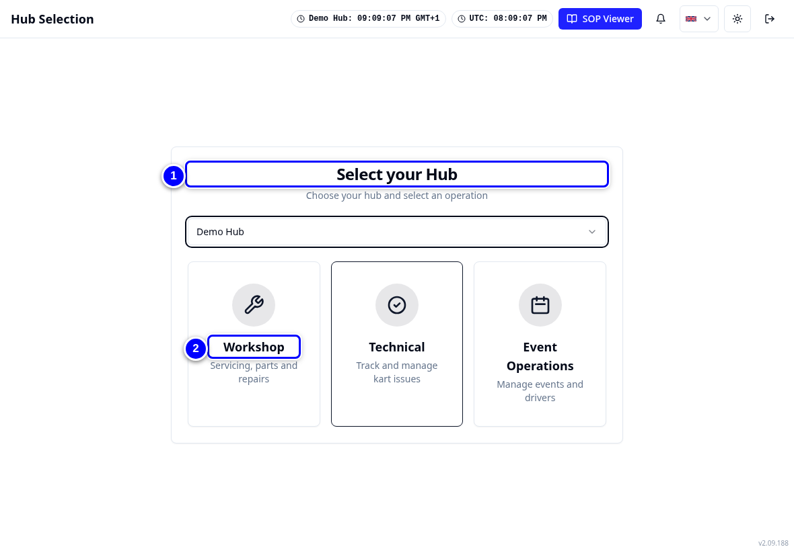

IFFFUTURE &nbsp; IFFFUTURE &nbsp; IFFFUTURE &nbsp; IFFFUTURE &nbsp; IFFFUTURE &nbsp; IFFFUTURE &nbsp; IFFFUTURE &nbsp; IFFFUTURE

# From the Workshop App to KART

Welcome. This is the official FAT Karting League guide for everyone who works on karts, runs a hub workshop or supports a hub from FKL Central or remote support.

Your hub's workshop work is moving from the **FKL Workshop App** (we call it "the Workshop App" in this guide) into **KART**, the FKL Kart Allocation & Reliability Tracking app. KART is the app the league already uses for kart allocation, reliability tickets and events. From your hub's switch-over day, all workshop work happens in KART too: services, repairs, parts, campaigns, schedules and orders.

{ loading=lazy }

## What KART is

- **One app for the whole kart.** Status, services, repairs, reliability tickets, parts and race numbers all sit on the same kart, so everybody sees the same picture.
- **It works in a browser.** Use it on the workshop tablet, a laptop or your phone. There is nothing to install.
- **The same words you know, mostly.** Some screens have new names. The [Where did it go?](where-did-it-go.md) page maps every Workshop App screen to its place in KART.

!!! info "What changed from the Workshop App"
    - The Workshop App was a separate app. KART is the league's main app, and the workshop is one area inside it.
    - "Turn Required" is now called **Requires service**. It means exactly the same thing: the kart has been used and needs a service.
    - Incidents are information only. Only a stopping reliability ticket takes a kart out of use. See [Incidents, tickets and repairs](start/problems-explained.md).

## Pick your role

<a class="fkl-role" href="mechanic/index.html"><strong>Mechanic</strong>Services, repairs, parts used, campaign work and Race to Chassis.</a>
<a class="fkl-role" href="hub-manager/index.html"><strong>Hub manager</strong>Everything a mechanic does, plus Workshop Manager, orders, campaigns and approvals.</a>
<a class="fkl-role" href="fkl-central/index.html"><strong>FKL Central and admin</strong>Master parts catalogue, part requests, checklists, thresholds and users.</a>
<a class="fkl-role" href="remote-support/index.html"><strong>Remote support</strong>KART Comms support chats, cover and direct chats.</a>

New to KART? Start with [Signing in and access](start/sign-in-and-access.md), then [Finding your way](start/finding-your-way.md).

## Useful pages

<a href="switch-over/index.html">Switch-over day for your hub</a>
<a href="where-did-it-go.html">Where did it go?</a>
<a href="cards/index.html">Quick reference cards</a>
<a href="troubleshooting.html">Something is not working</a>

!!! note "Remember"
    No hub has switched yet. Your hub lead confirms your hub's switch-over date and time at least 24 hours before. Until then, keep working the way your hub lead tells you.

!!! tip "Tip"
    Every step in this guide has a picture or a short video. The videos have captions, so you can watch them with the sound off in the workshop.

## About this guide

This guide shows a made-up hub called **Demo Hub** with example karts (Bambino 101 to 106, Cadet 201 to 208, Junior 301 to 308) and example people such as Alex Mechanic and Morgan Manager. The screens look the same at your hub, with your own karts and colleagues.
