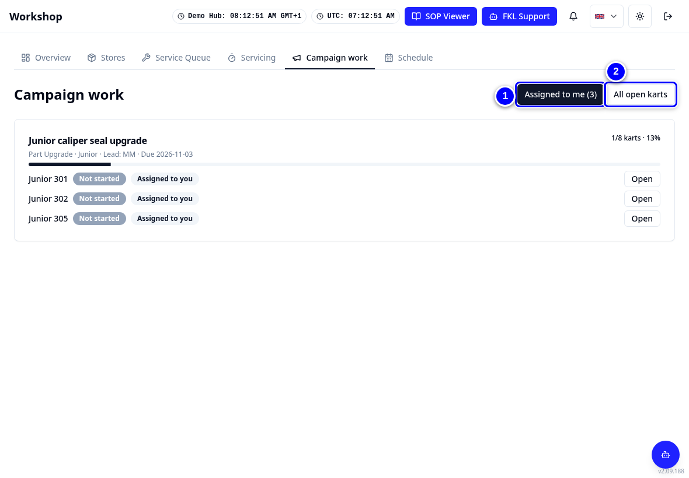
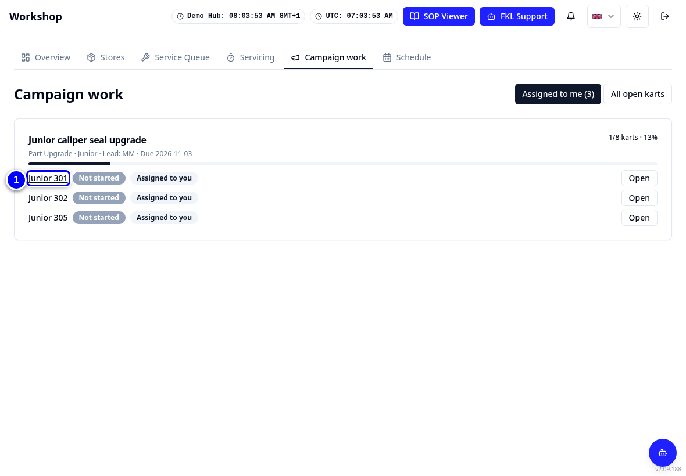
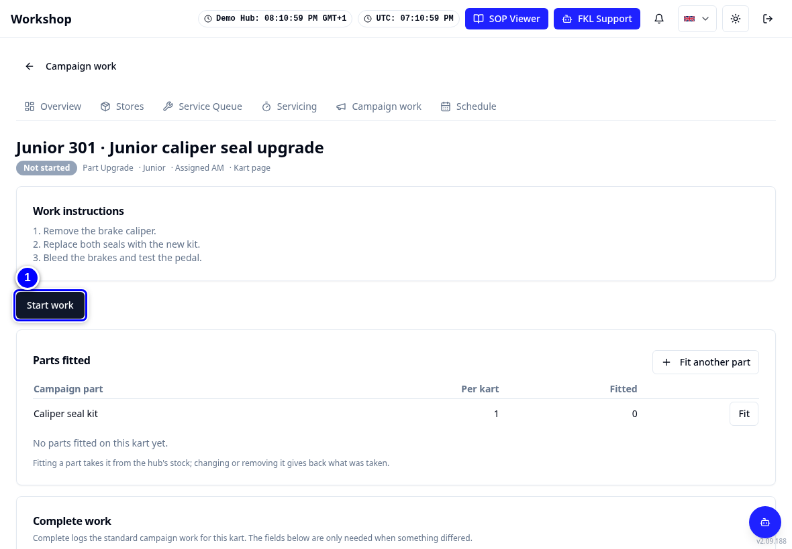
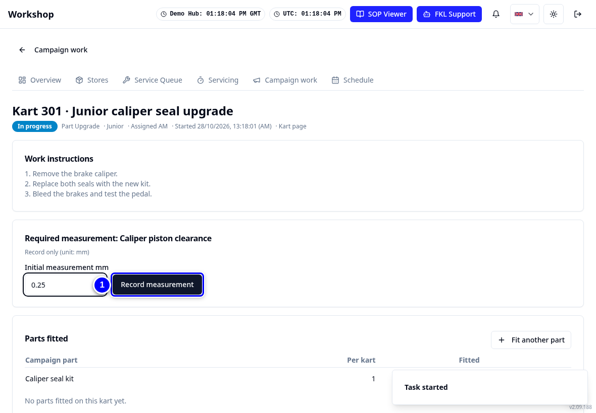
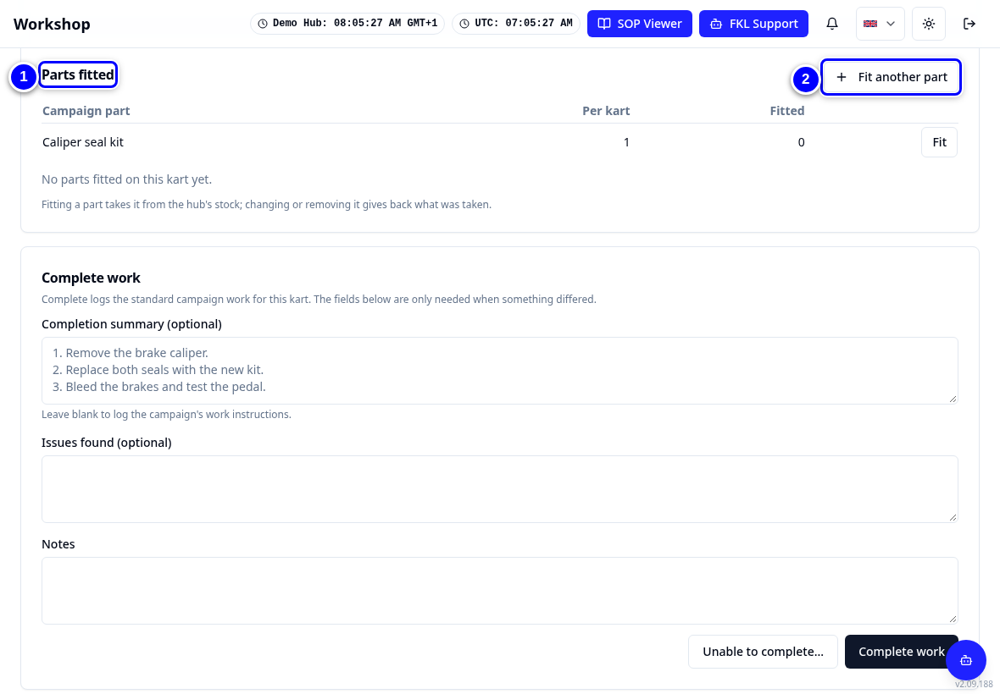
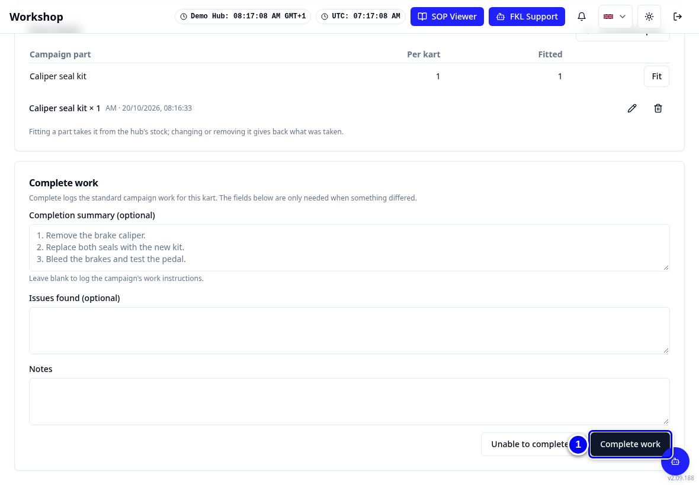
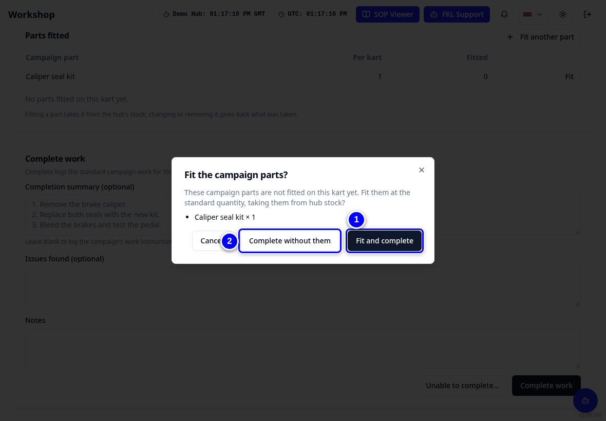
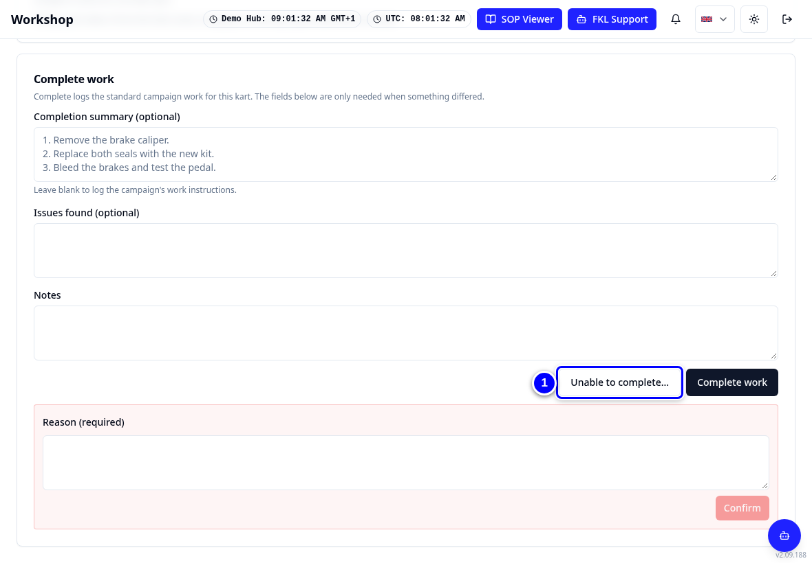

# Campaign work

A fleet campaign is the same job done on many karts, for example a part upgrade or an inspection. Your hub manager creates it. You do the work kart by kart on **Campaign work**.

!!! info "What changed from the Workshop App"
    - The Workshop App's **Campaign Work** task view is now the **Campaign work** tab.
    - Your own tasks come first under **Assigned to me**.
    - Karts with open tasks of an **integrated** campaign (a campaign added to the service checklist) show a **Campaign** tag on their tile and count under **Campaign Required** on the board. The kart stays usable.
    - Parts you fit on a task are taken from your hub's stock.

## Watch it first

<figure class="clip"><video controls preload="none" playsinline poster="../assets/video/mech-campaign-clip.jpg" width="1180">
<source src="../assets/video/mech-campaign-clip.mp4" type="video/mp4"><source src="../assets/video/mech-campaign-clip.webm" type="video/webm">
<track kind="captions" src="../assets/video/mech-campaign-clip.vtt" srclang="en" label="English" default></video>
<figcaption>Watch: doing the Junior caliper seal upgrade on Junior 301 (about 30 seconds, with captions)</figcaption></figure>

## Do a campaign task

1. Tap **Campaign work** in the tab strip.

    { loading=lazy }

2. Find the kart under **Assigned to me**, for example **Junior 301**, and tap **Open** on its row.

    { loading=lazy }

3. Read the work instructions, then tap **Start work**.

    { loading=lazy }

4. If the campaign asks for a reading, type it in the measurement box, then tap **Record measurement**.

    { loading=lazy }

5. Under **Parts fitted**, tap **Fit** next to each campaign part you fitted. KART asks for the **Quantity**: check it and tap **Confirm**. KART takes the part from the hub's stock. Used something extra? Tap **Fit another part**.

    { loading=lazy }

6. Tap **Complete work**.

    { loading=lazy }

!!! warning "Watch out"
    If you did not fit the campaign parts, KART asks **Fit the campaign parts?** Choose **Fit and complete** if you did fit them, or **Complete without them** only if the kart really did not need them.

    { loading=lazy }

## When you cannot finish a task

1. Tap **Unable to complete...** on the task. A **Reason (required)** box opens: type why, for example a part that does not fit, and tap **Confirm**. Your hub manager decides what happens next.

    { loading=lazy }

!!! note "Remember"
    Tasks only move while the campaign is **Active**. In an **integrated** campaign the task is also part of the service: **Complete service** waits until the campaign task is done. If a reading is outside the allowed range, the kart may need adjusting and measuring again before you can complete.

!!! tip "Tip"
    A kart that was already serviced and only has campaign work left shows **Complete campaign work** on Servicing.
