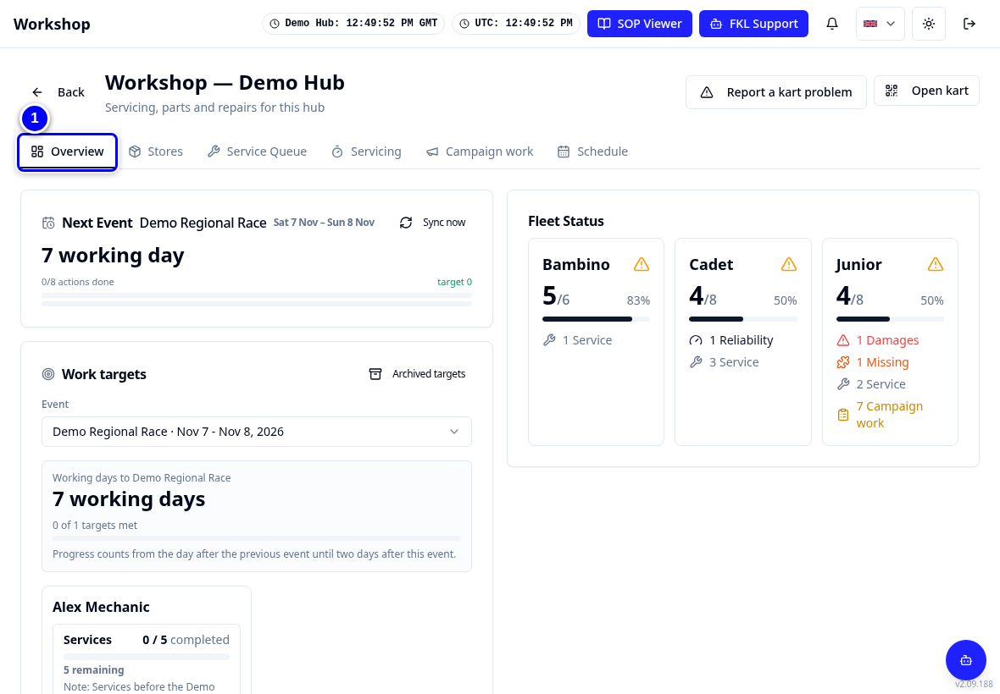
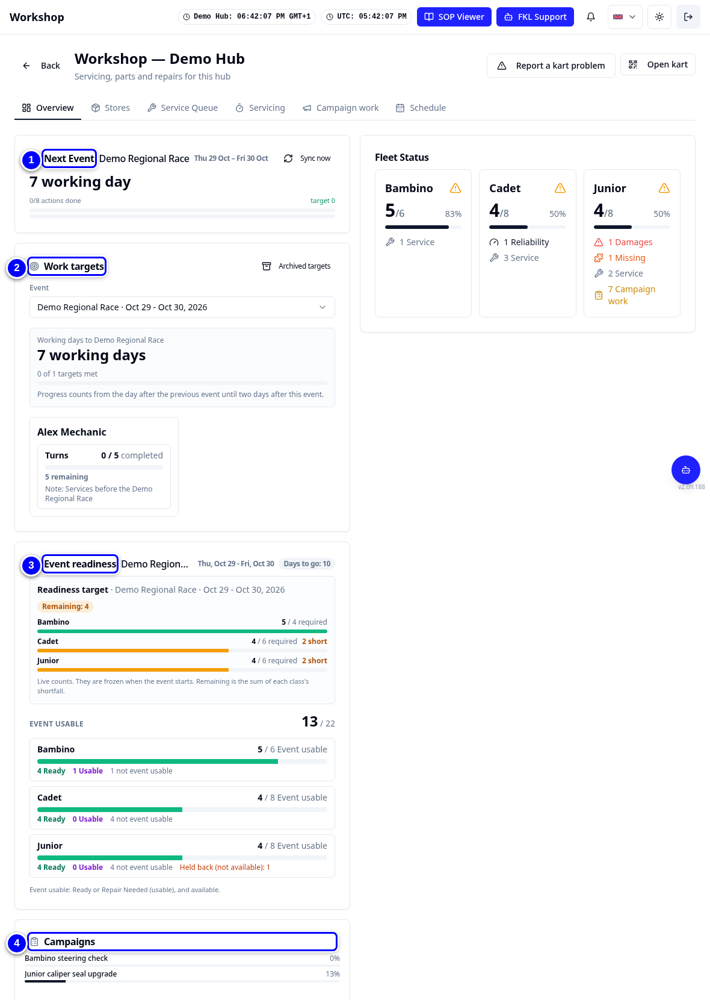
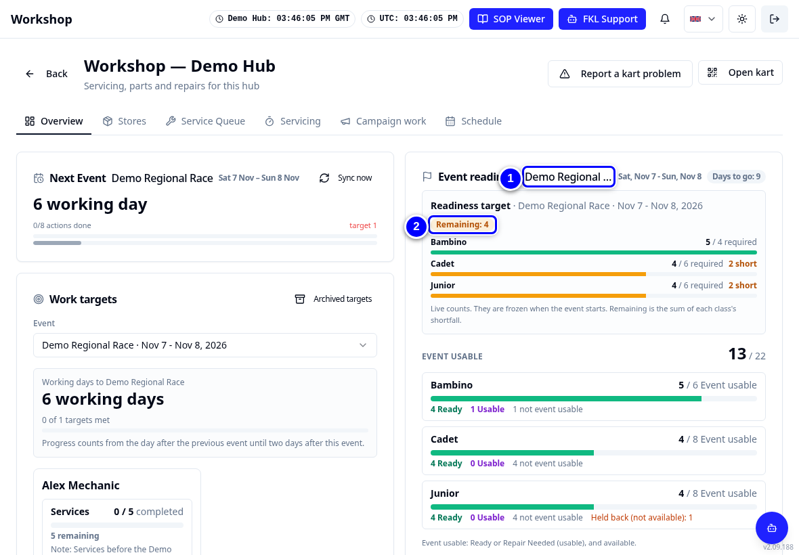
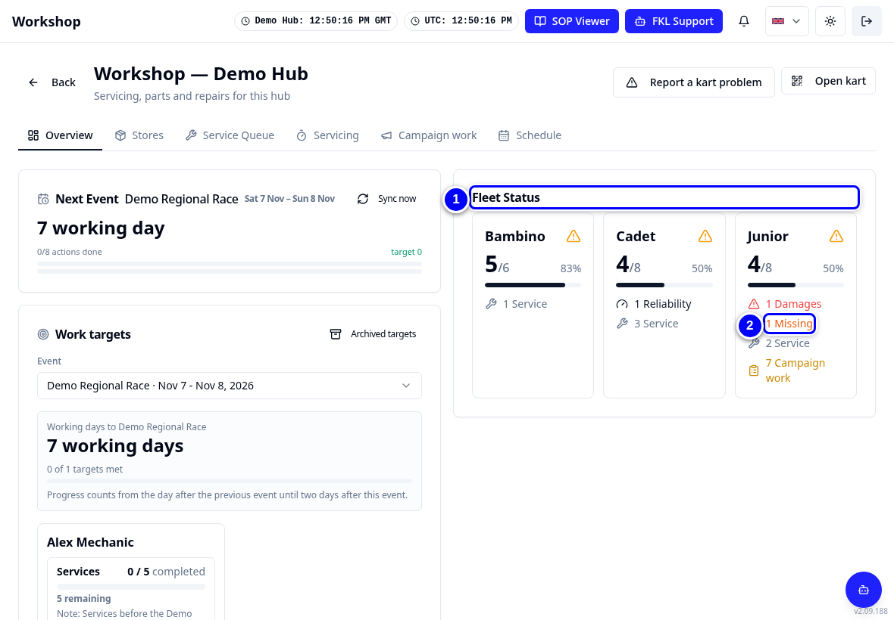
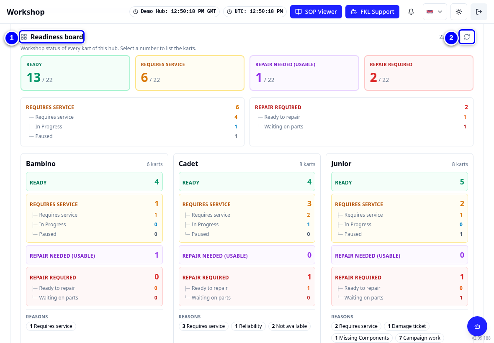
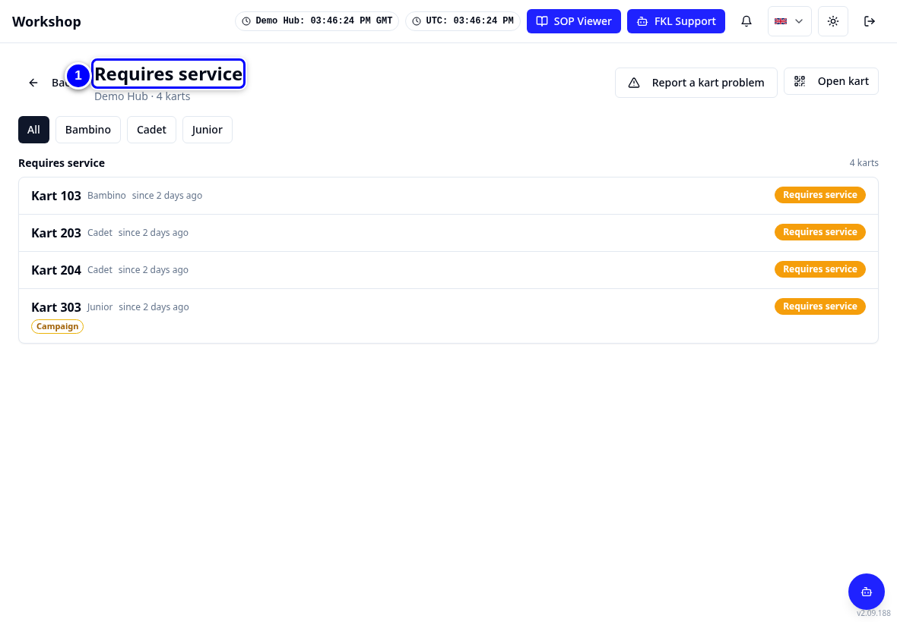
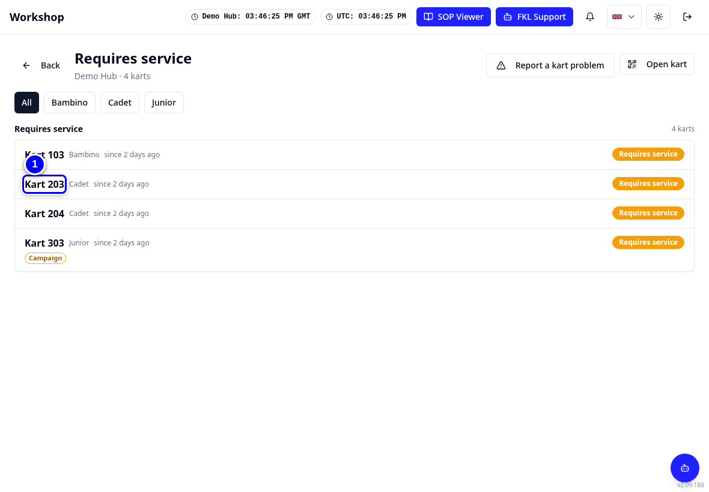
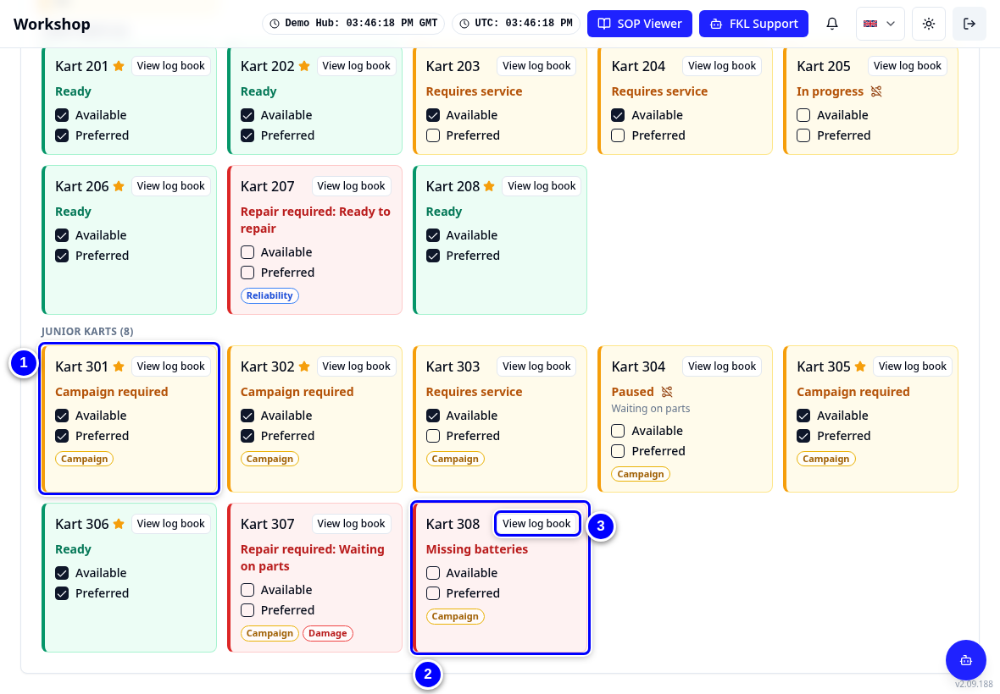

# The fleet board (Overview)

**Overview** is the first Workshop tab. It shows the whole fleet of your hub on one screen: what is ready, what needs a service, what needs a repair, and how close you are to the next event's targets.

!!! info "What changed from the Workshop App"
    - The Workshop App's **Readiness** (fleet) screen and the management **Dashboard** are together on **Overview**.
    - Click a count to list those karts. This replaces the Workshop App's status drill-down.
    - The board says **Requires service** where the Workshop App said Turn Required.

## Fleet board tour

<figure class="clip"><video controls preload="none" playsinline poster="../assets/video/mech-fleet-board-clip.jpg" width="1180">
<source src="../assets/video/mech-fleet-board-clip.mp4" type="video/mp4"><source src="../assets/video/mech-fleet-board-clip.webm" type="video/webm">
<track kind="captions" src="../assets/video/mech-fleet-board-clip.vtt" srclang="en" label="English" default></video>
<figcaption>Watch: a tour of the Overview tab and the Readiness board (about 60 seconds, with captions)</figcaption></figure>

1. Tap **Overview** in the tab strip.

    { loading=lazy }

2. Read the cards at the top: **Next Event**, **Work targets**, **Event readiness** and **Campaigns**.

    { loading=lazy }

3. Check **Event readiness**. It shows how many event-usable karts each class still needs for **Demo Regional Race**.

    { loading=lazy }

4. Look at **Fleet Status**. It counts karts with **Reliability**, **Damages**, **Performance**, **Missing**, **Service** and **Campaign work** items.

    { loading=lazy }

5. Scroll to the **Readiness board**. Tap **Reload board** if a colleague has just changed something.

    { loading=lazy }

6. Tap the **Requires service** count to list the karts that need a service.

    { loading=lazy }

7. Tap a kart in the list to open its kart page, or tap **Back** to return to the board.

    { loading=lazy }

8. Scroll down to the kart tiles per class, such as **Junior Karts (8)**. Each tile shows the kart number and its tags.

    { loading=lazy }

!!! note "Remember"
    Tile colours: red background means not available, green means preferred, yellow means available. With only the Workshop permission the **Available** and **Preferred** ticks are greyed out. Colleagues with **Reliability** can change them.

!!! tip "Tip"
    Start every shift on Overview. Compare the board with the karts in front of you. If something does not match, report it in KART Comms with the kart number.
