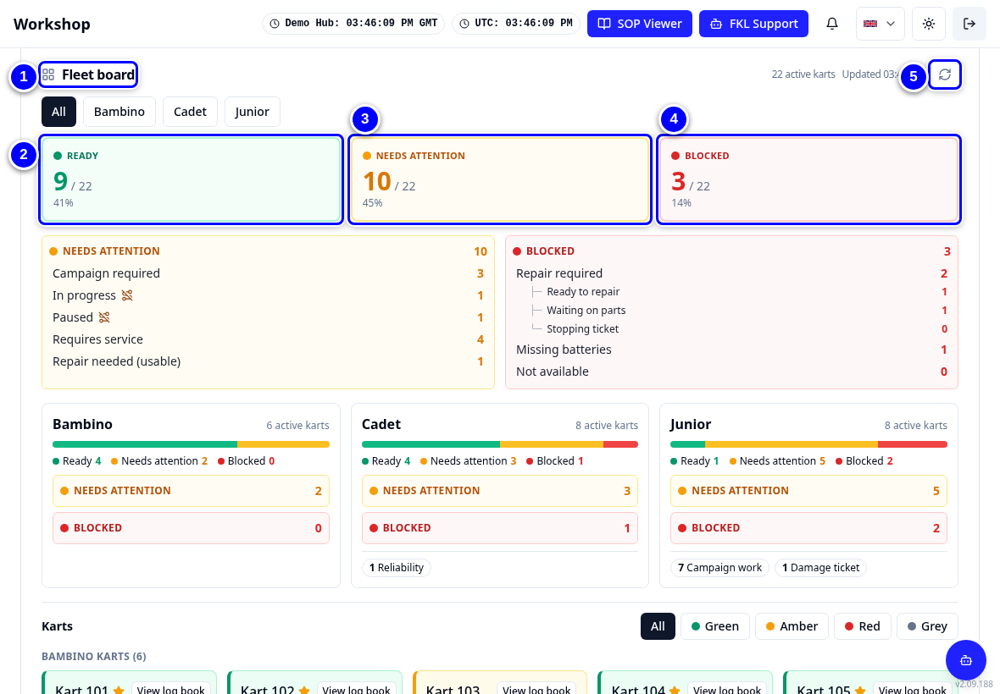
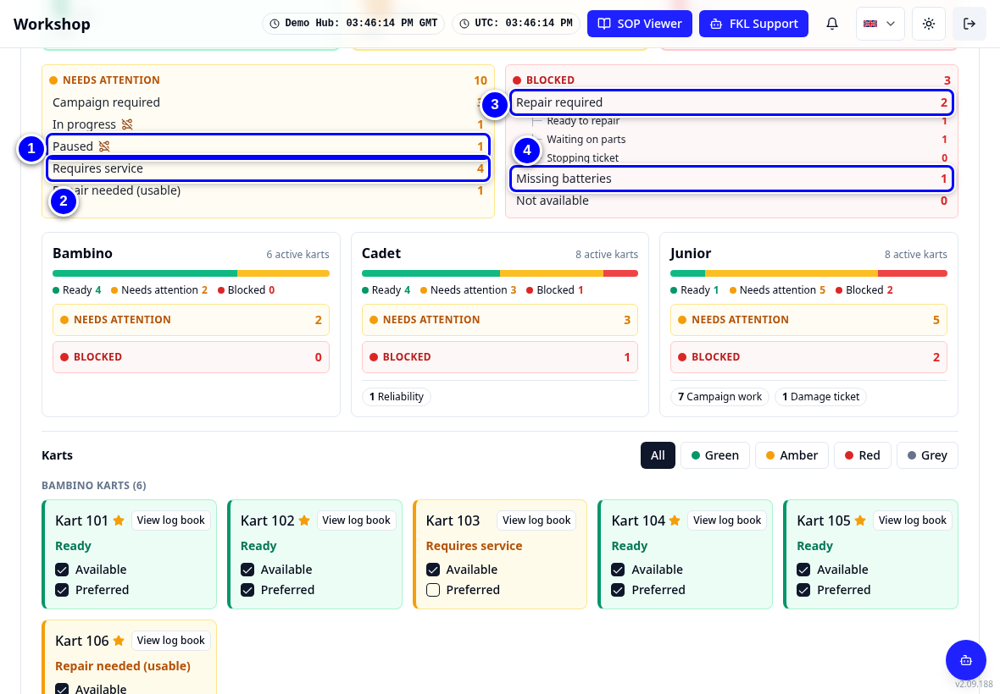
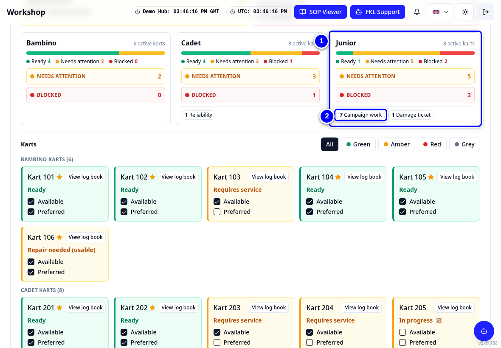

# The fleet board (Overview)

**Overview** is the first Workshop tab. It shows the whole fleet of your hub on one board: how many karts are green (ready), amber (need attention) and red (blocked), why, and every kart as a tile in its colour. The cards above it show the next event and your targets.

!!! info "What changed from the Workshop App"
    - The Workshop App's **Readiness** (fleet) screen and the management **Dashboard** are together on **Overview**.
    - **One fleet board.** The Fleet Status card, the Readiness board and the kart grid are now one **Fleet board**, with one set of numbers.
    - **Three colours.** Green **Ready**, amber **Needs attention**, red **Blocked**, with the reasons listed under amber and red. See [Kart statuses](../start/statuses.md).
    - Click a count to list exactly those karts. This replaces the Workshop App's status drill-down.
    - The board says **Requires service** where the Workshop App said Turn Required.

## Fleet board tour

<figure class="clip"><video controls preload="none" playsinline poster="../assets/video/mech-fleet-board-clip.jpg" width="1180">
<source src="../assets/video/mech-fleet-board-clip.mp4" type="video/mp4"><source src="../assets/video/mech-fleet-board-clip.webm" type="video/webm">
<track kind="captions" src="../assets/video/mech-fleet-board-clip.vtt" srclang="en" label="English" default></video>
<figcaption>Watch: a tour of the Overview tab and the Fleet board (about 40 seconds, with captions)</figcaption></figure>

1. Tap **Overview** in the tab strip.

    { loading=lazy }

2. Read the cards at the top: **Next Event**, **Work targets**, **Event readiness** and **Campaigns**.

    { loading=lazy }

3. Check **Event readiness**. It shows how many event-usable karts (Ready or Repair needed (usable), and available) each class still needs for **Demo Regional Race**. This is a planning event: an event your hub prepares karts for, with readiness targets. It stays a separate card because it carries the targets.

    { loading=lazy }

4. Scroll to the **Fleet board**. The colour row shows **Ready** (green), **Needs attention** (amber) and **Blocked** (red), each as a count of the hub's active karts. Use **All**, **Bambino**, **Cadet** or **Junior** at the top to see one class. If a colleague has just changed something, tap the round arrows icon (**Reload board**); **Updated** shows when the numbers were read.

    { loading=lazy }

5. Read the reasons under amber and red. Amber lists **Campaign required**, **In progress**, **Paused**, **Requires service** and **Repair needed (usable)**; In progress and Paused carry the **Not on track** marker. Red lists **Repair required** (with **Ready to repair**, **Waiting on parts** and **Stopping ticket** under it), **Missing batteries** and **Not available**.

    { loading=lazy }

6. Tap **Requires service** under amber to list the karts that need a service.

    { loading=lazy }

7. Tap a kart in the list to open its kart page, or tap **Back** to return to the board.

    { loading=lazy }

8. Below the reasons, each class has a block with a green, amber and red bar, the same reasons (tap to open) and tags with counts, such as **Campaign work** or **Performance**. Tap a tag to list those karts.

    { loading=lazy }

9. Scroll down to the kart tiles. Each tile has the kart's colour, its reason, a star when it is preferred, and its tags. Use **All**, **Green**, **Amber**, **Red** or **Grey** above the tiles to show only one colour.

    { loading=lazy }

!!! note "Remember"
    The tile colour is the kart's status colour, the same as everywhere else. A kart in a service or paused is amber with **Not on track**: it is not available until the service is finished. **View log book** on a tile opens the kart's record of past work. With only the Workshop permission the **Available** and **Preferred** ticks are greyed out. Colleagues with **Reliability** can change them.

!!! tip "Tip"
    Start every shift on Overview. Compare the board with the karts in front of you. If something does not match, tell your hub manager (hub lead), with the kart number (see [Getting help](../start/finding-your-way.md#getting-help)).

!!! note "Remember"
    The **Work targets** card may show **Services** with a count, such as 0 / 5 completed: your target number of services.
