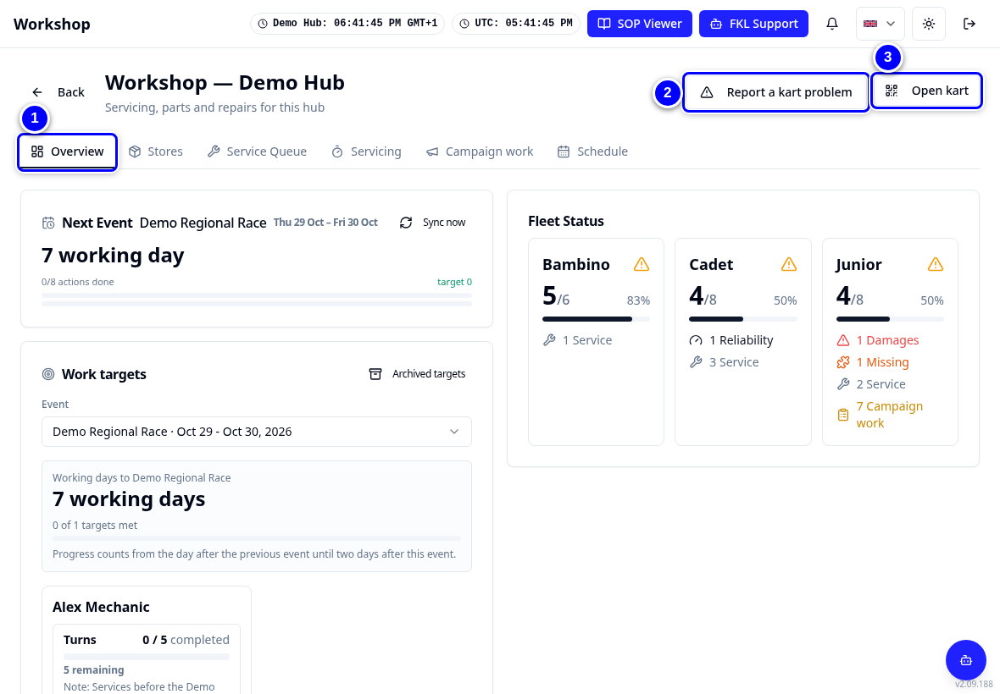

# Mechanic: your path

This section is for mechanics. Work through the pages in this order the first time. After that, use them as a reference.

!!! abstract "Coming with your hub's switch-over"
    Every screen on these pages already works in KART today. Your hub starts using them for workshop work on its switch-over day. Until then, keep recording in the Workshop App the way your hub lead tells you, and use these pages to practise. See [Switch-over day](../switch-over/index.md).

!!! info "What changed from the Workshop App"
    - You need a KART account with the **Workshop** permission and access to your hub. Check this with your hub lead **before** your hub's switch-over day.
    - The Workshop App's **Readiness**, **Repair Workflow**, **Campaign Work** and **Weekly Work Schedule** are now the Workshop tabs **Overview**, **Service Queue**, **Campaign work** and **Schedule**.
    - "Turn Required" is now **Requires service**. It means the same: the kart has been used and needs a service.

{ loading=lazy }

## In order

1. [Signing in and access](../start/sign-in-and-access.md) and [Finding your way](../start/finding-your-way.md): get into the Workshop.
2. [Kart statuses](../start/statuses.md) and [Incidents, tickets and repairs](../start/problems-explained.md): the words KART uses.
3. [The fleet board](fleet-board.md): what the Overview tells you at the start of a shift.
4. [Doing a service](service-turn.md): start, check, complete.
5. [Pause and resume](pause-and-resume.md): stop for a reason and pick up again.
6. [Report a problem](report-a-problem.md): incidents, driver feedback and following an incident up.
7. [Reliability tickets](reliability-ticket.md): take an unsafe kart out of use.
8. [Repairs and parts used](repairs-and-parts.md): fix it and record every part.
9. [Campaign work](campaign-work.md): fleet campaigns, task by task.
10. [Marking karts used](mark-used.md): how karts become Requires service.
11. [Race to Chassis](race-to-chassis.md): race numbers on the event day.
12. [The kart page](kart-page.md): one kart, its QR code and its history.
13. [Your weekly schedule](schedule.md): plan your week.
14. [Stores](stores.md): find a part and correct stock.

!!! tip "Tip"
    Print the [mechanic quick reference card](../cards/index.md) and keep it on the workbench.

!!! note "Remember"
    What you can do depends on your permissions. With only **Workshop** you cannot raise reliability tickets or tick **Available** and **Preferred**. A colleague with the **Reliability** permission, such as Casey Mechanic in this guide, can.

## Who to ask

- **Your hub lead** (the person who runs your hub) for accounts, access and how your hub works.
- **KART Comms support** (remote support) for KART problems. Give the kart number. See [Getting help](../start/finding-your-way.md#getting-help).
- Words you do not know are in the [Glossary](../glossary.md).
