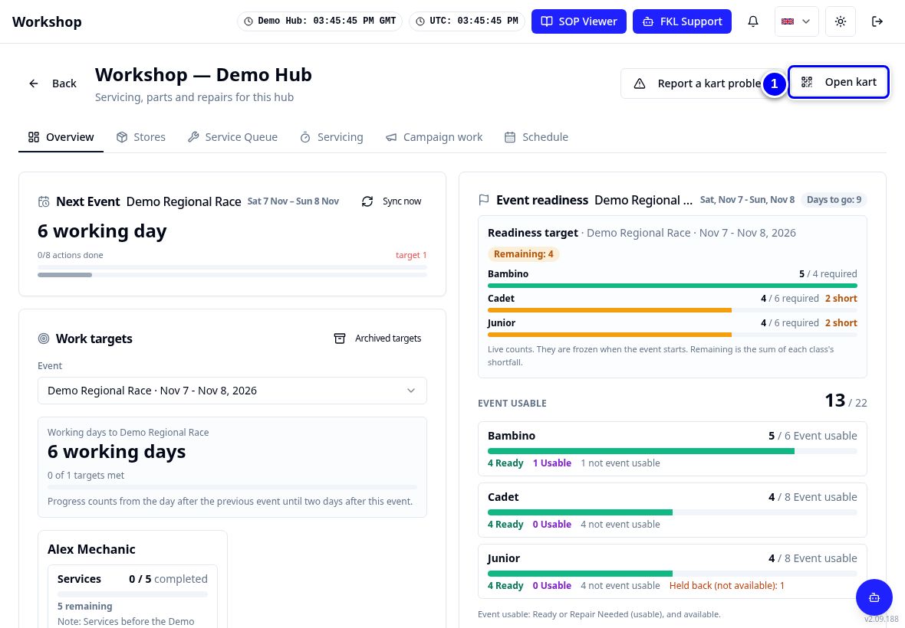
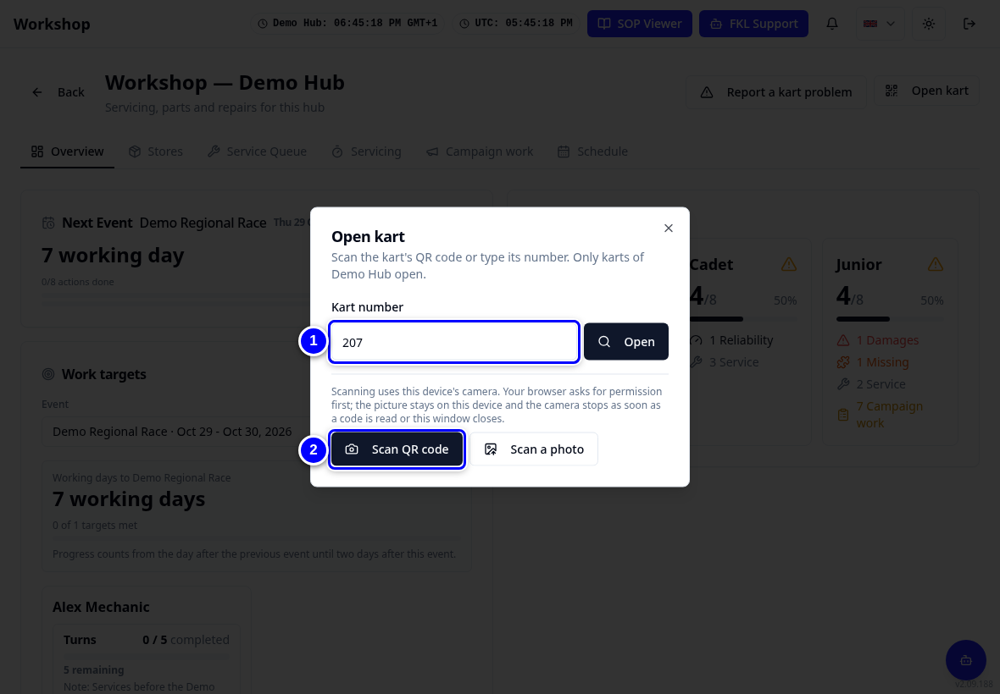
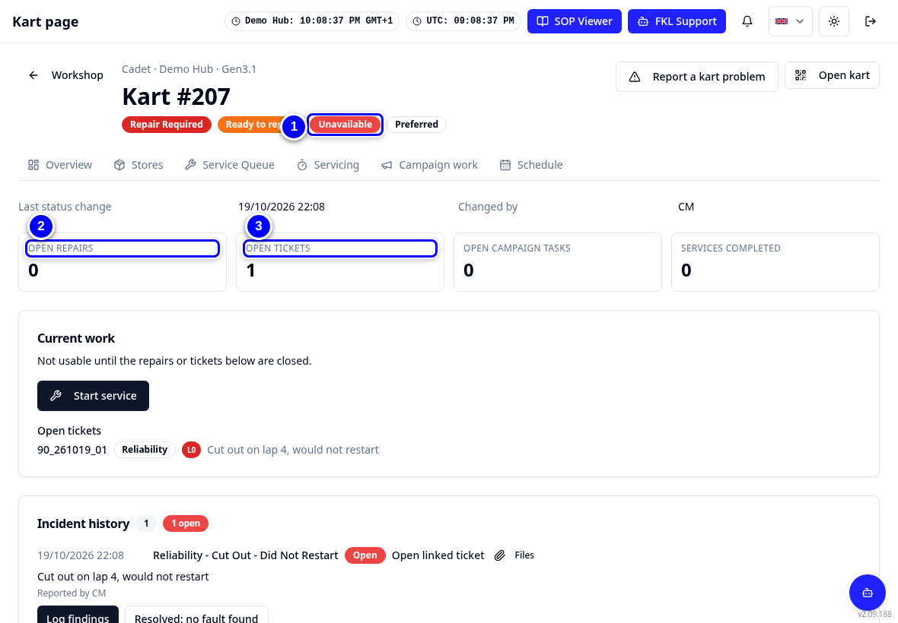
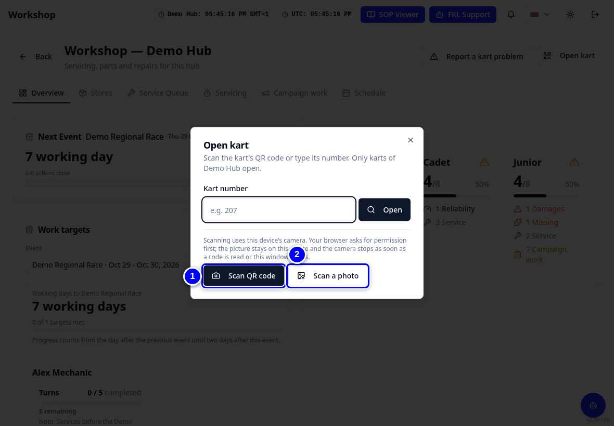
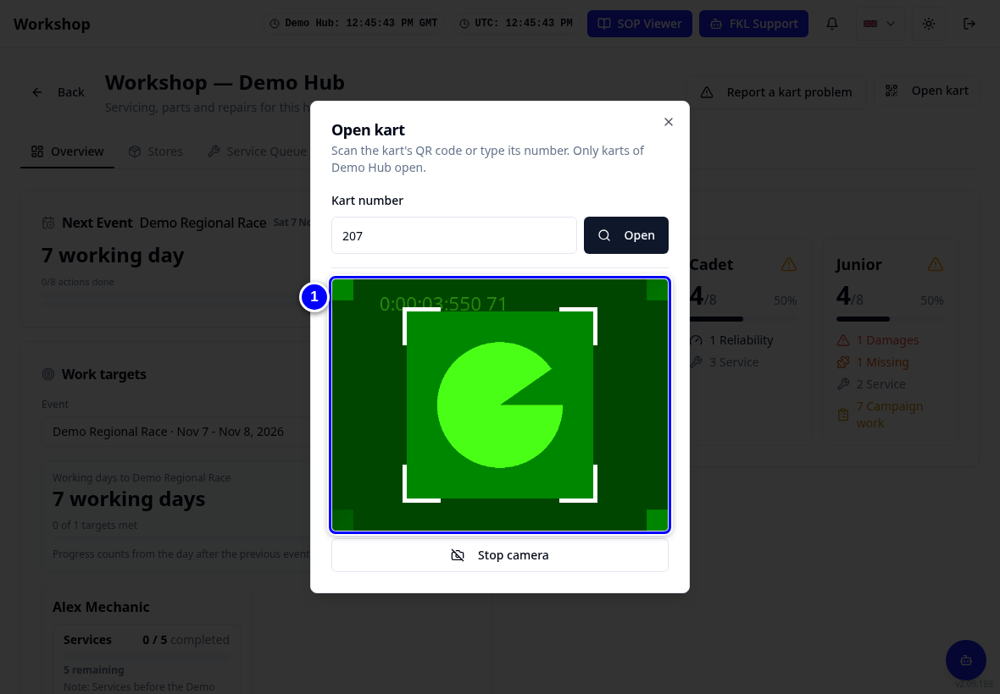
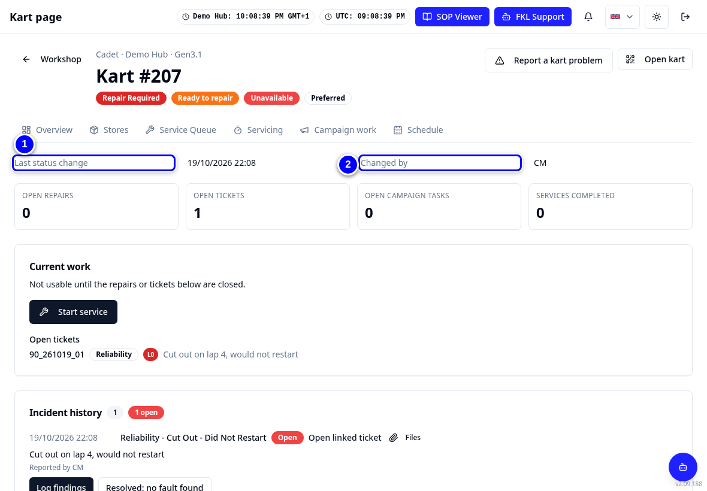
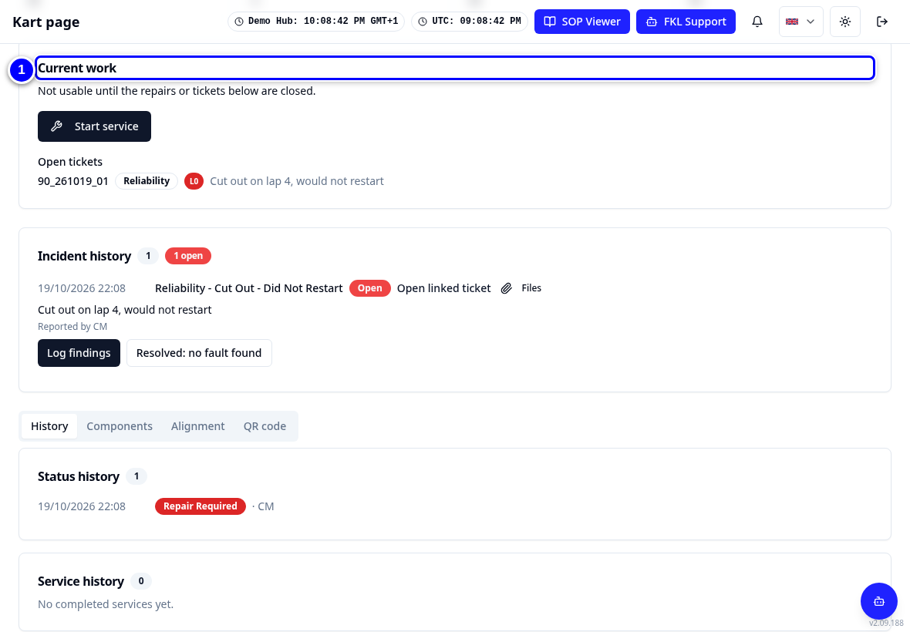
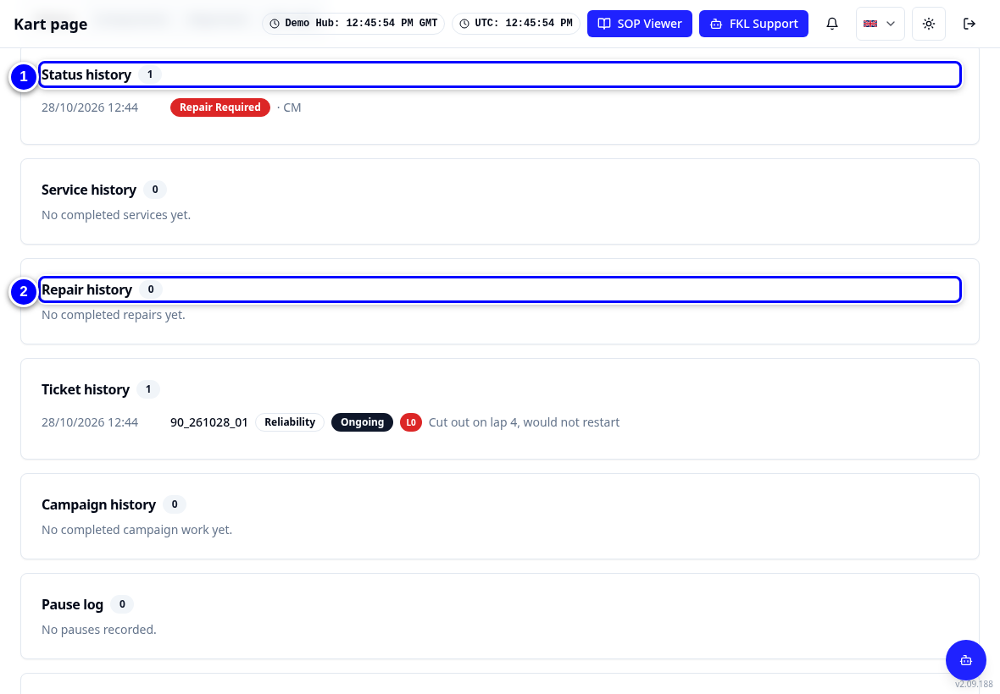
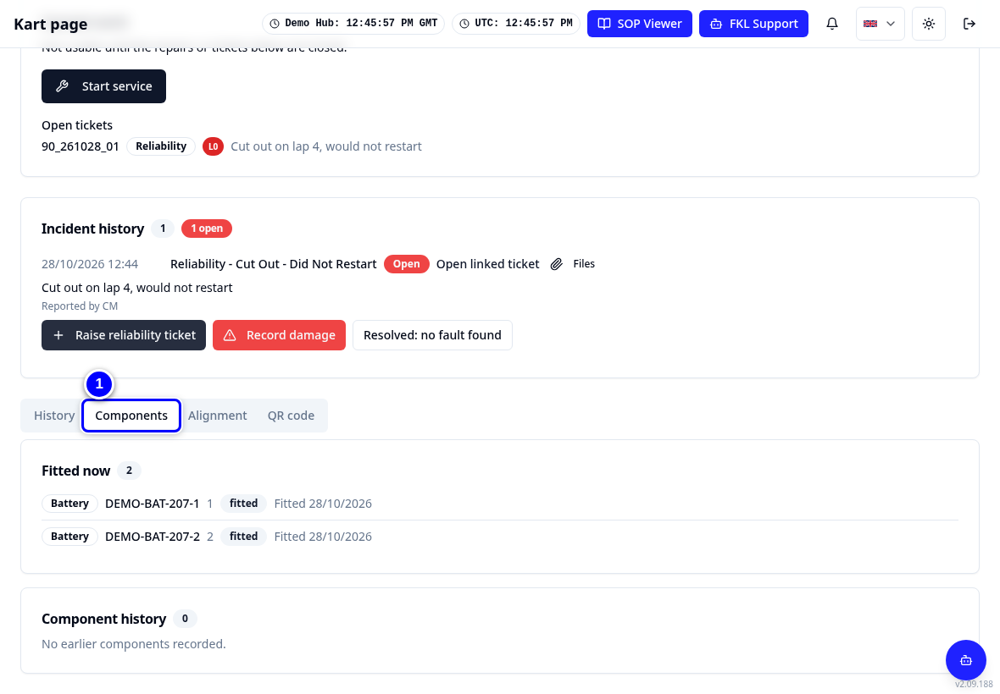
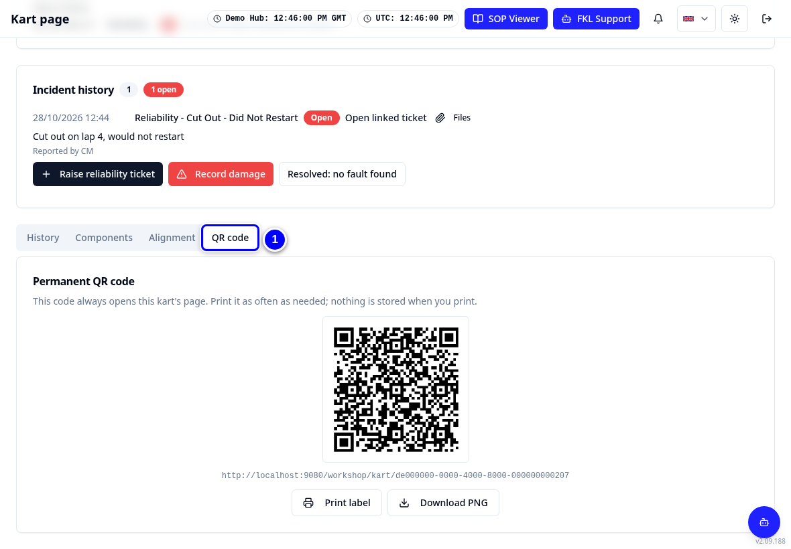

# The kart page

Every kart has its own page. It shows the kart's status, what is open on it, and its full history. Open it by typing the kart number or by scanning the QR code on the kart.

!!! info "What changed from the Workshop App"
    - The Workshop App's kart page is now the KART kart page. Open it with **Open kart** on Overview.
    - You can scan the kart's QR code with **Scan QR code**, or take a photo with **Scan a photo**.
    - The kart page has a **QR code** tab to print a new label.

## Open a kart

<figure class="clip"><video controls preload="none" playsinline poster="../assets/video/mech-openkart-clip.jpg" width="1180">
<source src="../assets/video/mech-openkart-clip.mp4" type="video/mp4"><source src="../assets/video/mech-openkart-clip.webm" type="video/webm">
<track kind="captions" src="../assets/video/mech-openkart-clip.vtt" srclang="en" label="English" default></video>
<figcaption>Watch: opening Cadet 207 with Open kart and looking at its history (about 35 seconds, with captions)</figcaption></figure>

1. On **Overview**, tap **Open kart**.

    { loading=lazy }

2. Type the number in **Kart number**, for example **207**.

    { loading=lazy }

3. Tap **Open**. The kart page opens. **Unavailable** means KART does not offer the kart when karts are handed out for an event (allocation).

    { loading=lazy }

!!! note "Remember"
    Only karts of your selected hub open. A Cadet with number 7 shows as **207**: Bambino numbers start at 100, Cadet at 200, Junior at 300.

## Scan the QR code

1. Tap **Open kart**, then **Scan QR code**. Allow the camera if the browser asks.

    { loading=lazy }

2. Hold the camera over the label on the kart. The kart page opens by itself.

    { loading=lazy }

## What the kart page shows

1. At the top: **Available** or **Unavailable**, **Preferred**, and who made the **Last status change**.

    { loading=lazy }

2. Under **Current work**: open repairs, the running service and the buttons **Start service**, **Resume service** or **Continue service**.

    { loading=lazy }

3. Tap the **History** tab for **Status history**, **Service history**, **Repair history**, **Ticket history**, **Campaign history**, **Pause log**, **Chassis reassignments** and **Used history**.

    { loading=lazy }

4. Tap **Components** to see what is fitted, or **Alignment** for alignment records.

    { loading=lazy }

5. Tap **QR code** to print a new label for the kart.

    { loading=lazy }

!!! tip "Tip"
    **Report a kart problem** is on the kart page too, with this kart already chosen.

!!! abstract "Coming with your hub's switch-over"
    The old Workshop App QR labels still point to the Workshop App. Reprinting labels and redirecting old QR links is part of the switch-over plan. Until your hub lead says otherwise, open karts with **Open kart** and the number.
