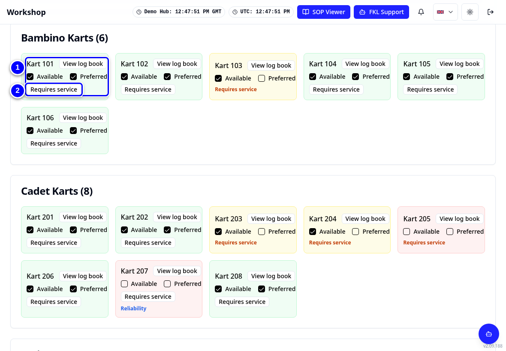
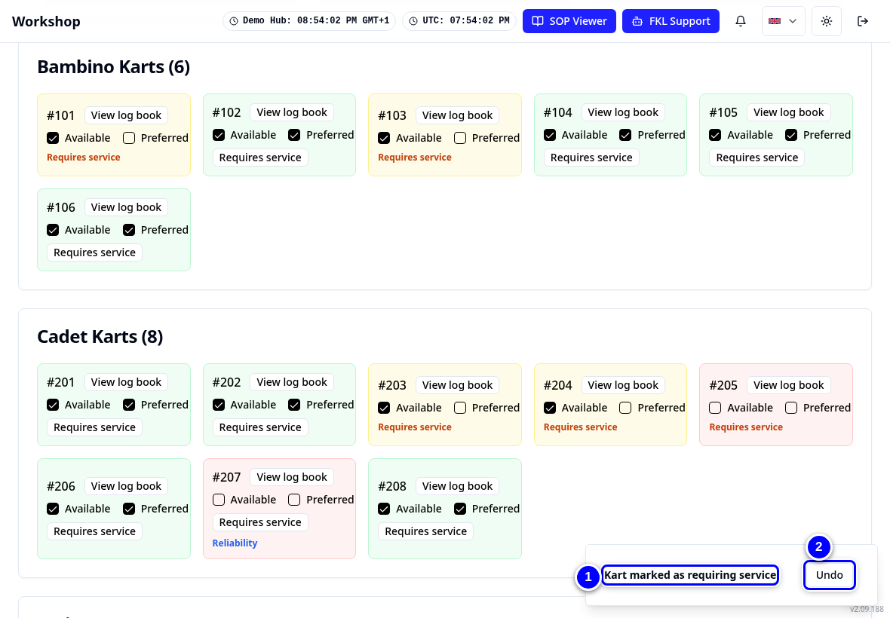
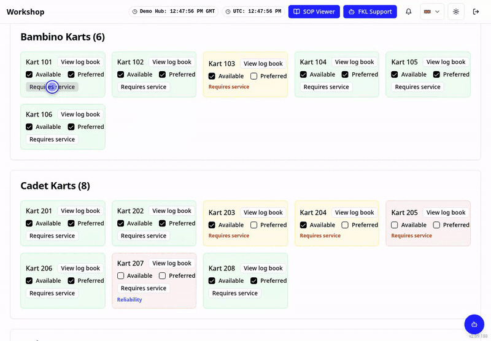
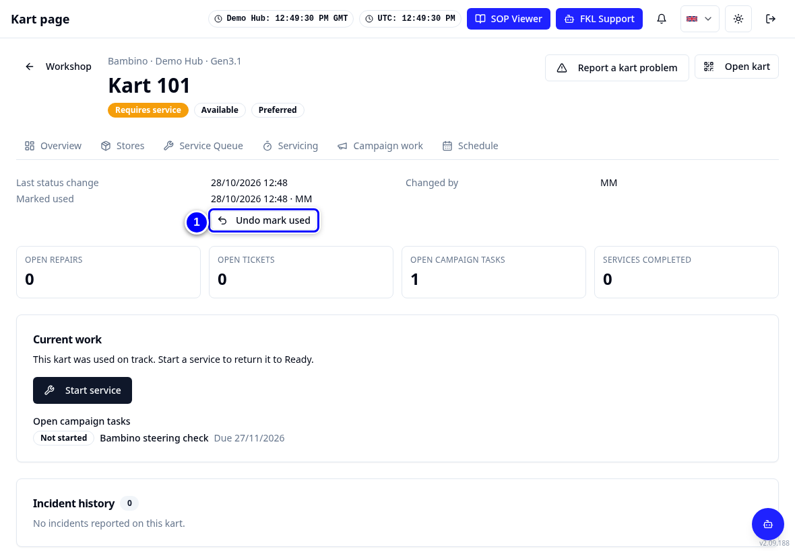
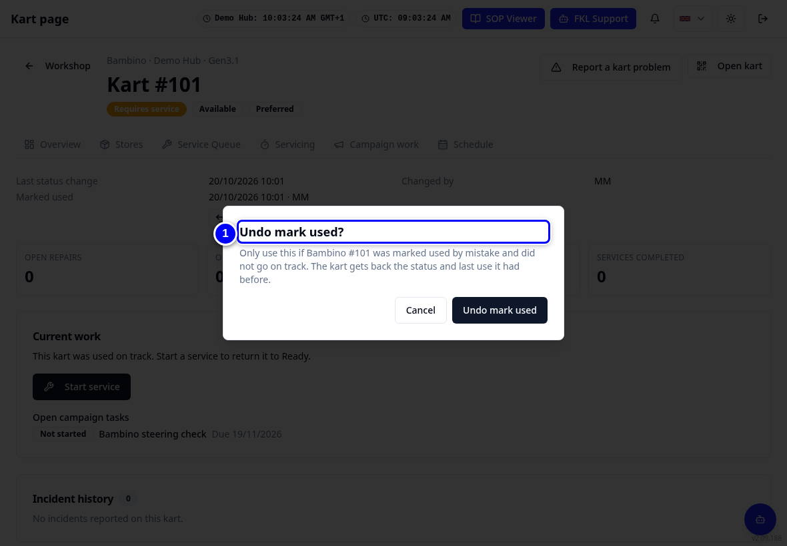
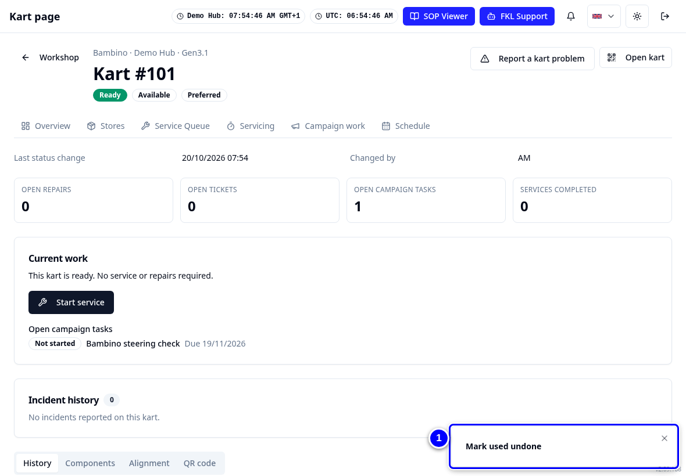

# Marking karts used

A kart needs a service after it has been used. KART needs to know which karts were used so they show **Requires service**. Most of the time this happens by itself through Race to Chassis on the event day.

!!! info "What changed from the Workshop App"
    - The Workshop App's **Mark used** screen is gone. On the event day, **Race to Chassis** marks karts used when a race number is put on a chassis.
    - Hub managers and admins can also mark a single kart by hand with the **Requires service** button on its Overview tile.
    - A mistake can be undone with **Undo** or **Undo mark used**.

## How karts get marked used

- **On the event day:** putting a race number on a chassis in Race to Chassis marks that chassis used. KART says **It stays Ready during the event and requires service after the event day.** See [Race to Chassis](race-to-chassis.md).
- **By hand:** a hub manager or admin taps **Requires service** on the kart's tile on Overview. Mechanics do not see this button. Ask your hub manager if a kart was used outside an event, for example for testing.

## Mark a kart used by hand (hub managers)

<figure class="clip"><video controls preload="none" playsinline poster="../assets/video/mech-mark-used-clip.jpg" width="1180">
<source src="../assets/video/mech-mark-used-clip.mp4" type="video/mp4"><source src="../assets/video/mech-mark-used-clip.webm" type="video/webm">
<track kind="captions" src="../assets/video/mech-mark-used-clip.vtt" srclang="en" label="English" default></video>
<figcaption>Watch: marking Bambino 101 used by hand, undoing it, and Race to Chassis marking a chassis used (about 45 seconds, with captions)</figcaption></figure>

1. On **Overview**, find the kart's tile, for example **#101**.

    { loading=lazy }

2. Tap **Requires service** on the tile. KART says **Kart marked as requiring service** and offers **Undo**.

    { loading=lazy }

3. Made a mistake? Tap **Undo** in the message straight away.

    { loading=lazy }

## Undo later from the kart page

1. Open the kart page (see [The kart page](kart-page.md)). If the mark can still be undone, KART shows **Undo mark used**.

    { loading=lazy }

2. Tap **Undo mark used**. Read the question **Undo mark used?**

    { loading=lazy }

3. Tap **Undo mark used** in the question. The kart gets back the status it had before.

    { loading=lazy }

!!! warning "Watch out"
    Only undo if the kart was marked by mistake and did **not** go on track. Once someone starts a service on the kart, undo is no longer offered.

!!! note "Remember"
    Karts used at an event stay **Ready** during the event day and show **Requires service** after it.
