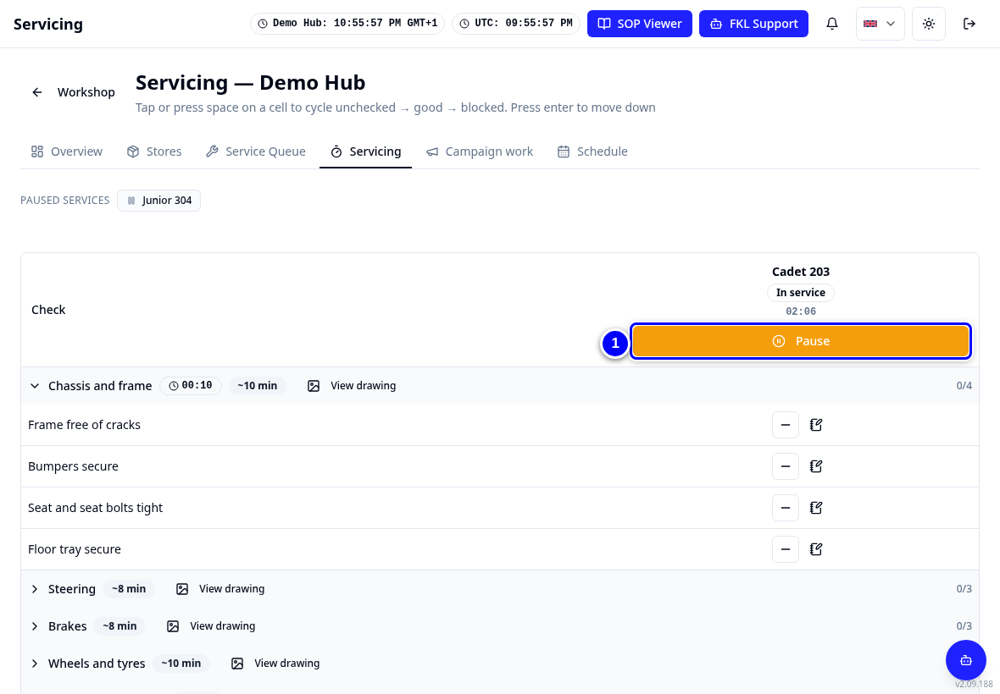
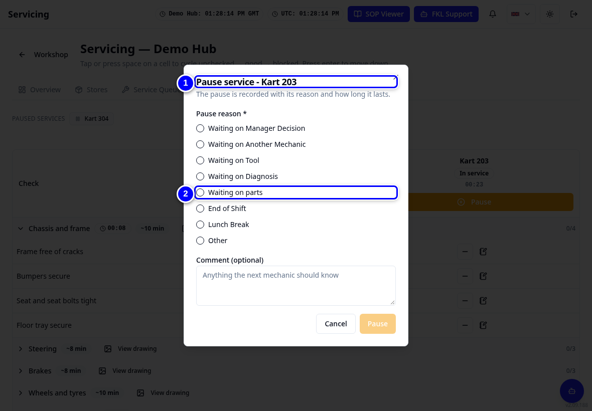
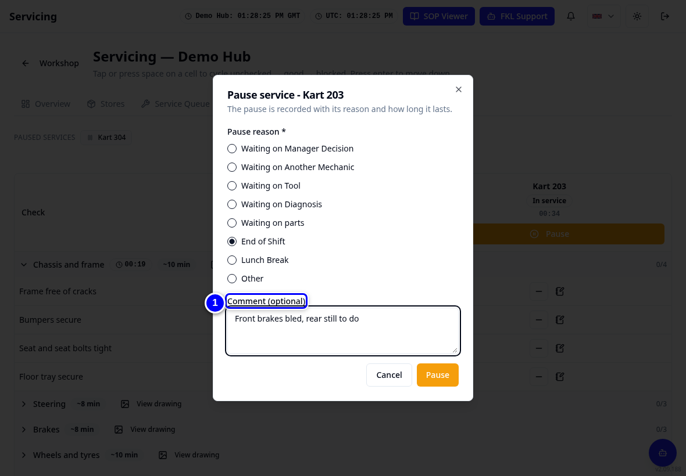
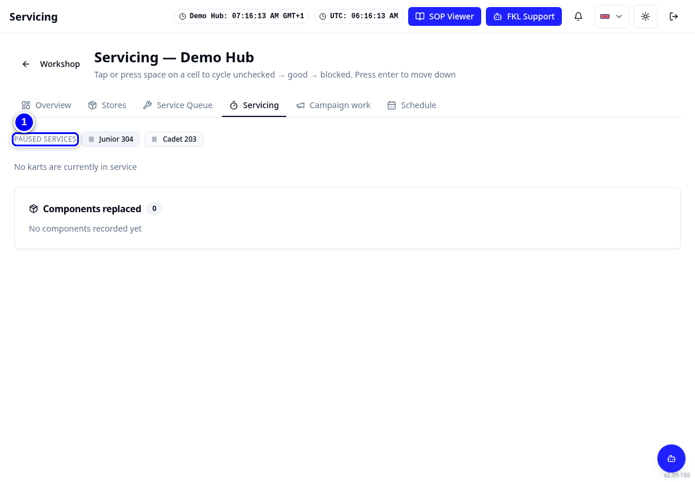
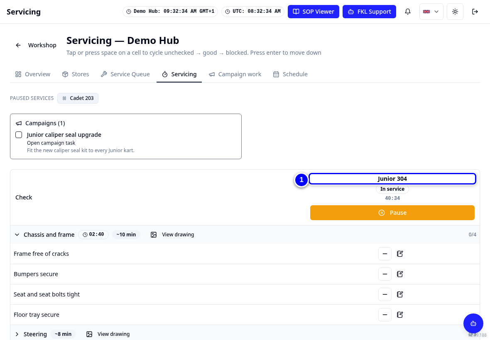
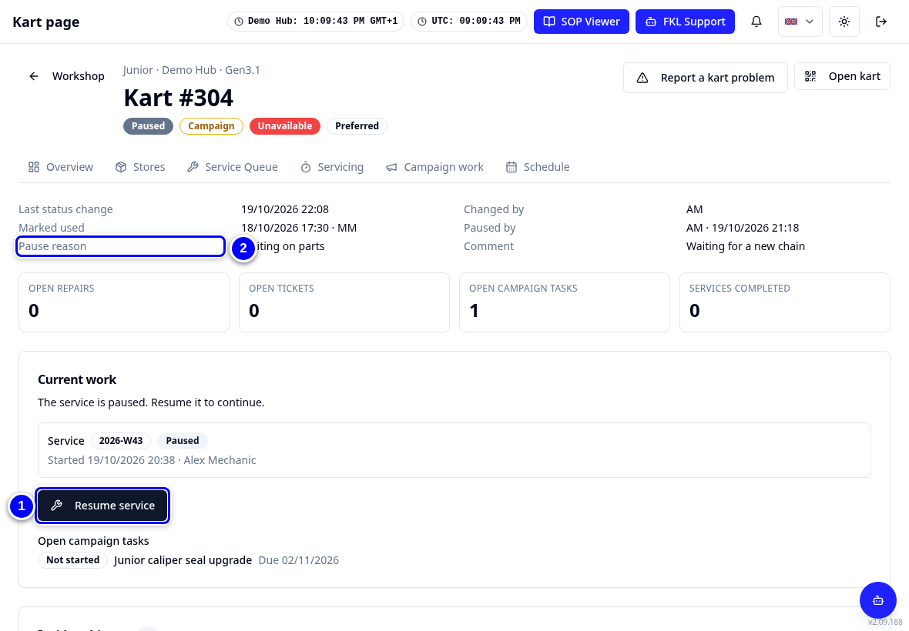
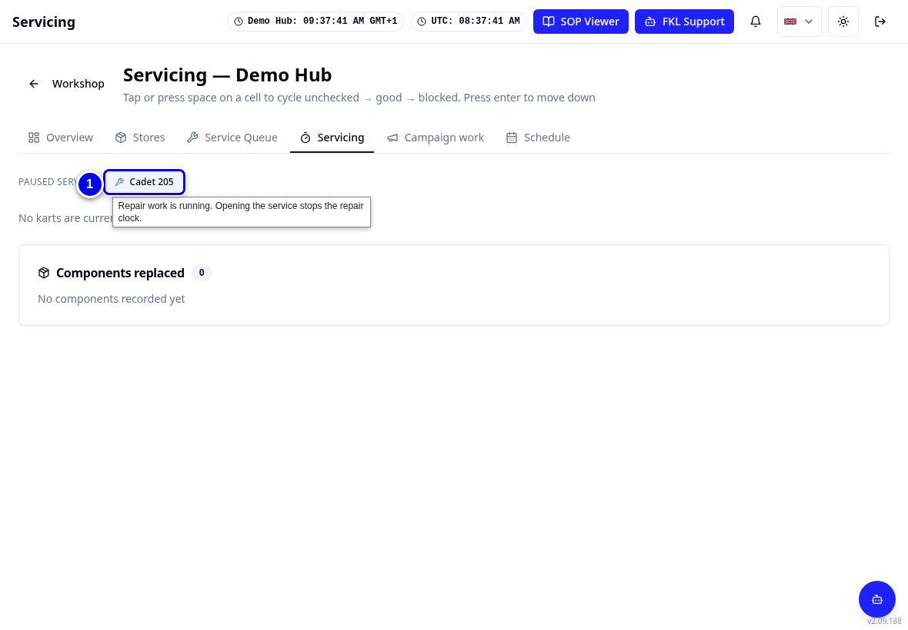

# Pause and resume a service

Pause a service whenever you stop working on the kart: end of shift, waiting for parts, waiting for another mechanic or a decision. The pause is recorded with its reason and how long it lasts, so the service time stays honest.

!!! info "What changed from the Workshop App"
    - Pausing works like the Workshop App, but KART always asks for a **Pause reason**.
    - Your paused services sit in a **Paused services** bar under the Workshop tabs. Tap one to carry on.
    - Doing repair work on the kart pauses its service by itself. The service then shows the extra repair minutes.

## Watch it first

<figure class="clip"><video controls preload="none" playsinline poster="../assets/video/mech-pause-clip.jpg" width="1180">
<source src="../assets/video/mech-pause-clip.mp4" type="video/mp4"><source src="../assets/video/mech-pause-clip.webm" type="video/webm">
<track kind="captions" src="../assets/video/mech-pause-clip.vtt" srclang="en" label="English" default></video>
<figcaption>Watch: pausing Cadet 203 with a reason and resuming Junior 304 (about 50 seconds, with captions)</figcaption></figure>

## Pause

1. On **Servicing**, tap **Pause**.

    { loading=lazy }

2. In **Pause service**, tap a **Pause reason**, for example **End of Shift** or **Waiting on parts**.

    { loading=lazy }

3. Add a note in **Comment (optional)** if the next mechanic should know something.

    { loading=lazy }

4. Tap **Pause**. The kart moves to the **Paused services** bar at the top of **Servicing**, and shows **Paused** (grey) on the board.

    { loading=lazy }

!!! note "Remember"
    The reasons are: **Waiting on Manager Decision**, **Waiting on Another Mechanic**, **Waiting on Tool**, **Waiting on Diagnosis**, **Waiting on parts**, **End of Shift** and **Other**.

## Resume

1. On **Servicing**, find the kart in the **Paused services** bar under the Workshop tabs. Hover or long-press to see the reason.

    { loading=lazy }

2. Tap the kart, for example **304**. KART opens its **Servicing** page and the timer runs again.

    { loading=lazy }

3. Or open the kart page and tap **Resume service**.

    { loading=lazy }

!!! warning "Watch out"
    If another mechanic paused the kart, KART says **Another mechanic is servicing this kart. A hub manager can re-allocate it in the Service Queue.** Ask your hub manager rather than starting a new service.

## Repair work pauses the service

When you start repair work on a kart that is in service (see [Repairs and parts used](repairs-and-parts.md)), KART pauses the service for you. The paused tab shows a spanner, and its hint says **Repair work is running. Opening the service stops the repair clock.**

1. Tap the paused kart to go back to the service. The repair clock stops and the service clock runs again.

    { loading=lazy }

!!! tip "Tip"
    Pause before a break, even a short one. A service left running all night makes the service time look much longer than the work was.
