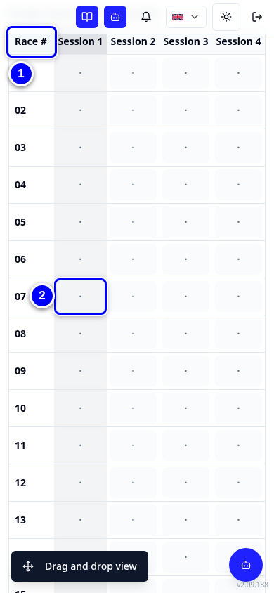
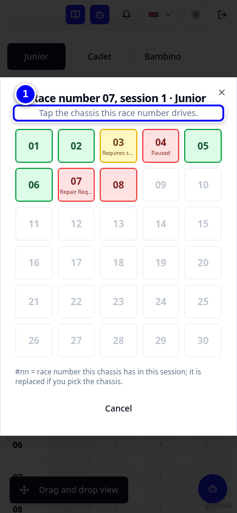

# Race to Chassis

Race to Chassis (R2C) links each race number (the driver's number for the day) to the chassis (kart) it drives in each session (each time out on track). On the event day it also marks karts used, so they need a service after the event. You can drag numbers onto chassis (tablet and laptop) or use the tap grid (phone).

!!! info "What changed from the Workshop App"
    - **On Event > Race to Chassis** is now in **Event Operations**: pick the event, then **Race to Chassis**.
    - New since 19 October: **drag and drop**. Drag a race number onto a chassis. On phones the tap grid stays the default. Each device remembers the view you last chose.
    - Everything the tap grid did still happens on each drop: reasons, track use overrides (letting a not-available kart run until the end of the event), marking karts used with **Undo**, and the reassignment log.

## Open Race to Chassis

1. On **Select your Hub**, tap **Event Operations**. It opens in a new tab.

    { loading=lazy }

2. Under **Existing Events**, tap today's event, **Demo Practice Day**. (Do not use **Upload Driver File** at the top: that creates a new event.)

    { loading=lazy }

3. In **Select Action for Demo Practice Day**, tap **Race to Chassis**.

    { loading=lazy }

## Drag and drop (tablet and laptop)

<figure class="clip"><video controls preload="none" playsinline poster="../assets/video/mech-r2c-drag-clip.jpg" width="1180">
<source src="../assets/video/mech-r2c-drag-clip.mp4" type="video/mp4"><source src="../assets/video/mech-r2c-drag-clip.webm" type="video/webm">
<track kind="captions" src="../assets/video/mech-r2c-drag-clip.vtt" srclang="en" label="English" default></video>
<figcaption>Watch: putting race numbers on chassis with drag and drop (about 70 seconds, with captions)</figcaption></figure>

The buttons at the top pick the kart class (**Junior**, **Cadet**, **Bambino**) and the session (**1**, **2**, **3**, **4**). The chassis show each kart's number in its class, so Junior 301 is chassis **01**. The chassis border colour shows **Available** (green), **Unpreferred** (yellow), **Unavailable** (red) or **Not in fleet** (grey).

1. At the top, tap the kart class, for example **Junior**. Check the right session is selected. The **Race Number** list on the right holds the numbers to place.

    { loading=lazy }

2. Drag the number onto the chassis, for example race number **5** onto chassis **01** (Junior 301).

    { loading=lazy }

3. KART says **Kart 301 marked used** and **It stays Ready during the event and requires service after the event day.** Tap **Undo** only if it was a mistake. A kart that already requires service is not marked again: KART says **Not marked used: the kart already requires service.**

    { loading=lazy }

4. To take a number off, drag it back to the race number list, or tap the chassis and tap **Take off chassis**.

    { loading=lazy }

!!! tip "Tip"
    **Copy Last Session** copies the previous session's numbers to this one. **Clear Session** empties only this session. **Clear All** empties every session of the event and cannot be undone.

## Tap grid (phone)

<figure class="clip"><video controls preload="none" playsinline poster="../assets/video/mech-r2c-tap-clip.jpg" width="390">
<source src="../assets/video/mech-r2c-tap-clip.mp4" type="video/mp4"><source src="../assets/video/mech-r2c-tap-clip.webm" type="video/webm">
<track kind="captions" src="../assets/video/mech-r2c-tap-clip.vtt" srclang="en" label="English" default></video>
<figcaption>Watch: putting a race number on a chassis with the tap grid on a phone (about 25 seconds, with captions)</figcaption></figure>

1. Tap the cell for the race number and session, for example race number **7** in the **Current session**.

    { loading=lazy }

2. Tap the chassis this race number drives, for example chassis **02** in the **Junior** class (Junior 302).

    { loading=lazy }

3. To switch views, tap **Drag and drop view** at the bottom left. In drag and drop, tap **Tap grid** to come back.

    { loading=lazy }

## A chassis that is not available

1. Put a number on a chassis that is not available, for example Junior chassis **07**. KART names the kart by its number and says **Kart 307 is not available** and why.

    { loading=lazy }

2. Normally tap **Cancel** and use another chassis. Only if your hub manager agrees, type a reason and tap **Assign anyway**. This gives a track use override until the end of the event.

    { loading=lazy }

!!! warning "Watch out"
    Never assign a kart with a stopping reliability ticket (Repair Required) just to fill the grid. **Assign anyway** is recorded with your reason.

## Moving a race number to another chassis

1. Drag a race number that is already on a chassis onto a different chassis. KART asks **Logged. Why did the race number change chassis?**

    { loading=lazy }

2. Choose a reason in **Select a reason**, then tap **Save reason**. The reason is optional: **Skip** closes the question and the move is still logged. The clock button next to **Clear Session** counts the moves. On a wide screen it says **Reassignments**.

    { loading=lazy }

## Past events are read-only

1. Open Race to Chassis for an event on another day. KART shows **Past Event - Editing Restricted**. Only administrators can change it.

    { loading=lazy }

!!! note "Remember"
    Race numbers go from 1 to 30. Marking karts used only happens for today's event, in the hub's own time zone.
