# Reliability tickets: stop a kart

A reliability ticket records a fault for engineering. When the ticket's effect is anything other than **Performance**, it **stops** the kart: the kart shows **Repair Required** and is not offered for allocation (KART does not offer it when karts are handed out for an event). This is the only normal way to take a kart out of use.

You need the **Reliability** permission to raise tickets. In this guide Casey Mechanic has it and Alex Mechanic does not.

!!! info "What changed from the Workshop App"
    - In the Workshop App an incident could stop a kart. In KART only a **stopping reliability ticket** (or a blocking repair) does.
    - Tickets live in KART's **Technical** area (the Karting Reliability Tracker). Saving a ticket also creates a linked workshop incident, so the workshop sees it.
    - A ticket raised from an incident (**Raise reliability ticket** on the kart page or ICU board) resolves that incident and links it instead. KART says **Incident resolved with this ticket.**
    - The Tracker also has **Log incident** for events staff and contractors. See [Report a problem](report-a-problem.md#log-an-incident-from-the-tracker-events-staff-and-contractors).
    - The root cause stays on the ticket. The remedy (what you did) goes on the repair.

## Raise a stopping ticket

<figure class="clip"><video controls preload="none" playsinline poster="../assets/video/mech-ticket-clip.jpg" width="1180">
<source src="../assets/video/mech-ticket-clip.mp4" type="video/mp4"><source src="../assets/video/mech-ticket-clip.webm" type="video/webm">
<track kind="captions" src="../assets/video/mech-ticket-clip.vtt" srclang="en" label="English" default></video>
<figcaption>Watch: raising a stopping reliability ticket on Cadet 207 that cut out and would not restart (about 40 seconds, with captions)</figcaption></figure>

1. On **Overview**, tap **Report a kart problem**.

    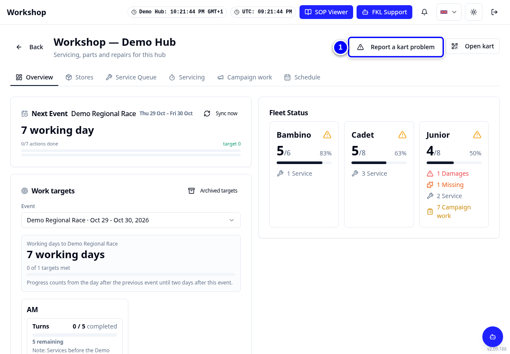{ loading=lazy }

2. Choose the kart, for example **207**, and choose **Reliability**.

    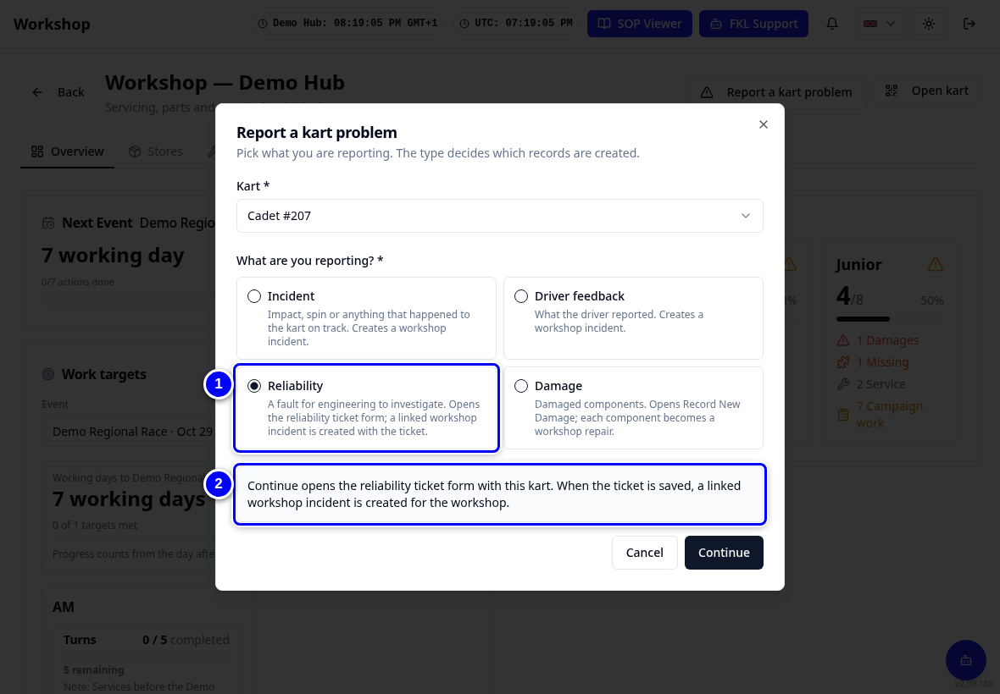{ loading=lazy }

3. Tap **Continue**. The reliability ticket form opens with this kart. **Kart Number** shows the kart's number in its class, so Cadet 207 shows as **07**.

    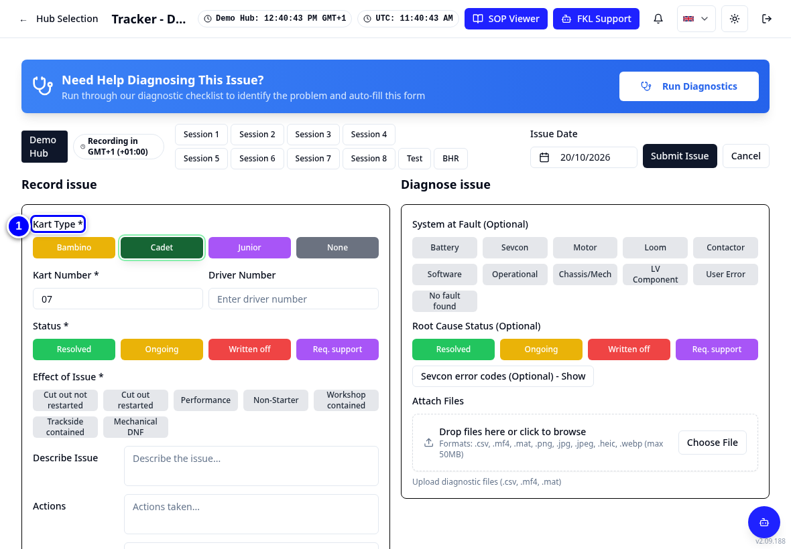{ loading=lazy }

4. Choose the **Effect of Issue** (what the kart did), for example **Cut out not restarted**.

    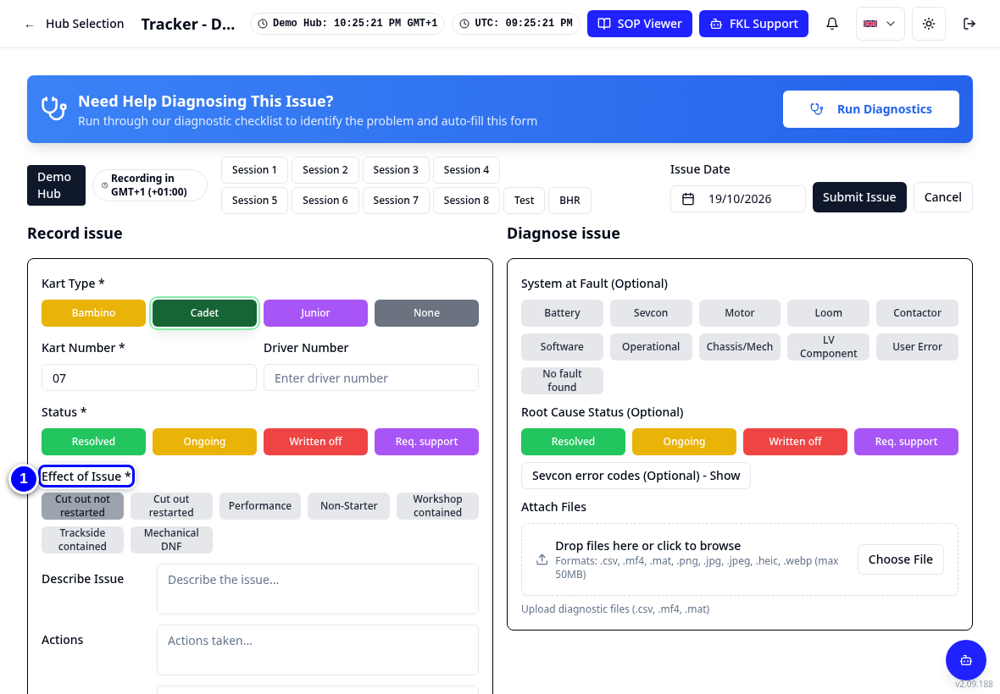{ loading=lazy }

5. Leave **Status** as **Ongoing**.

    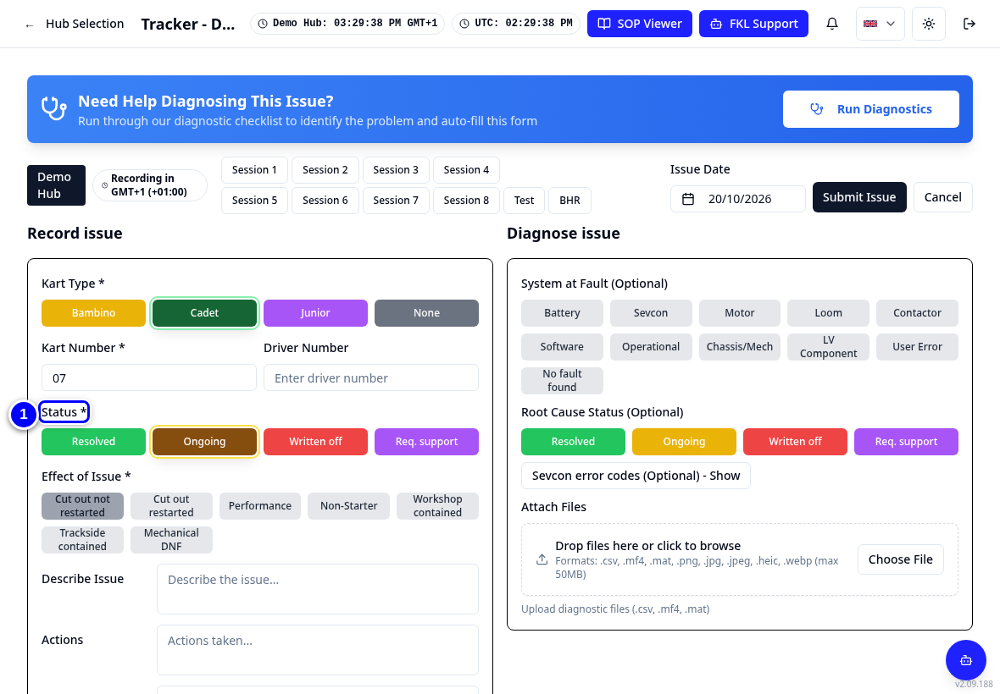{ loading=lazy }

6. Type what happened in **Describe Issue**.

    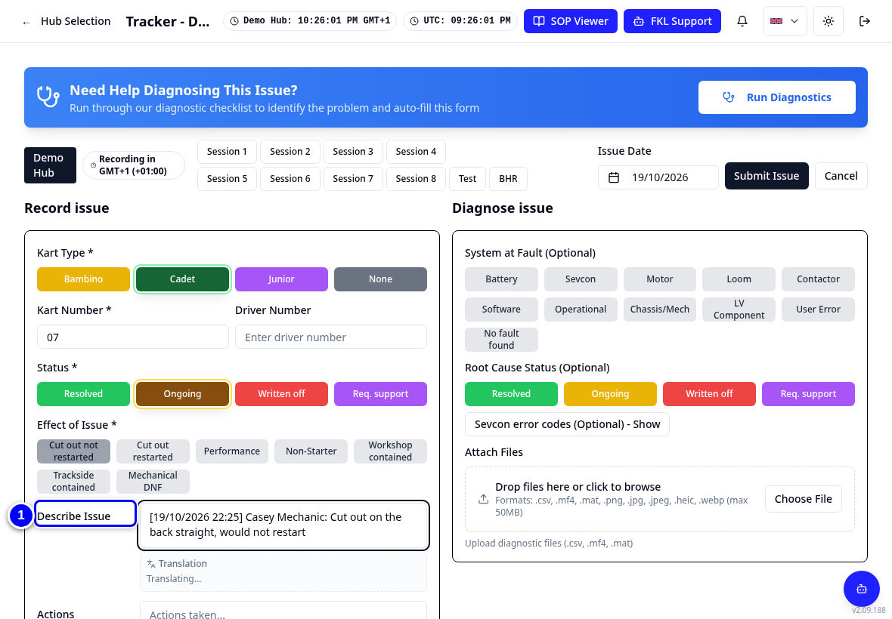{ loading=lazy }

7. Tap **Submit Issue**. KART says **Workshop incident linked to the ticket.**

    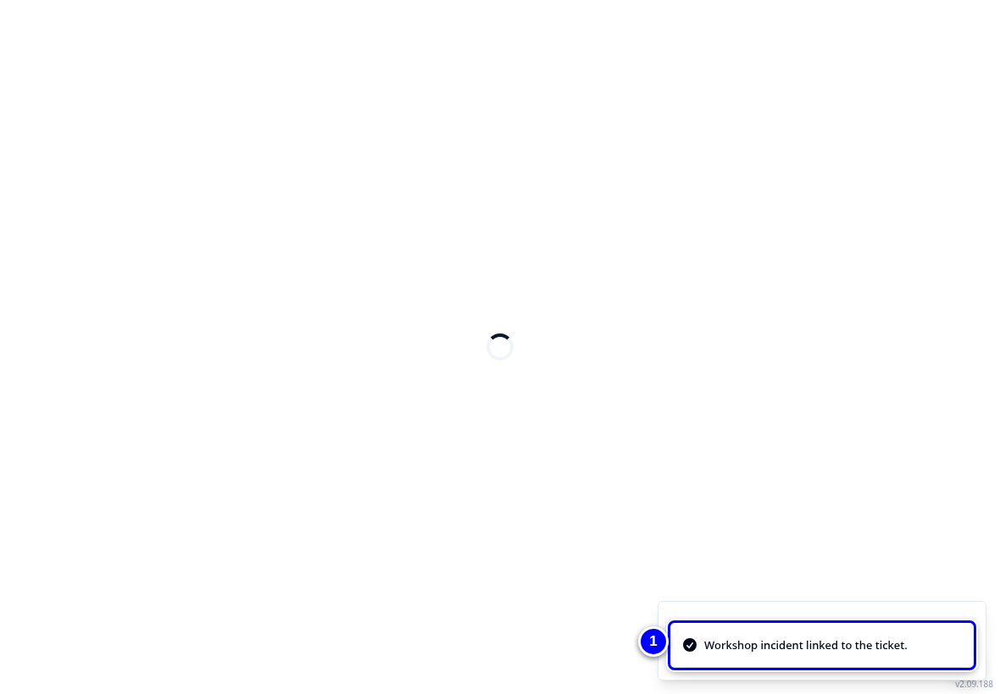{ loading=lazy }

8. Go back to the Workshop tab. The kart shows **Repair Required** and a repair card with **Open ticket** is in the **Service Queue**.

    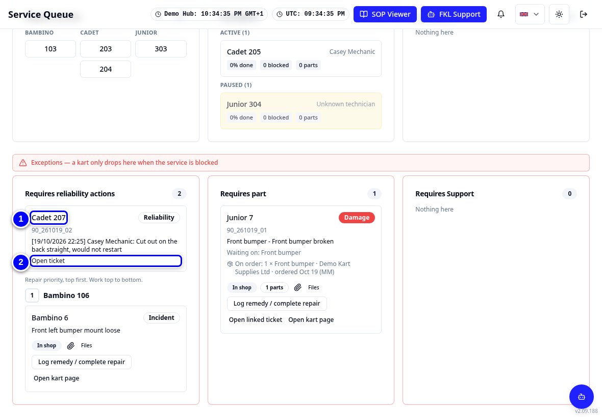{ loading=lazy }

!!! tip "Tip"
    You can also open **Technical** from **Select your Hub** and tap **New Reliability Issue**. For damage, use **Record New Damage**.

!!! warning "Watch out"
    **Performance** tickets do not stop the kart. Choose the effect that matches what happened, not the one that gives the board you want.

## Close a ticket when the fault is fixed

1. In the **Service Queue**, tap the kart's reliability card (it says **Open ticket**). On a card that came from an incident or damage, tap **Open linked ticket** instead.

    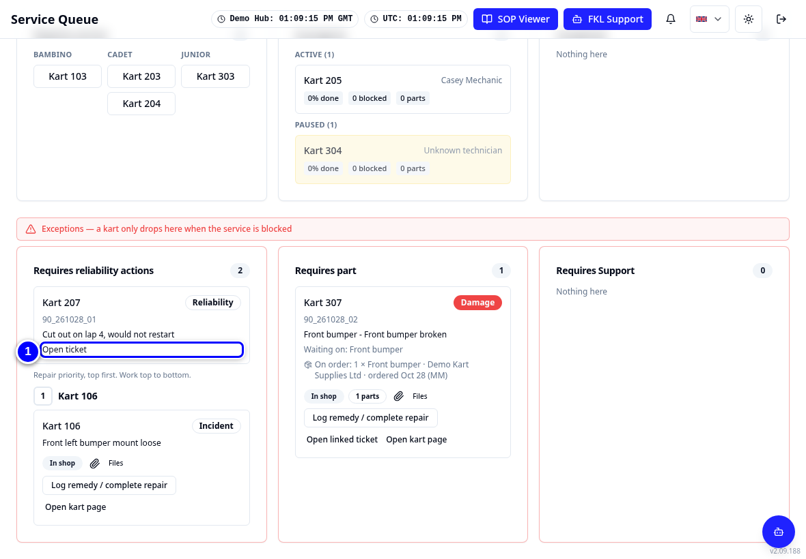{ loading=lazy }

2. Change **Status** to **Resolved**.

    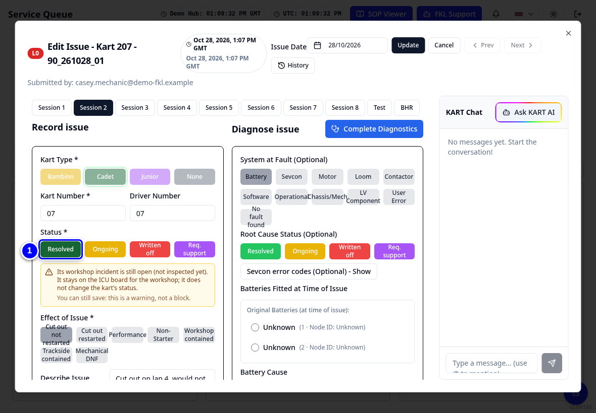{ loading=lazy }

3. Tap **Update** at the top of the ticket. When the ticket is resolved, the kart leaves Repair Required. If it has no other stopping ticket, it shows as available again.

    !!! warning "Watch out"
        If **System at fault** is **Battery**, pick the battery before you tap **Update**. If no battery is picked, the ticket is not saved and KART shows "Missing fields". Check that the kart really changed on the board.

    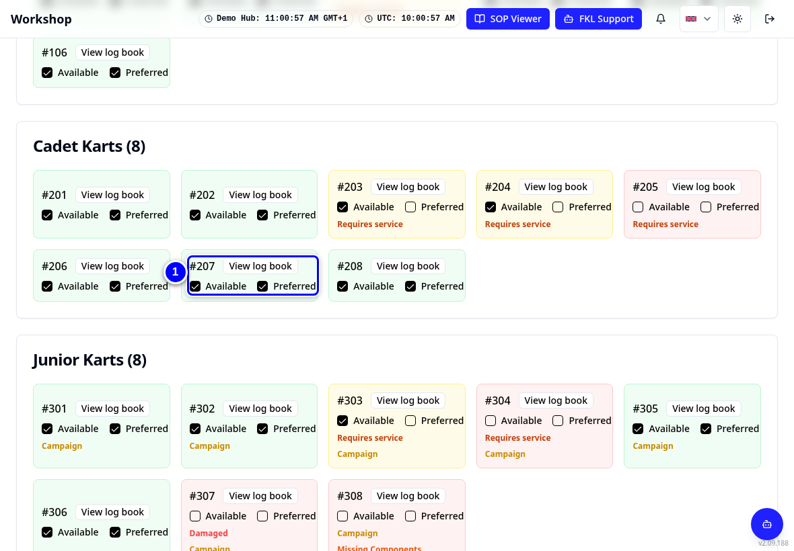{ loading=lazy }

!!! note "Remember"
    On your hub's switch-over day, close any stopping ticket whose fault is already fixed. Karts that were Repair Required in KART stay that way until their ticket or repair is closed, whatever the Workshop App said.
