# Repairs and parts used

Every finding, every damaged component and every stopping ticket becomes a **repair**. Repairs show as cards in the **Service Queue**. You time the work, then log the remedy and the parts you used.

!!! info "What changed from the Workshop App"
    - The Workshop App's **Repair Workflow** is now in the **Service Queue**, in the exception lanes **Requires reliability actions** (ready to repair) and **Requires part** (waiting on parts).
    - The **Waiting on Parts** bucket is the **Requires part** lane. Once the part is ordered, the card says **On order** with the supplier and date.
    - The remedy goes on **Log remedy / complete repair**. The root cause stays on the reliability ticket.

## Find a repair

1. Open the **Service Queue** and scroll to the exception lanes: the three lanes under the red **Exceptions** bar. Every open repair is here, whatever it came from, even though the bar talks about blocked services.

    - **Requires reliability actions**: repairs you can do now (Ready to repair), including repairs from incidents.
    - **Requires part**: repairs waiting for a part.
    - **Requires Support**: repairs that need help from outside the workshop, such as a specialist or a decision. Ask your hub manager about these.

    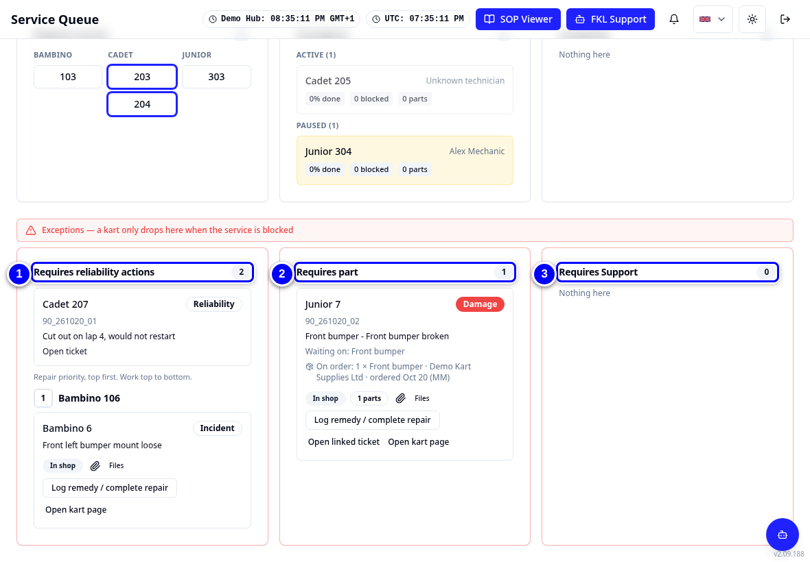{ loading=lazy }

2. Work the **Requires reliability actions** list from the top. Your hub manager sets the order.

    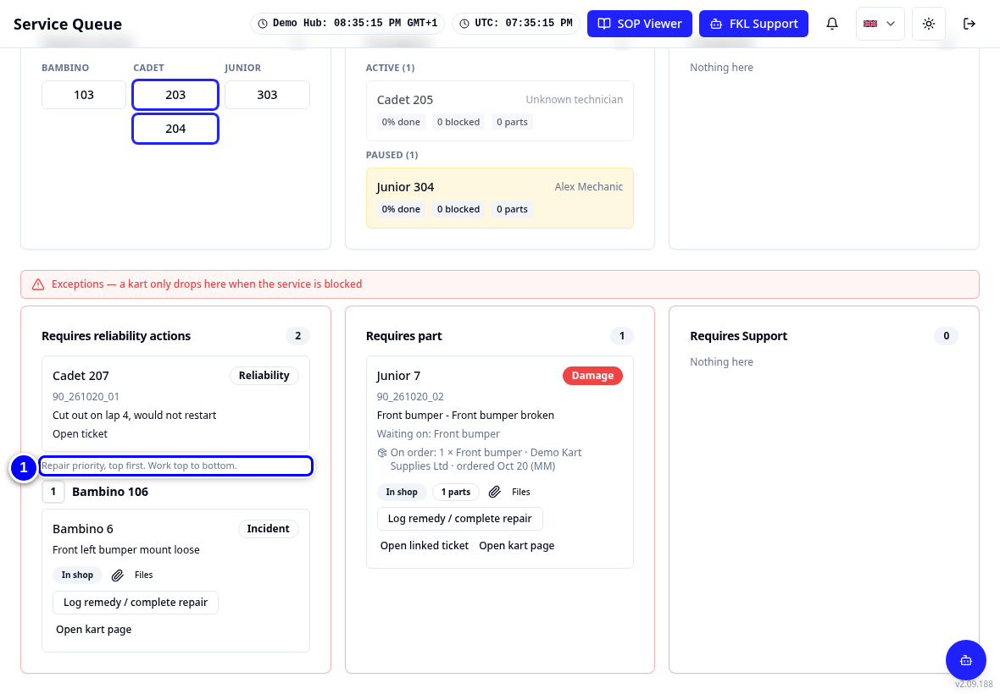{ loading=lazy }

3. Read the card. It shows the kart, where the repair came from (**Damage**, **Incident** or **Reliability**), and **Waiting on:** with the parts if any. Repair cards name the kart by class and its number in the class: **Junior 7** is kart 307. Small tags say where the work happens (**In shop** or **Remote**) and **Files** opens photos.

    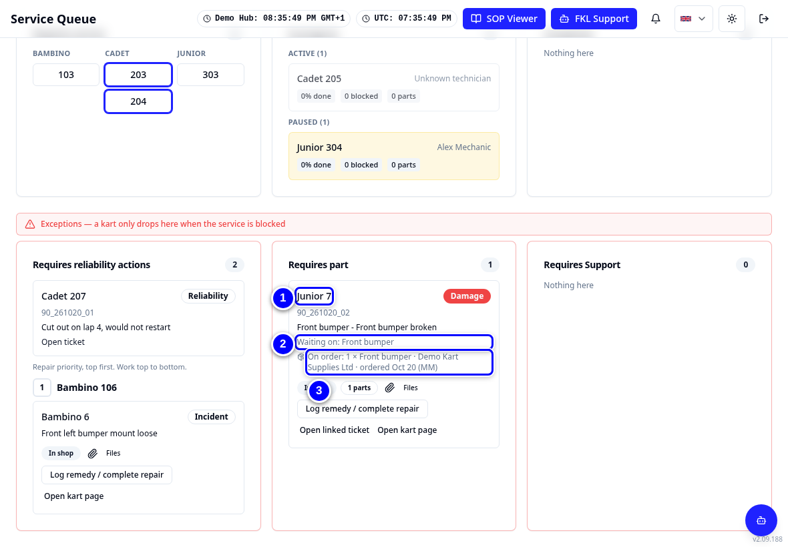{ loading=lazy }

## Time the repair work

<figure class="clip"><video controls preload="none" playsinline poster="../assets/video/mech-repair-clip.jpg" width="1180">
<source src="../assets/video/mech-repair-clip.mp4" type="video/mp4"><source src="../assets/video/mech-repair-clip.webm" type="video/webm">
<track kind="captions" src="../assets/video/mech-repair-clip.vtt" srclang="en" label="English" default></video>
<figcaption>Watch: repairing Bambino 106, logging the remedy and recording the parts used (about 45 seconds, with captions)</figcaption></figure>

1. On the card, tap **Open kart page**.

    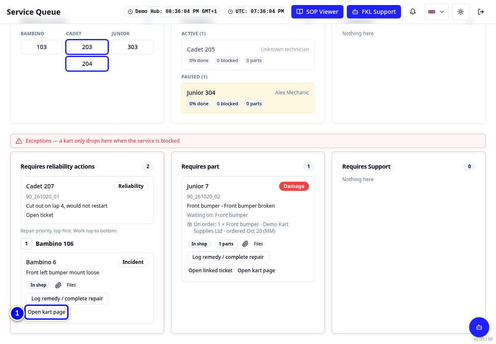{ loading=lazy }

2. Under **Current work**, tap **Start repair** when you begin.

    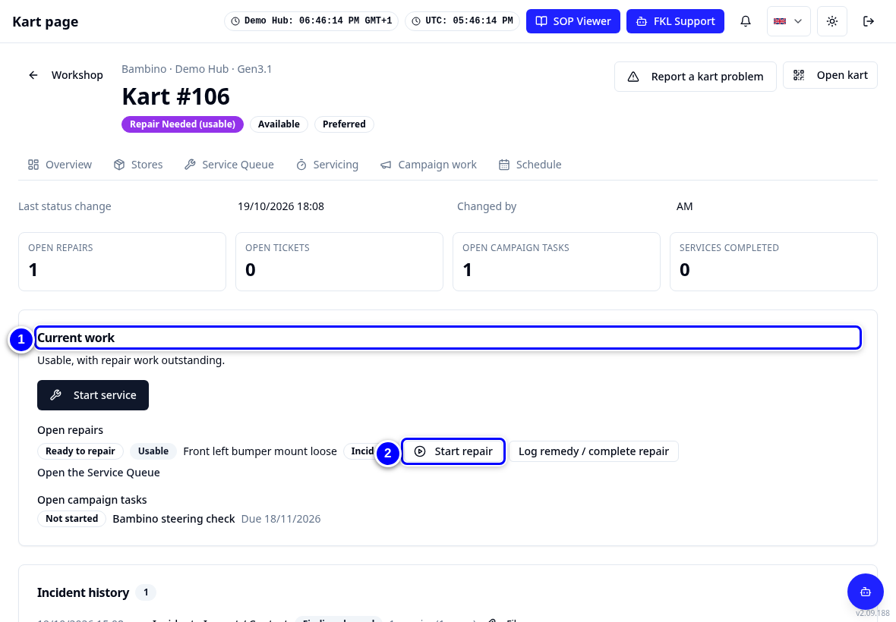{ loading=lazy }

3. Tap **Pause repair** for a break, then **Resume repair**. Tap **Stop repair work** when you finish. On an incident or damage repair, **Log remedy / complete repair** then opens straight away (see the next section). Pausing never opens it.

    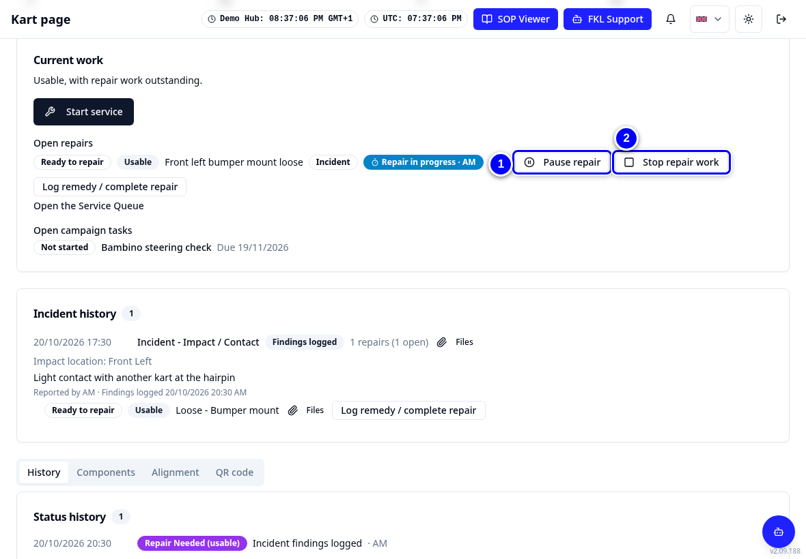{ loading=lazy }

!!! tip "Stopping for now, not finished?"
    Tap **Cancel** or close the remedy dialog. The repair work stays stopped and the repair stays open. Tap **Start repair** (or **Resume repair**) later, or complete it from **Log remedy / complete repair**.

!!! note "Repairs on a reliability ticket"
    A repair on a stopping reliability ticket has no remedy dialog, so nothing opens when you stop its work. It is completed in the **Service Queue** (drag the card to **Completed**) or when the ticket is closed.

!!! note "Remember"
    If the kart is also in service, starting repair work pauses the service. The service then shows the extra repair minutes. See [Pause and resume](pause-and-resume.md).

## Log the remedy and complete the repair

1. The dialog opens on its own when you tap **Stop repair work**. To open it later, tap **Log remedy / complete repair** on the card in the **Service Queue** or next to the repair on the kart page.

    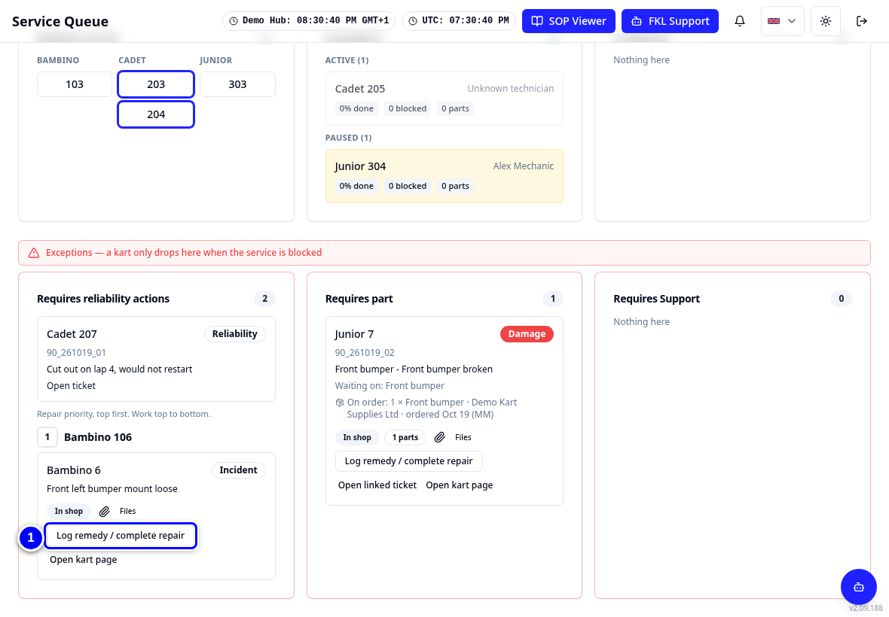{ loading=lazy }

2. Choose the **Remedy**, for example **Tightened / Secured**.

    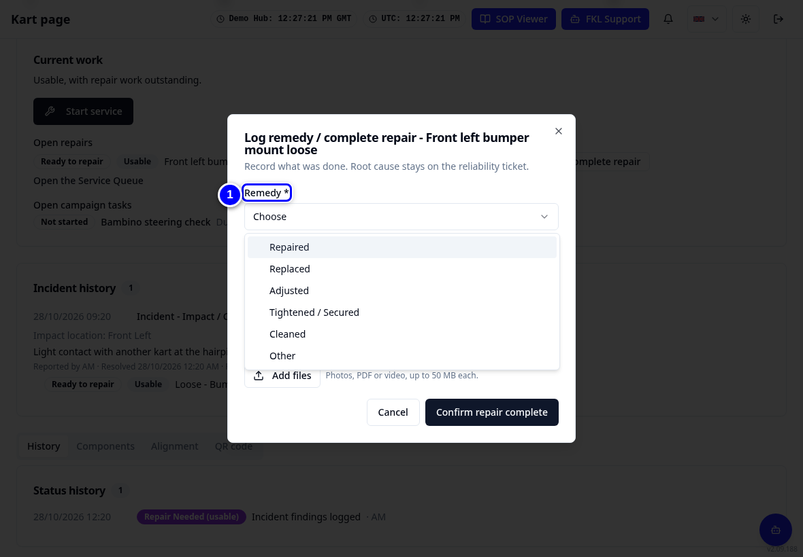{ loading=lazy }

3. If the repair has parts, **Remedy per part** is at the top of the dialog. Choose one answer per part: **Replaced** or **Used part installed** take the part from stock; **Repaired** and **Inspected and reused** do not.

    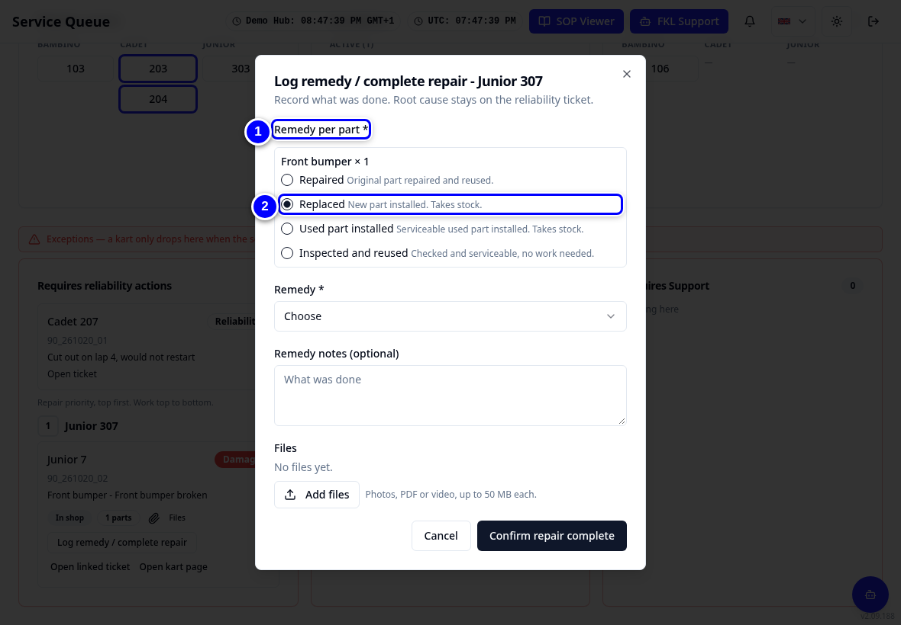{ loading=lazy }

4. Type a short note in **Remedy notes (optional)**, for example what you tightened.

    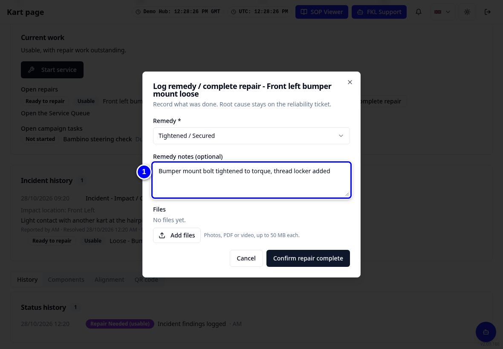{ loading=lazy }

5. If a photo helps, tap **Add files** under **Files**.

    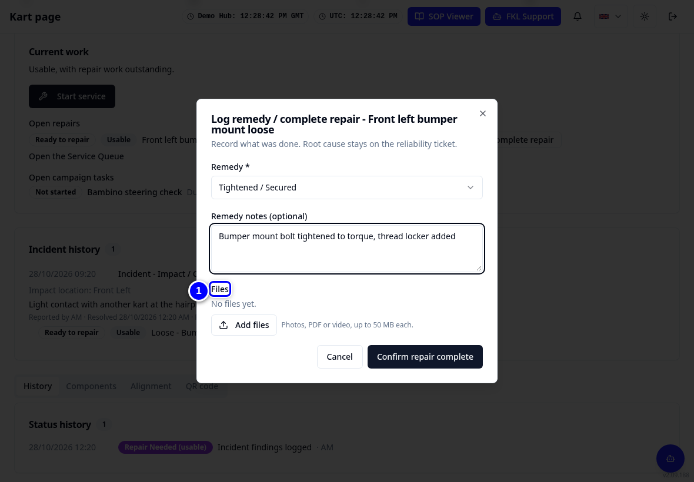{ loading=lazy }

6. Tap **Confirm repair complete**.

    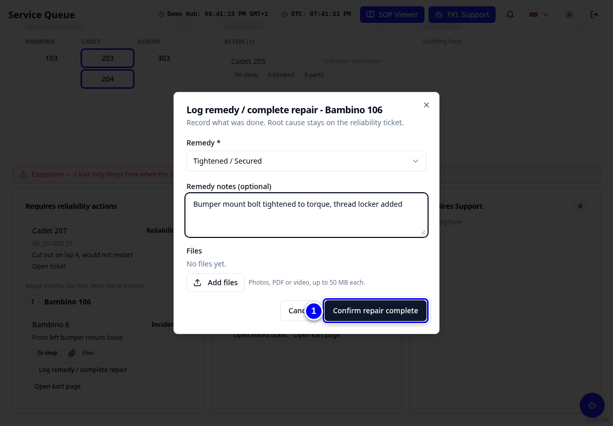{ loading=lazy }

!!! tip "Tip"
    If you inspected the kart and nothing needed repairing, use **Resolved: no fault found** instead of a remedy. The linked reliability ticket then gets System at fault: No fault found.

## Record every part you use

Parts reach a kart in three ways. Record each one in KART:

- **In a service:** **Components replaced** on Servicing (**Select**, then **Add to components replaced**). See [Doing a service](service-turn.md).
- **On a repair:** the parts on the repair, with **Remedy per part** when you complete it.
- **In campaign work:** **Parts fitted** on the campaign task. See [Campaign work](campaign-work.md).

!!! warning "Watch out"
    Why it matters: KART takes each recorded part from your hub's stock. **Parts needed** and the order list are worked out from that stock. If you fit a part without recording it, KART thinks it is still on the shelf, nobody orders a new one, and the next kart waits.

!!! abstract "Coming with your hub's switch-over"
    Your hub's stock moves from the Workshop App a few days after your switch-over. KART then sets each part to the Workshop App count minus what you used in KART since the switch. So record every part you use in KART from day one. Until then, check the shelf before ordering.

!!! abstract "Coming soon"
    Repairs moved from the Workshop App will be listed under their incidents on the kart page, with a **Files** button on completed repairs for their photos.
