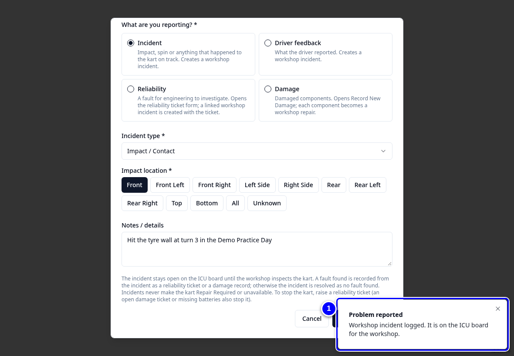
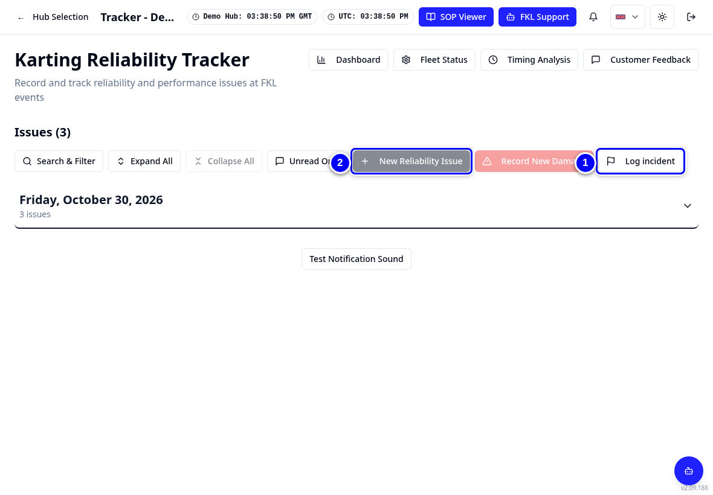
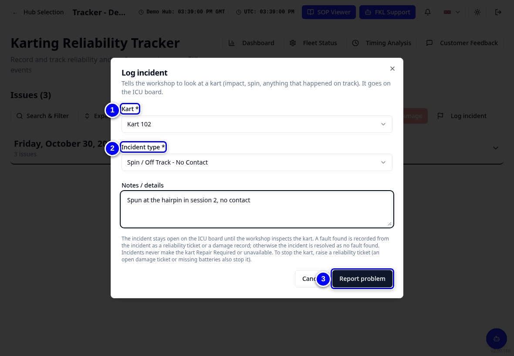
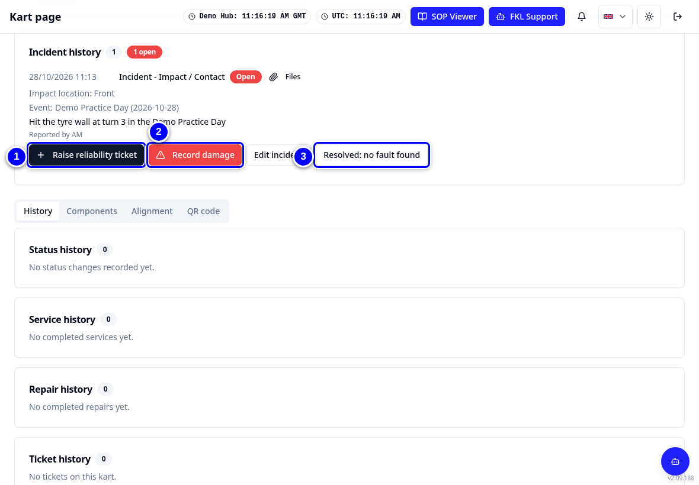
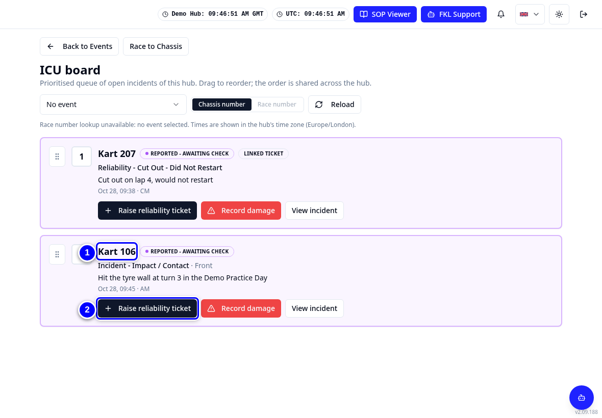
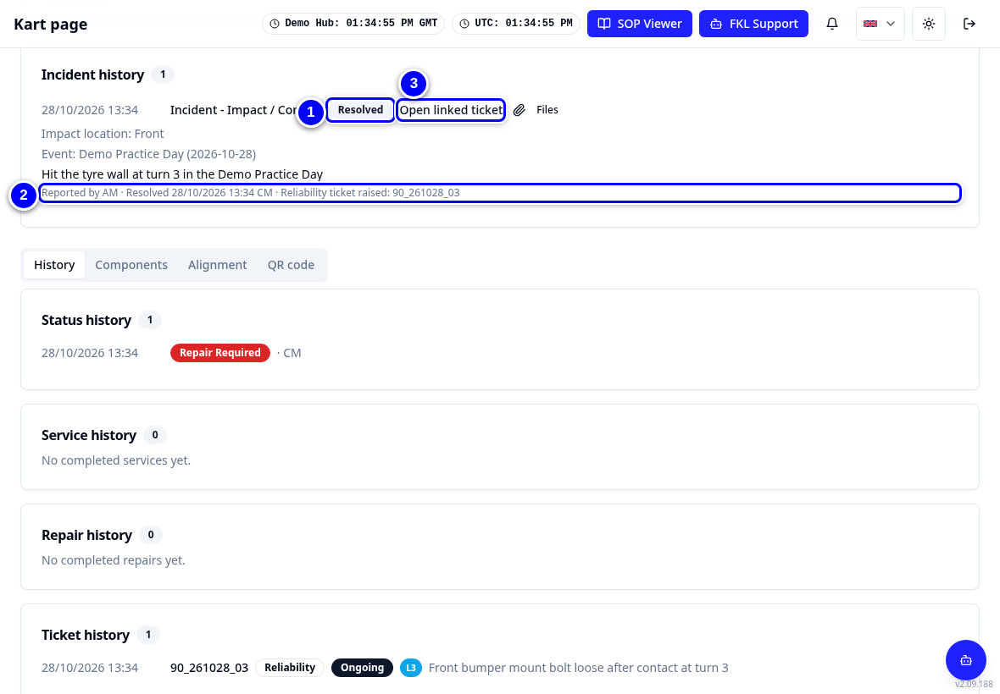

# Report a problem

Use **Report a kart problem** for anything that happened to a kart or anything you found on it. The type you pick decides which records KART creates. This page covers incidents, driver feedback and what to do after you inspect a kart. To stop a kart, see [Reliability tickets](reliability-ticket.md).

!!! info "What changed from the Workshop App"
    - **Create New Kart Report** is now the **Report a kart problem** button on Overview and on the kart page.
    - **Incidents are information only.** They never make a kart Repair Required or unavailable. To take a kart out of use, raise a stopping reliability ticket.
    - An incident tells the workshop to **look at a kart**. What you find is recorded the standard way: a **reliability ticket** (for example a loose bolt, root cause operational or poor quality control) or a **damage record**. There are no "inspection findings" any more.
    - Events staff and contractors log incidents on the **Tracker** with **Log incident**. They do not need the Workshop permission.
    - The **Power / Performance Inspection** is now part of the **Driver feedback** report.

## The four types

| Type | Use it for | What KART creates |
|---|---|---|
| **Incident** | Impact, spin or anything that happened on track | A workshop incident on the ICU board |
| **Driver feedback** | What the driver reported, for example low power or noise | A workshop incident, plus repairs for failed inspection checks |
| **Reliability** | A fault for engineering to investigate | Opens the reliability ticket form. Needs the Reliability permission |
| **Damage** | Damaged components | Opens Record New Damage. Each component becomes a repair. Needs the Reliability permission |

## Report an incident

<figure class="clip"><video controls preload="none" playsinline poster="../assets/video/mech-incident-clip.jpg" width="1180">
<source src="../assets/video/mech-incident-clip.mp4" type="video/mp4"><source src="../assets/video/mech-incident-clip.webm" type="video/webm">
<track kind="captions" src="../assets/video/mech-incident-clip.vtt" srclang="en" label="English" default></video>
<figcaption>Watch: reporting an incident on Bambino 106 and finding it on the ICU board (about 45 seconds, with captions)</figcaption></figure>

1. On **Overview**, tap **Report a kart problem**.

    { loading=lazy }

2. In **Kart**, tap **Choose a kart** and pick the kart, for example **106**.

    { loading=lazy }

3. Under **What are you reporting?** choose **Incident**.

    { loading=lazy }

4. Choose the **Incident type**, for example **Impact / Contact**.

    { loading=lazy }

5. Type what happened in **Notes / details**. (**Describe the incident** only appears when the incident type is **Other**.)

    { loading=lazy }

6. Tap the **Impact location**, for example **Front**.

    { loading=lazy }

7. Tap **Report problem**. KART says **Workshop incident logged. It is on the ICU board for the workshop.** The kart's status does not change.

    { loading=lazy }

!!! note "Remember"
    **The incident stays open on the ICU board until the workshop inspects the kart.** The ICU board is the list of an event's open incidents in priority order (in **Event Operations**, pick the event, then **ICU board**). It was **ICU Workflow** in the Workshop App. When you inspect the kart, follow the incident up as described below.

## Log an incident from the Tracker (events staff and contractors)

On an event you may not have the Workshop permission, for example as a contractor. You can still log an incident for any kart of a hub you have access to.

1. On **Select your Hub**, tap the **Technical** card of your hub. It opens the Karting Reliability Tracker (the **Tracker**).
2. Tap **Log incident**, next to **New Reliability Issue** and **Record New Damage**.

    { loading=lazy }

3. Choose the **Kart**, the **Incident type** (and the **Impact location** for an impact) and type what happened in **Notes / details**.

    { loading=lazy }

4. Tap **Report problem**. You stay on the Tracker. The incident goes on the ICU board for the workshop.

!!! warning "Watch out"
    An incident never takes a kart out of use. If the kart must not be used, raise a reliability ticket (**New Reliability Issue**, needs the Reliability permission) or tell someone with the Reliability permission straight away.

## Follow up an incident after inspecting the kart

Open the kart page (or the **ICU board**). Every open incident shows three actions:

{ loading=lazy }

On the **ICU board** the same incident has **Raise reliability ticket** and **Record damage** on its card.

{ loading=lazy }

| Action | When | What happens |
|---|---|---|
| **Raise reliability ticket** | You found a fault, for example a loose bolt (root cause operational or poor quality control) | The ticket form opens on the Tracker with the kart filled in. When you tap **Submit Issue**, the incident is resolved and linked to the ticket (**Open linked ticket**); no new incident is created. KART says **Incident resolved with this ticket.** |
| **Record damage** | You found damaged components | **Record New Damage** opens with the kart filled in. When you record the damage, the incident is resolved and names the damage ticket. Each component becomes a repair |
| **Resolved: no fault found** | Nothing needs repairing | The incident is closed. The kart's status does not change |

**Raise reliability ticket** and **Record damage** need the Reliability permission, like the Tracker buttons. The ticket may be **Ongoing** or already **Resolved** (fixed trackside). An incident that still has open repairs from before shows **Complete the open repairs first, then raise a reliability ticket or record damage.** instead of the two buttons. After saving, KART takes you back to the kart page, where the incident shows **Resolved** with **Reliability ticket raised: <ticket>** or **Damage recorded: <ticket>**.

{ loading=lazy }

!!! tip "Tip"
    Repairs that were logged as findings before this change stay on the kart page under their incident. Complete them as usual with **Log remedy / complete repair**.

## Report driver feedback and do the Power / Performance inspection

1. Open **Report a kart problem** for the kart, as in steps 1 and 2 above (for example kart **302**). Then choose **Driver feedback**.

    { loading=lazy }

2. Choose the **Driver feedback type**. For low power choose **Power / Performance**.

    { loading=lazy }

3. Type what the driver said in **Notes / details**. (**Describe the driver feedback** only appears for the type **Other**.)

    { loading=lazy }

4. Work through the **Power / Performance inspection**. Answer every check Pass or Fail. A failed check needs a finding, which becomes a repair.

    { loading=lazy }

5. For a failed check, add its finding in the check. Use **Other findings (optional)** for anything else you found on the kart.

    { loading=lazy }

6. Tap **Report problem**.

    { loading=lazy }

!!! tip "Tip"
    If KART says **No Power / Performance inspection checklist is published. The report is saved without an inspection.**, tell your hub manager so FKL Central (the league's central team) can publish it.
