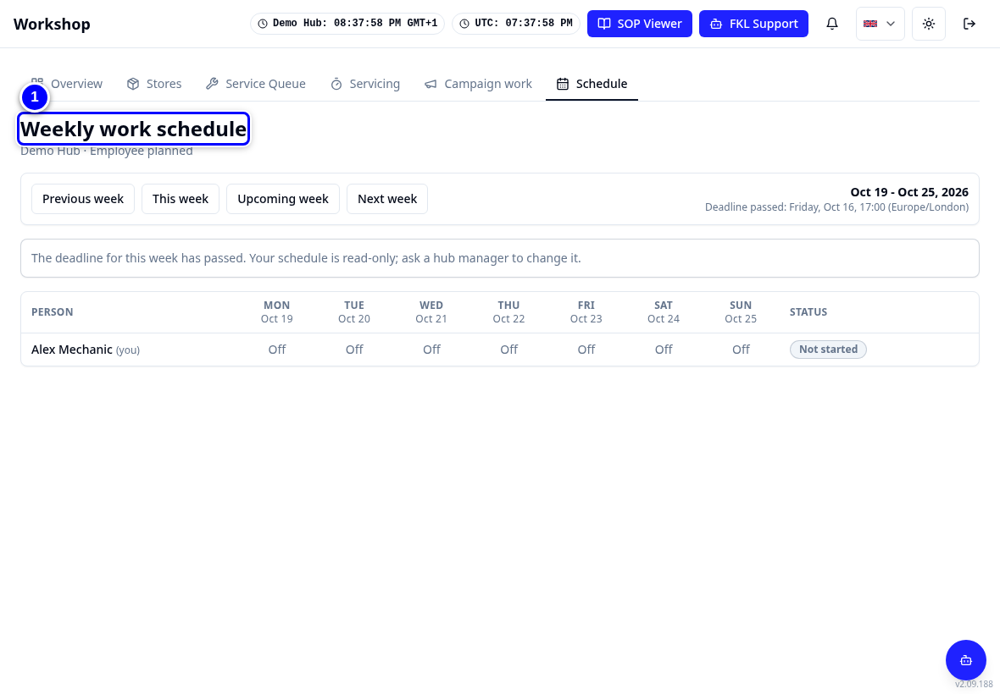
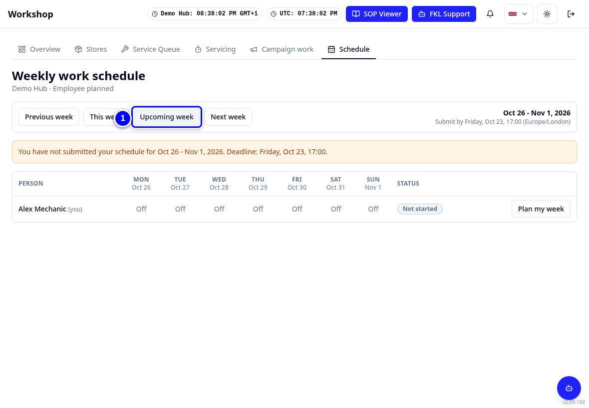
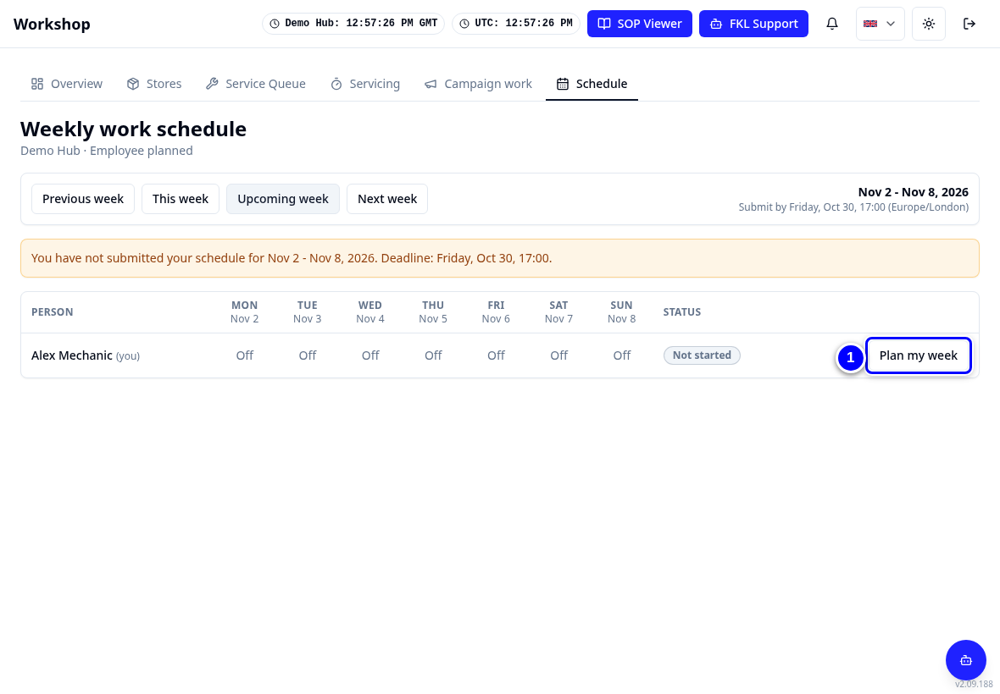
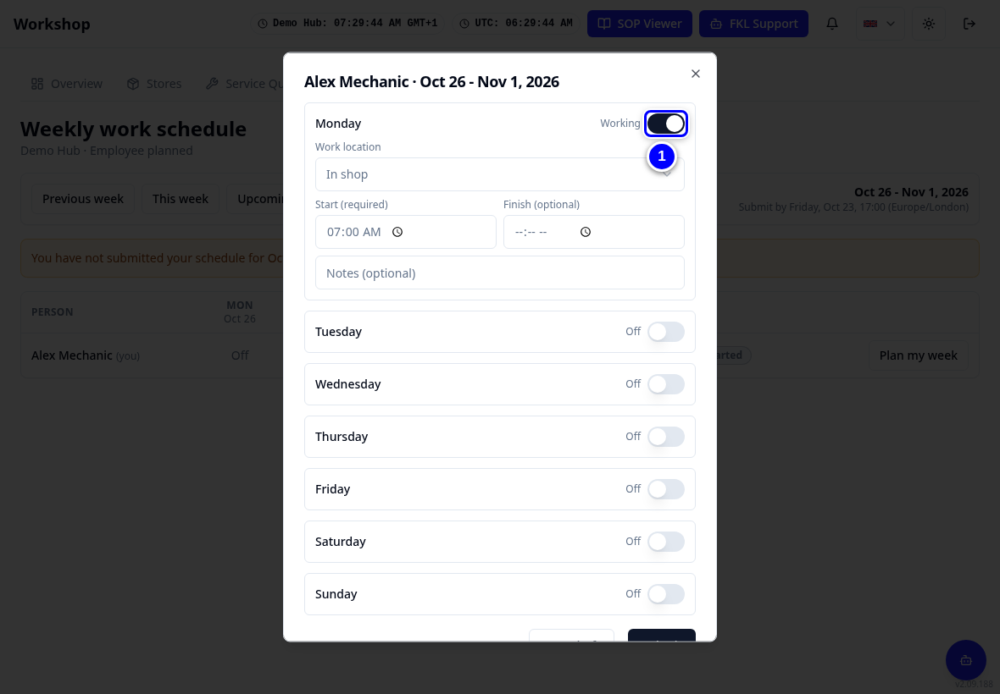
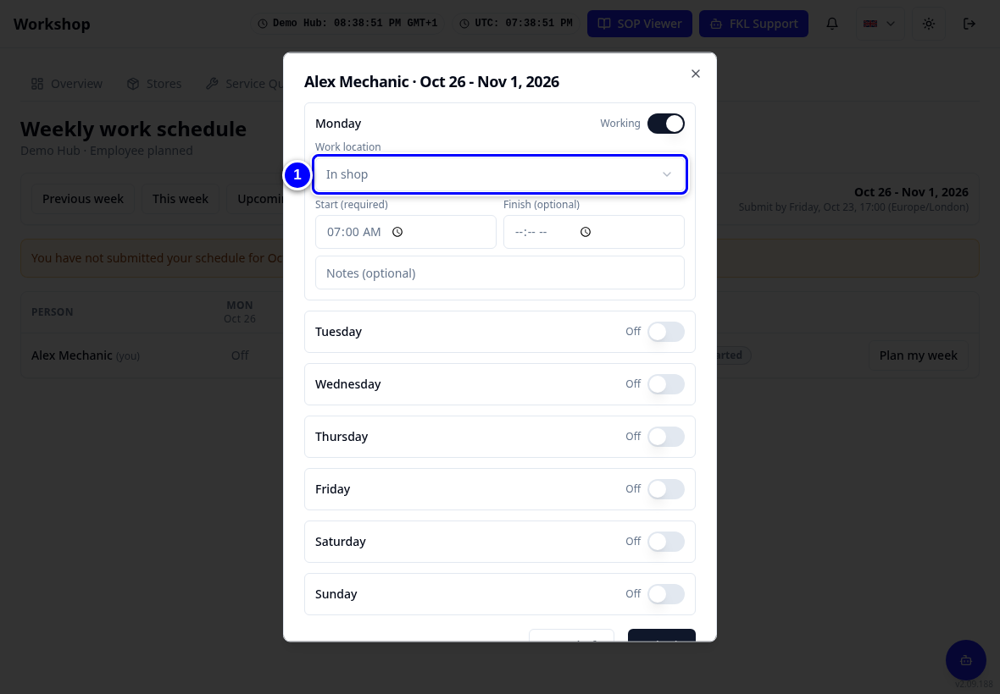
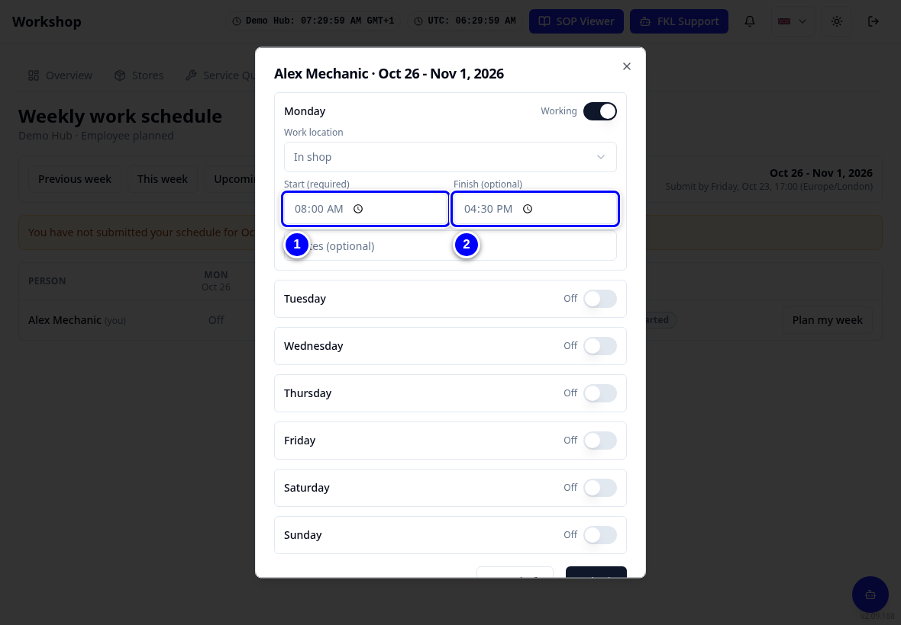
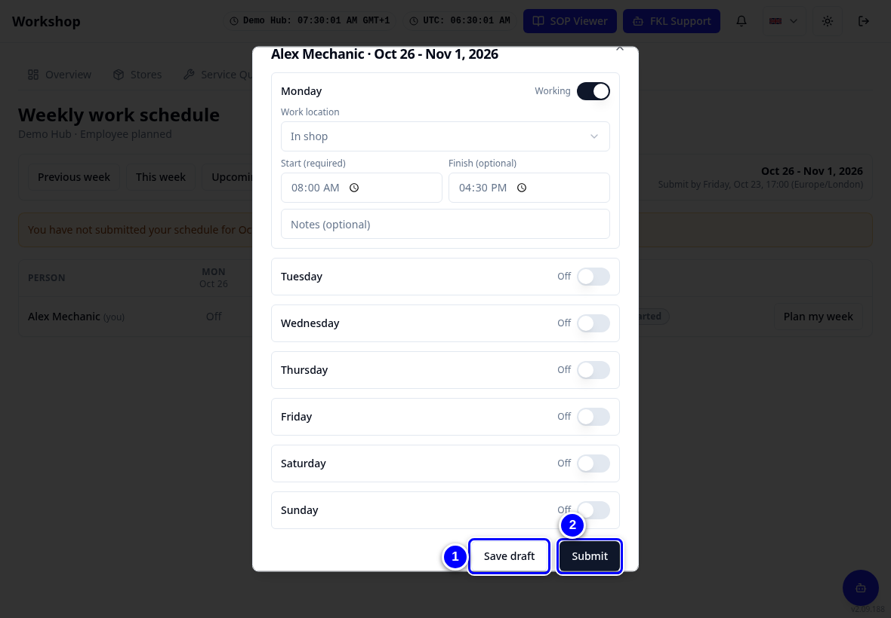

# Your weekly schedule

On **Schedule** you plan the days you work next week, where you work and your start and finish times. Your hub manager sees everybody's plan.

!!! info "What changed from the Workshop App"
    - The Workshop App's **Weekly Work Schedule** is now the **Schedule** tab.
    - It works the same way: plan your week, save a draft, then submit before the deadline.
    - If your hub uses **Manager assigned**, your hub manager fills it in and you only read it.
    - New in KART: your hub manager can set a **default week** for you. A week with nothing planned yet then opens already filled in.

## Plan your week

1. Tap **Schedule** in the tab strip. You see the **Weekly work schedule**.

    { loading=lazy }

2. Tap **Upcoming week** to plan next week.

    { loading=lazy }

3. Tap **Plan my week**.

    { loading=lazy }

    If your hub manager has set a default week for you and nothing is planned for this week yet, the days, places and times are already filled in. A note at the top says **Filled from your default week**. Check them and change anything that is different this week. Nothing is saved until you tap **Save draft** or **Submit**.

4. For each day, tick **Working on** that day if you work it. When you switch a day on, it takes the start and finish times from your default week. If your default week has that day off, or you have no default week, it starts at 07:00.

    { loading=lazy }

5. Choose the **Work location**: In shop or Remote work.

    { loading=lazy }

6. Set **Start** and **Finish** times.

    { loading=lazy }

7. Tap **Save draft** to keep it for later, or **Submit** when it is complete.

    { loading=lazy }

!!! warning "Watch out"
    Submit before your hub's deadline. Your hub manager sets the deadline day and time in the schedule settings.

!!! tip "Tip"
    Your default week is only a starting point. A week you have already saved (draft or submitted) always opens as you saved it. To change your default week, ask your hub manager.

!!! tip "Tip"
    If your plan changes after you submitted, tell your hub manager. They can change it and the plan then shows as modified by the manager.
