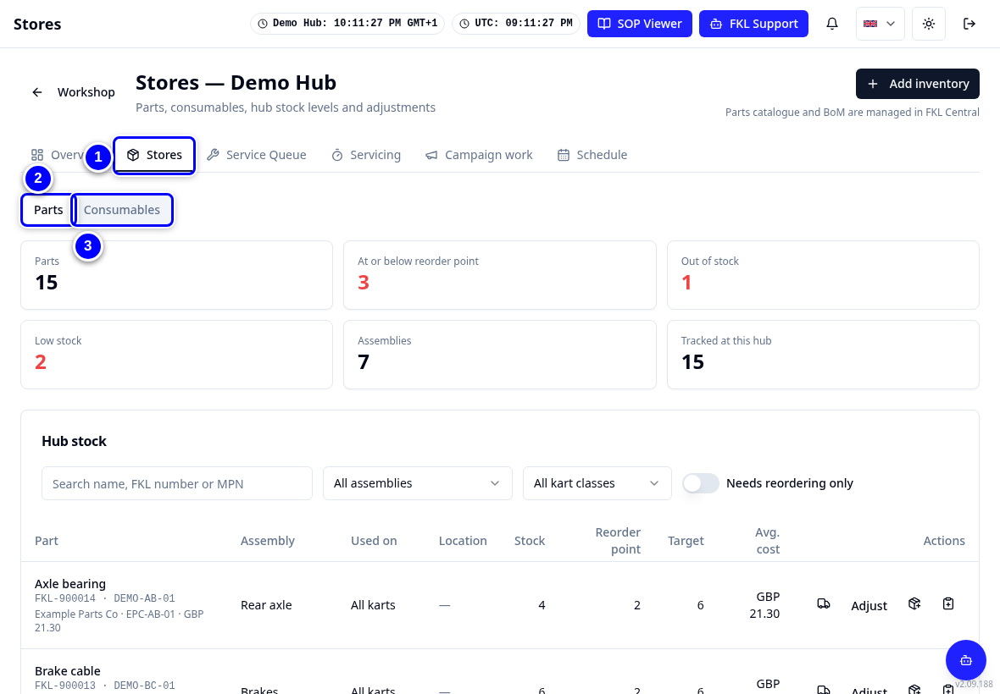
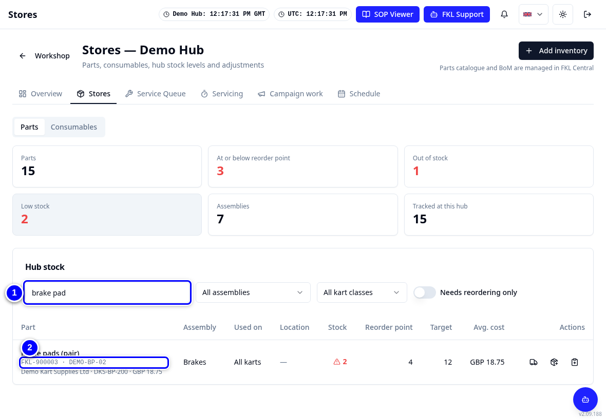
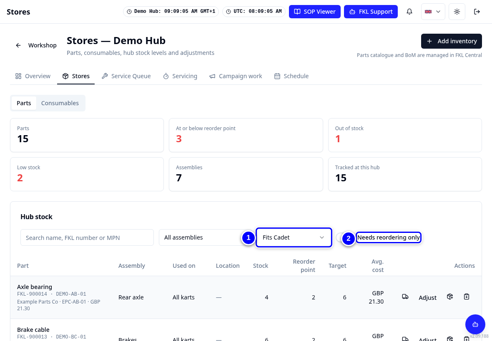
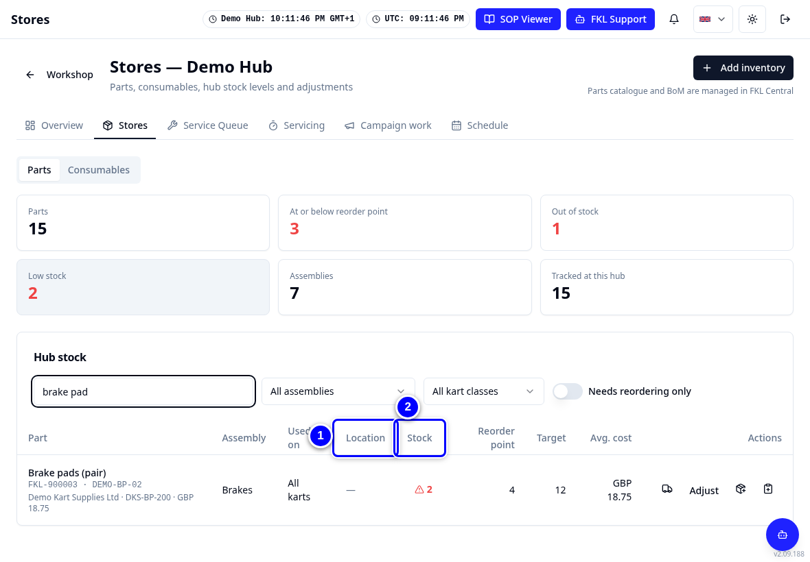
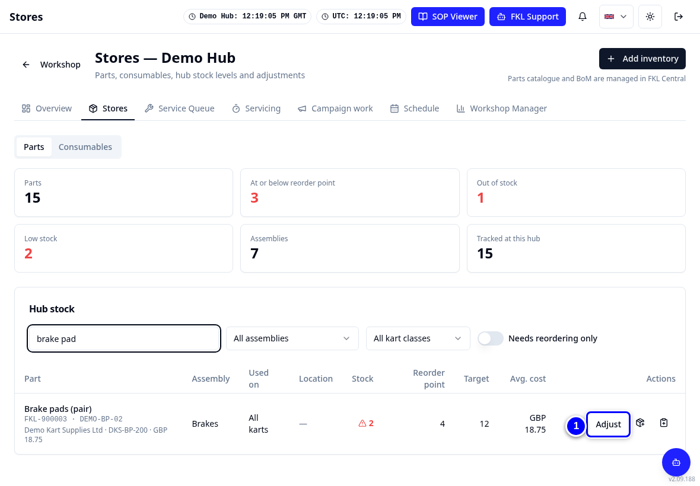
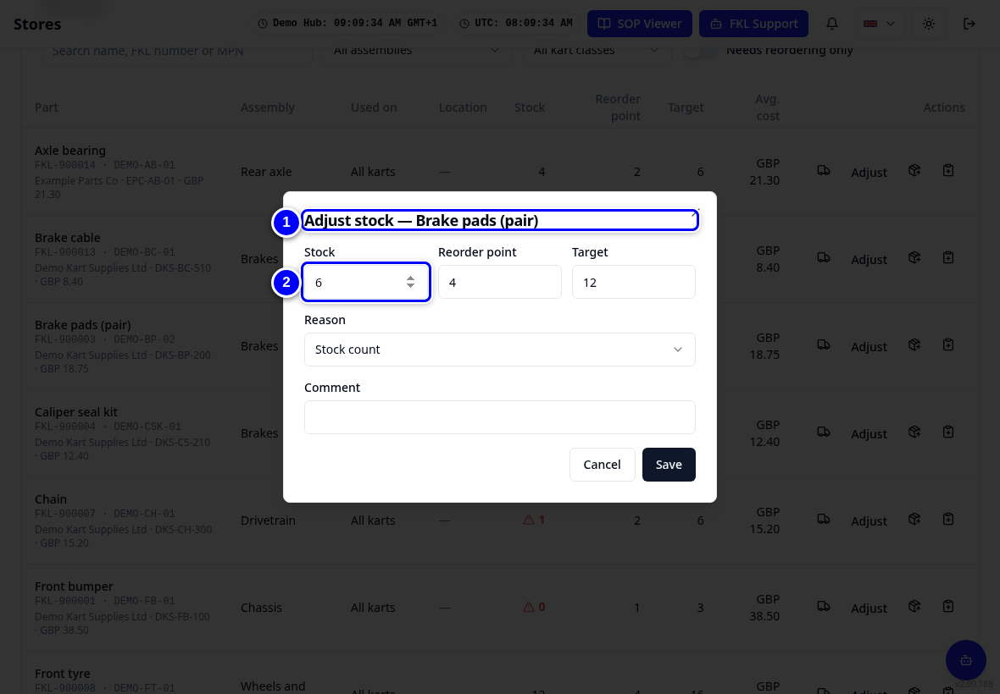
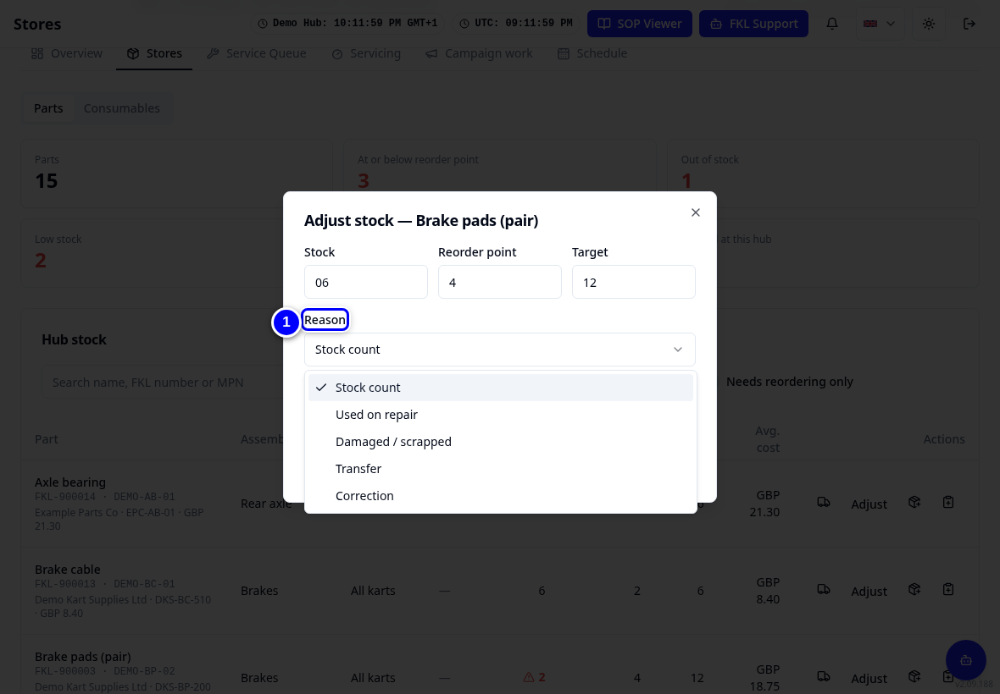
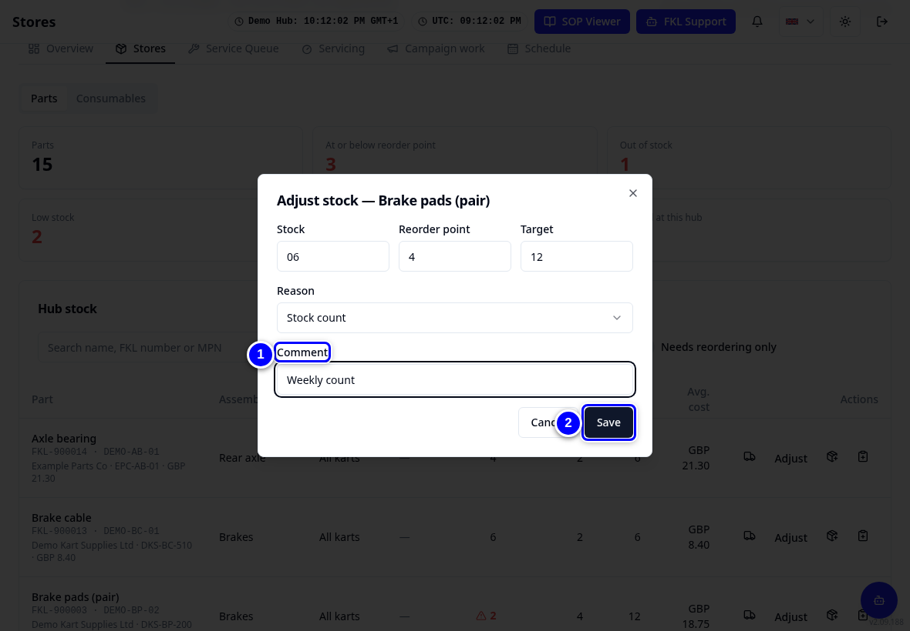
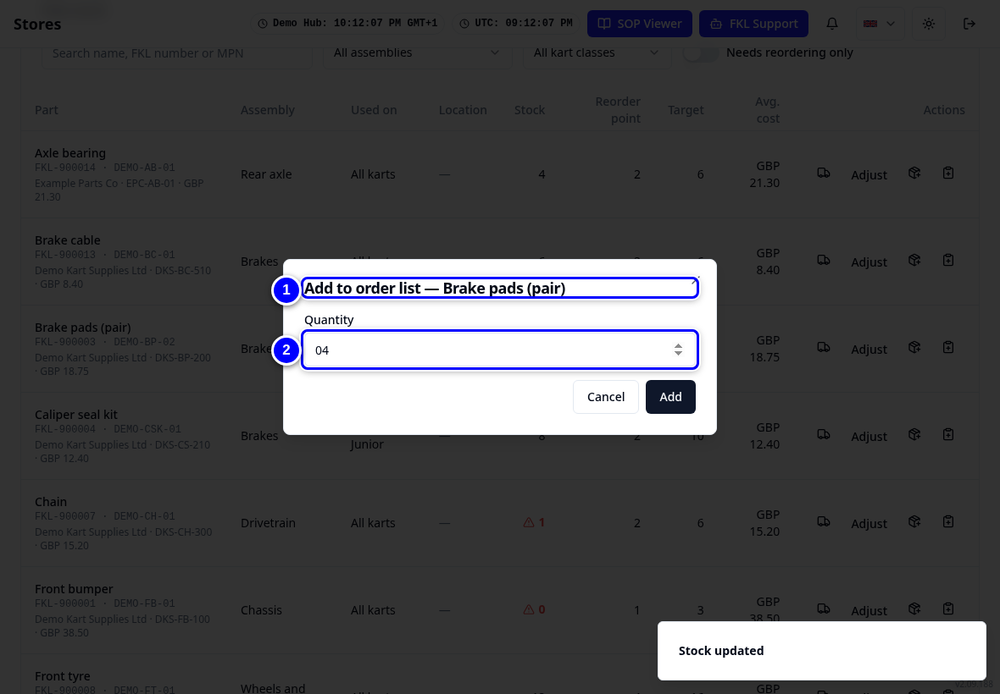
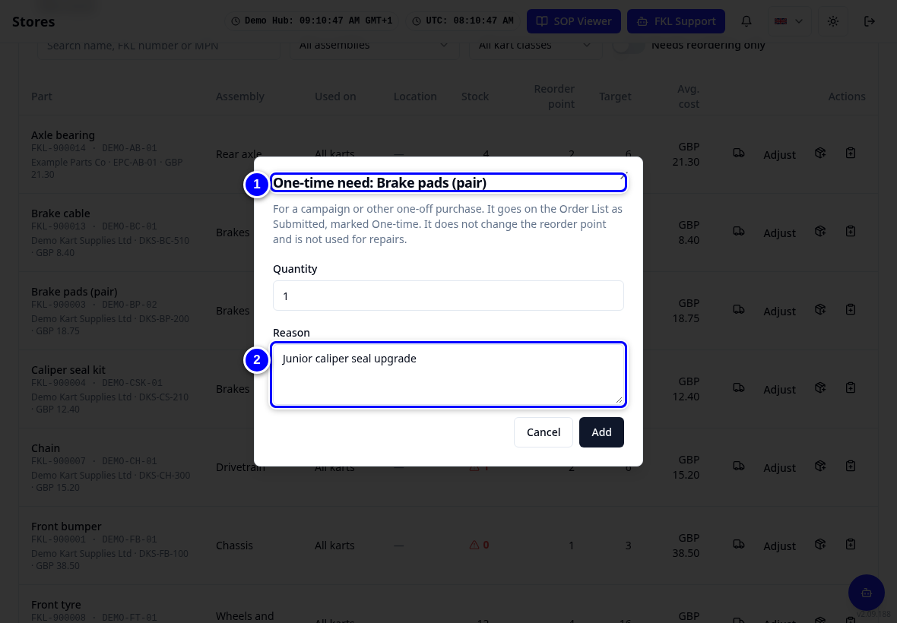

# Stores: finding a part and correcting stock

**Stores** shows the parts and consumables your hub holds, how many are on the shelf and where they are. You can search for a part and ask for a part to be ordered. Hub managers and admins also correct the count after a stock check.

!!! info "What changed from the Workshop App"
    - The Workshop App's **Inventory** is now the **Parts** tab in **Stores**. **Consumables** is the second tab.
    - The parts list comes from the master catalogue kept by FKL Central (the league's central team). Every part has an FKL part number (for example FKL-900001). The note **Parts catalogue and BoM are managed in FKL Central** on the Stores page means the same: FKL Central keeps the parts list and the BoM (bill of materials: which parts make up each kart).
    - Every stock correction asks for a **Reason**.
    - Only hub managers and admins can adjust stock, as in the Workshop App. Mechanics do not see **Adjust**.

## Find a part

1. Tap **Stores** in the tab strip.

    { loading=lazy }

2. Type a name, FKL number or MPN (the manufacturer's own part number) in **Search name, FKL number or MPN**, for example "brake pad".

    { loading=lazy }

3. Narrow the list with **All kart classes** (for example Cadet) or tick **Needs reordering only**.

    { loading=lazy }

4. Read the row: **Location** (where it is kept), **Stock** (how many are on the shelf), **Reorder point** (when stock falls to this number, it is time to order) and **Target** (how many the hub wants to hold).

    { loading=lazy }

!!! warning "Watch out"
    If a part is not in Stores, it may be hidden at your hub or not in the catalogue yet. Ask your hub manager. They can show it again or request it from FKL Central.

## Correct the stock after a count (hub managers and admins)

Only hub managers of your hub and admins see **Adjust**. If you are a mechanic and the count on the shelf is different, tell your hub manager the part and the real count.

1. On the part's row, tap **Adjust**.

    { loading=lazy }

2. In **Adjust stock**, type the real count in **Stock**.

    { loading=lazy }

3. Choose the **Reason**, for example **Stock count**.

    { loading=lazy }

4. Add a **Comment** if it helps, then tap **Save**.

    { loading=lazy }

!!! tip "Tip"
    Do not use **Adjust** for parts you fitted to a kart. Record those in the service, repair or campaign task. That way KART knows which kart they went on. See [Repairs and parts used](repairs-and-parts.md).

## Ask for a part to be ordered

1. On the part's row, under **Actions**, tap the box icon with a plus (**Add to order list**). Check the **Quantity** and tap **Add**. It goes on the Order List (the hub's list of parts to order) as **Submitted** for your hub manager to approve.

    { loading=lazy }

2. For a one-off need (for example a campaign), tap the clipboard icon with a plus (**One-time need**) instead, and give a **Reason**.

    { loading=lazy }

!!! abstract "Coming with your hub's switch-over"
    Until your hub's stock is moved from the Workshop App, the counts in Stores may be wrong. Check the shelf before ordering. Open orders from the Workshop App are re-entered in KART so they can be received there.

!!! abstract "Coming soon"
    A small change to how supplier details are shown: the **Hub price** label in Stores will be renamed **Hub description**. Nothing changes in how you work.
