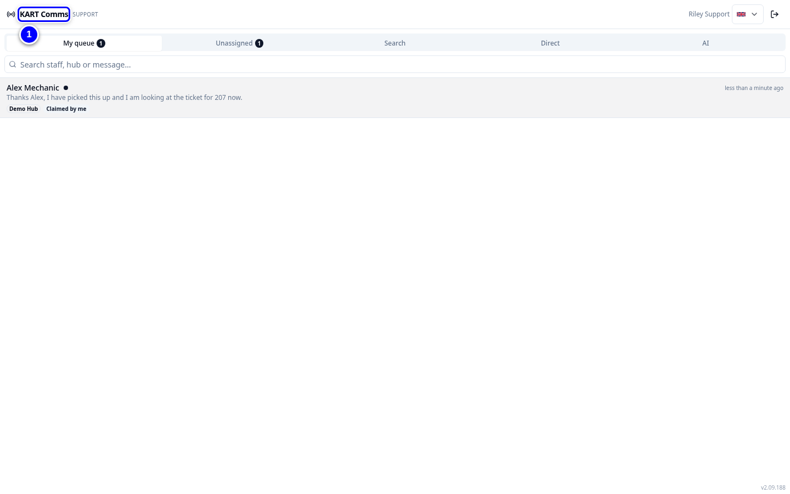
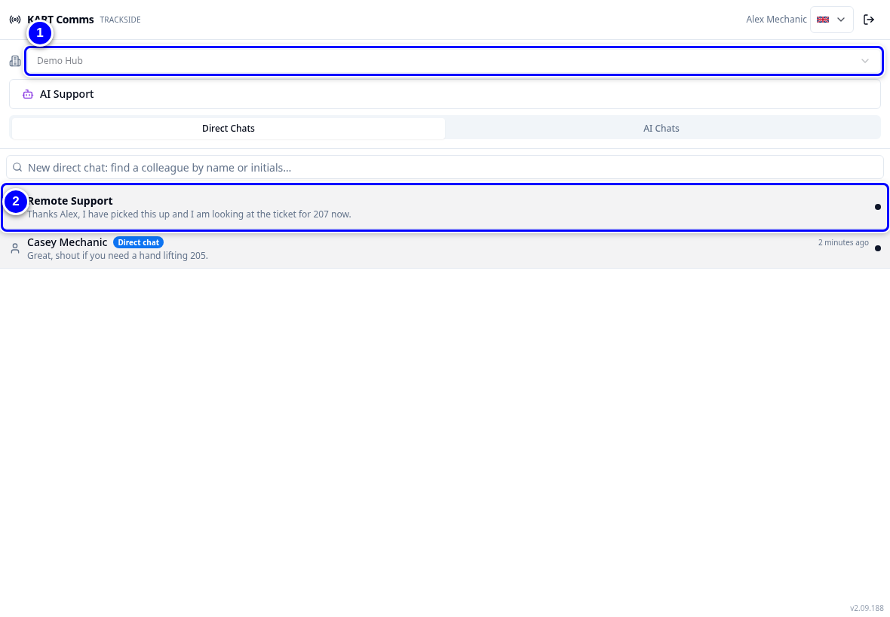
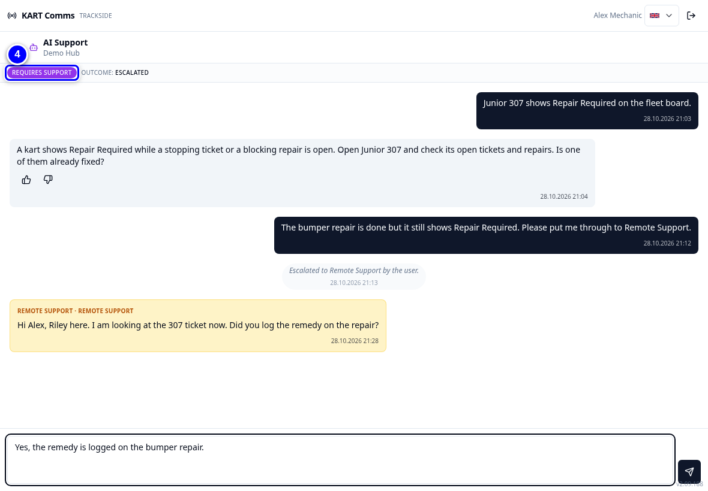
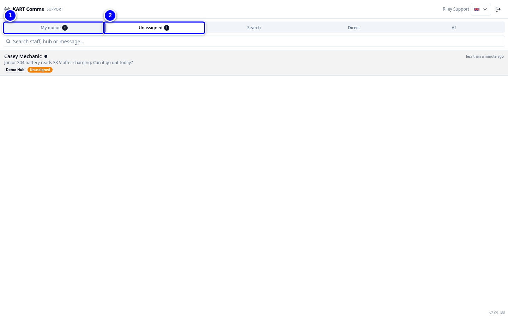
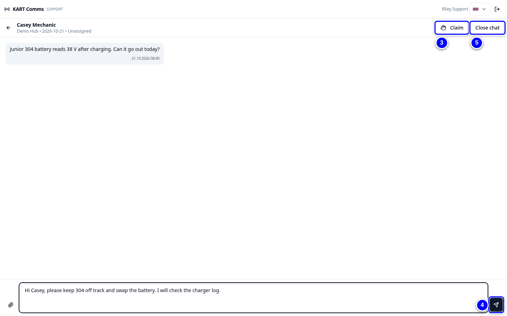
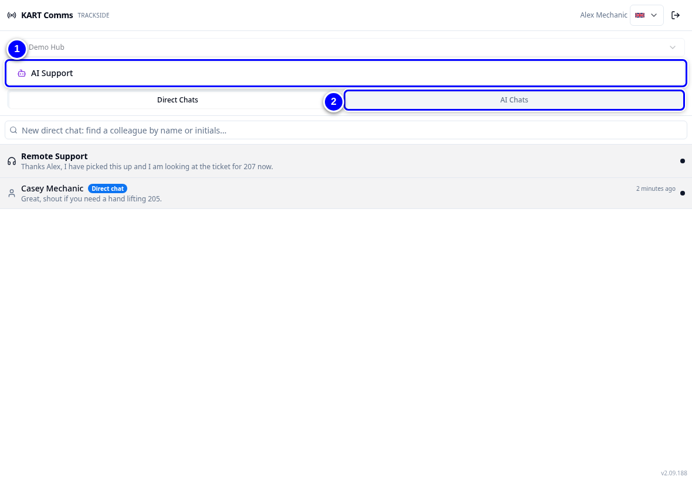

# KART Comms

**KART Comms** is KART's messenger. Hub staff see the **Trackside** view: they message remote support and colleagues. Remote support and admins see the **Support** view: a queue of chats to claim, answer and close.

!!! info "What changed from the Workshop App"
    - Help with KART goes through KART Comms support, not the Workshop App.
    - KART Comms has no menu link. Open it at the address ending in `/comms`, or use the KART Comms desktop app.
    - Mentions with **@** and two letters list colleagues by name and initials, never e-mail addresses.

## Open KART Comms

1. Open the KART address ending in **/comms**, for example by adding `/comms` after the address in the browser bar. Bookmark it.

    { loading=lazy }

## Trackside view: asking for help (hub staff)

1. As hub staff you see **Remote Support** with the person **On cover** today.

    { loading=lazy }

2. If KART asks, **Choose the hub you are working at**.

    { loading=lazy }

3. Type your message and tap **Send**. **It is routed to whoever is covering your hub today.**

    { loading=lazy }

!!! note "Remember"
    If nobody is on cover the header says **Unassigned** and every remote support person is alerted.

## Support view: answering chats

<figure class="clip"><video controls preload="none" playsinline poster="../assets/video/rs-comms-clip.jpg" width="1440">
<source src="../assets/video/rs-comms-clip.mp4" type="video/mp4"><source src="../assets/video/rs-comms-clip.webm" type="video/webm">
<track kind="captions" src="../assets/video/rs-comms-clip.vtt" srclang="en" label="English" default></video>
<figcaption>Watch: claiming, answering and closing a support chat in KART Comms (about 60 seconds, with captions)</figcaption></figure>

1. Tap **My queue** for chats claimed by you and chats for hubs you cover.

    { loading=lazy }

2. Tap **Unassigned** to see chats nobody has taken.

    { loading=lazy }

3. Open the chat and tap **Claim**. Others see it is **Claimed by** you.

    { loading=lazy }

4. Type your reply and tap **Send**.

    { loading=lazy }

5. When it is solved, tap **Close chat**. The staff member can still read it.

    { loading=lazy }

6. To carry on later, open the closed chat and tap **Reopen chat**.

    { loading=lazy }

!!! tip "Tip"
    Use **Search** to find chats by staff member, hub or message. **My cover** and **Cover** show chats for the hubs you, or others, cover today.

## AI Support

**AI Support** gives automatic answers from the FKL knowledge base. It is not a person. Hub staff can use it when remote support has closed a chat or for quick how-to questions. For anything about a real kart, a status that looks wrong or missing data, message remote support instead.

1. Hub staff tap **AI Support** to start an AI chat. Their AI chats are listed under **AI Chats**.

    { loading=lazy }

!!! warning "Watch out"
    Never paste passwords or personal data into any chat.
