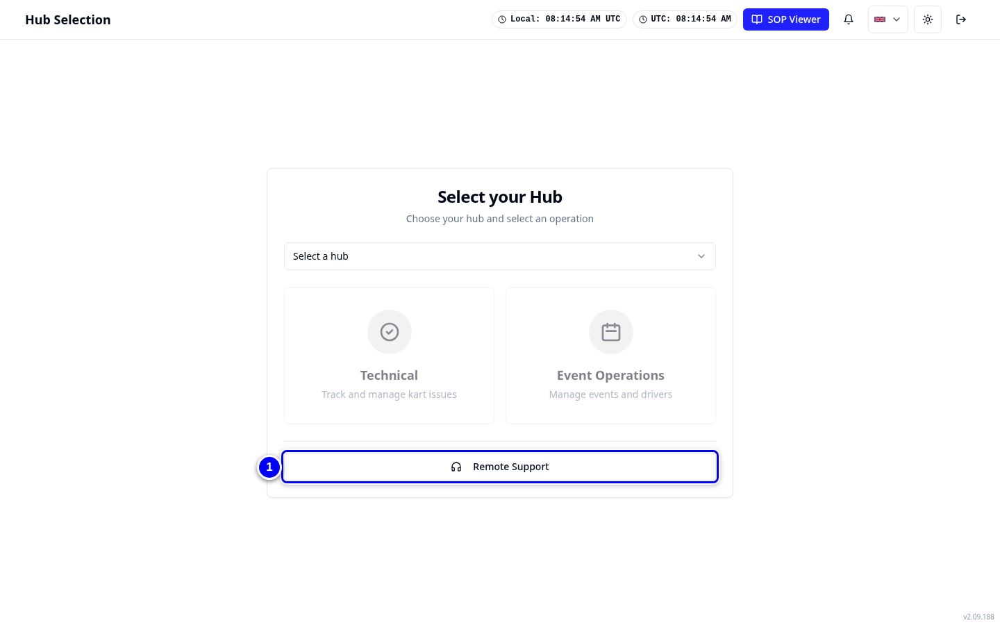
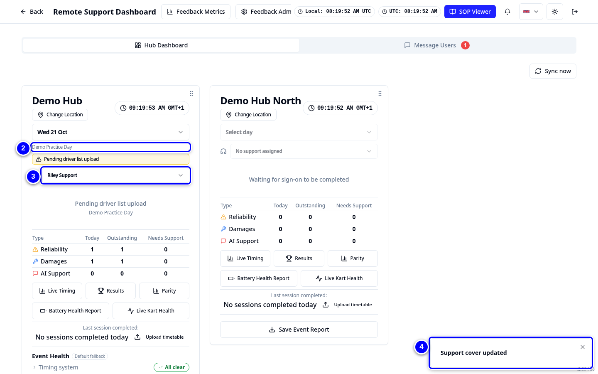

# Support cover

Support cover says who answers a hub's support chats on a given day. You set it per event in **Remote Support**. KART Comms then routes the hub's messages to that person and shows them as **On cover**.

!!! info "What changed from the Workshop App"
    - Cover is set per event on the Remote Support dashboard.
    - Only people with the **Remote support** permission can be chosen. Anyone else is not offered.
    - **On cover** in KART Comms refreshes by itself.

## Set cover for an event

<figure class="clip"><video controls preload="none" playsinline poster="../assets/video/rs-cover-clip.jpg" width="1440">
<source src="../assets/video/rs-cover-clip.mp4" type="video/mp4"><source src="../assets/video/rs-cover-clip.webm" type="video/webm">
<track kind="captions" src="../assets/video/rs-cover-clip.vtt" srclang="en" label="English" default></video>
<figcaption>Watch: setting support cover for Demo Practice Day (about 35 seconds, with captions)</figcaption></figure>

1. On **Select your Hub**, tap **Remote Support**.

    { loading=lazy }

2. On **Hub Dashboard**, find the hub and the event, for example Demo Hub, **Demo Practice Day**.

    { loading=lazy }

3. Open **Support cover** and choose the person, for example Riley Support.

    { loading=lazy }

4. KART says **Support cover updated**. Choose **No support assigned** to clear it.

    { loading=lazy }

!!! warning "Watch out"
    If nobody covers a hub, its chats show as **Unassigned** and every remote support person is alerted. Set cover before the event starts.
