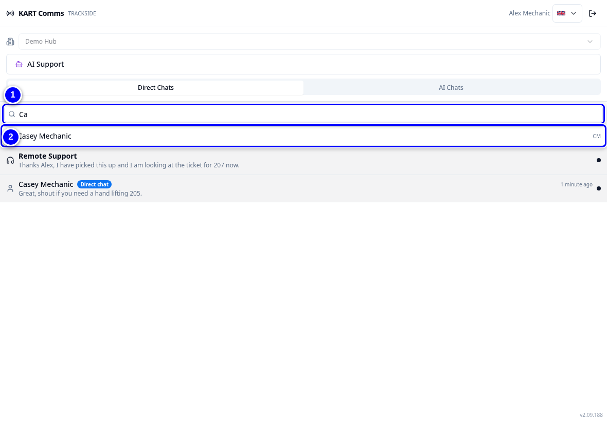
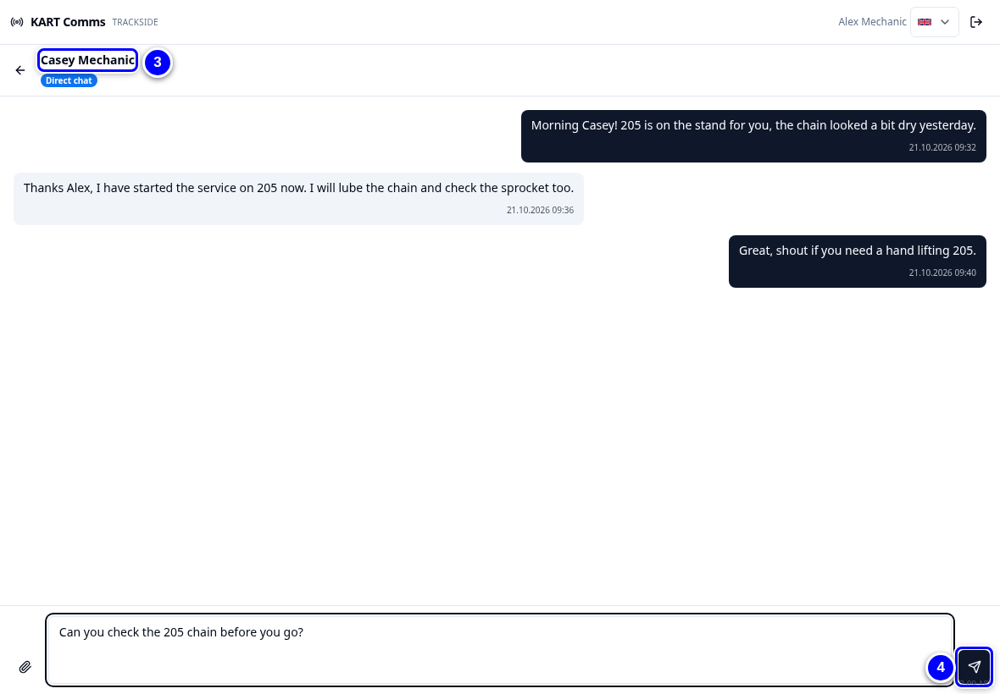
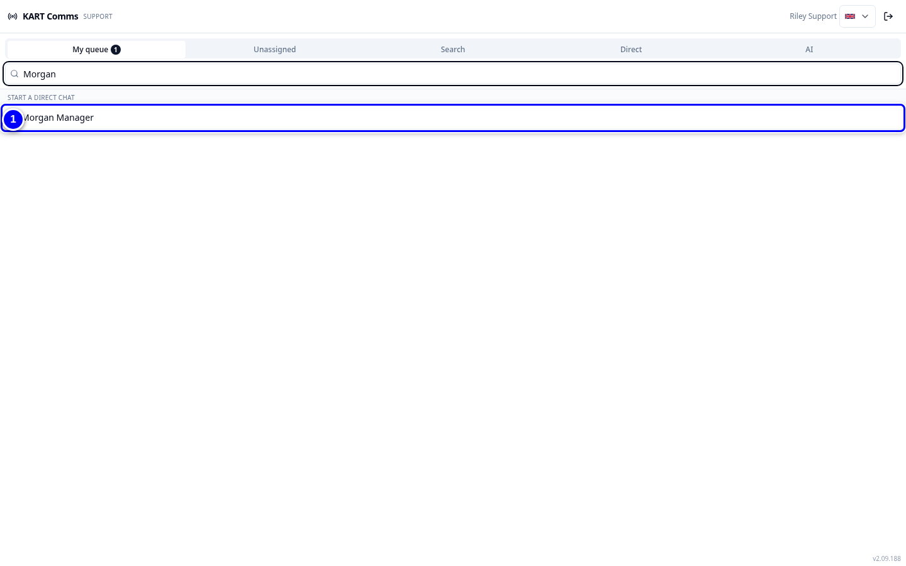

# Direct chats

Any staff member can start a direct chat with any colleague in KART Comms. It is a quick way to ask the other shift a question or share a photo.

!!! info "What changed from the Workshop App"
    - **New direct chats are private to the two people in them.** Remote support and admins do not see them.
    - **Existing chats keep their visibility.** A chat that existed before stays as visible as it was.
    - **Starting a chat with someone you have chatted with before reopens that same chat.**
    - Notifications show names or initials, never e-mail addresses.

## Start a direct chat

<figure class="clip"><video controls preload="none" playsinline poster="../assets/video/rs-direct-clip.jpg" width="1180">
<source src="../assets/video/rs-direct-clip.mp4" type="video/mp4"><source src="../assets/video/rs-direct-clip.webm" type="video/webm">
<track kind="captions" src="../assets/video/rs-direct-clip.vtt" srclang="en" label="English" default></video>
<figcaption>Watch: starting a direct chat with a colleague in KART Comms (about 35 seconds, with captions)</figcaption></figure>

{ loading=lazy }

1. In KART Comms, tap **Direct Chats**. Tap the search box **New direct chat: find a colleague by name or initials**.

2. Type part of the name or the initials, for example "Ca" or "CM".

3. Tap the colleague. If you chatted before, the same chat opens again.

4. Type your message and tap the send button (**Send**). Use the paper clip (**Attach file**) for a photo.

    { loading=lazy }

## For remote support

1. In the Support view, type the person's name in the search box, for example "Morgan". Under **Start a direct chat**, tap the person to message them directly.

    { loading=lazy }

!!! note "Remember"
    You cannot see new private direct chats between two colleagues, even as remote support or admin. That is by design.

!!! tip "Tip"
    In a chat, type **@** and two letters to mention a colleague. KART lists names and initials only.
