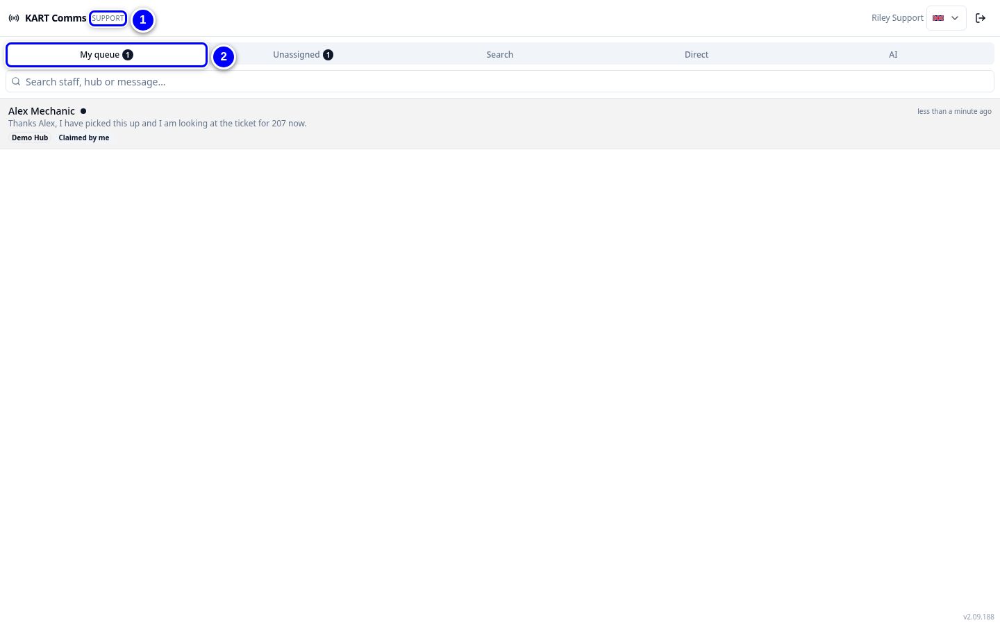

# Remote support: your path

Remote support helps hubs from a distance. In KART you answer hub staff in **KART Comms**, set who covers each event in **Remote Support**, and chat directly with colleagues.

!!! info "What changed from the Workshop App"
    - Workshop staff now ask **AI Support** in **KART Comms** first. The AI escalates to Remote Support (whoever covers their hub today) or FKL Central when a person is needed.
    - Support cover can only be given to people with the **Remote support** permission.
    - New direct chats between two colleagues are private to those two people. Remote support and admins do not see them.

{ loading=lazy }

## In order

1. [KART Comms](comms.md): the Support view, claiming, closing and reopening chats.
2. [Support cover](cover.md): who covers each event.
3. [Direct chats](direct-chats.md): private chats between colleagues.

!!! tip "Tip"
    Print the [remote support quick reference card](../cards/index.md).

!!! note "Remember"
    When a hub reports that the fleet board or a kart status looks wrong after its switch-over, ask for the kart number and pass it to the KART team. Do not ask the hub to change statuses by hand.
