# Finding your way

KART has no side menu. You move around with the hub selection cards, the **Back** button at the top of each page and the Workshop tab strip. This page shows all three.

!!! info "What changed from the Workshop App"
    - The Workshop App had one menu with Workshop, On Event, Parts & Consumables, Management and Calendar. In KART you start on **Select your Hub** and open an area with a card: **Workshop**, **Technical** or **Event Operations**.
    - Each card **opens a new browser tab**. That is normal.
    - Inside the Workshop, the old menu items are tabs along the top: **Overview**, **Stores**, **Service Queue**, **Servicing**, **Campaign work**, **Schedule** and, for hub managers, **Workshop Manager**.

## Choose your hub and an area

1. After signing in you see **Select your Hub**. Tap the hub list.

    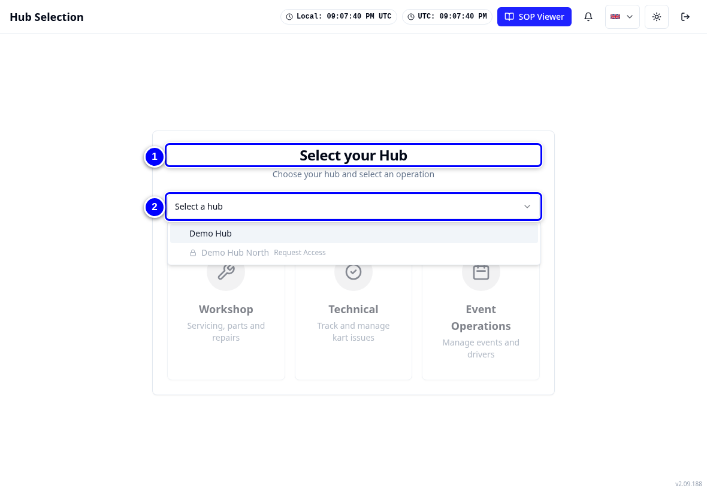{ loading=lazy }

2. Tap **Demo Hub** (your own hub). The area cards appear.

    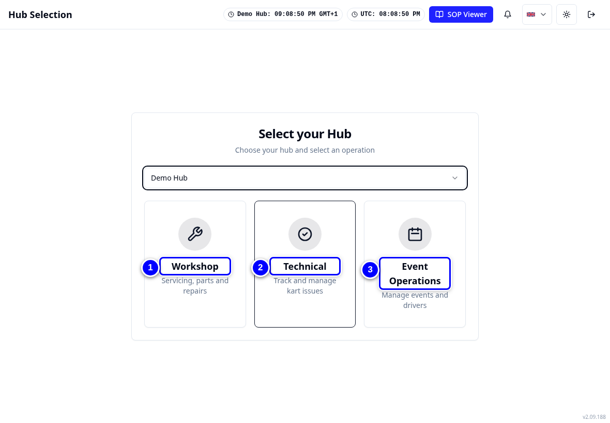{ loading=lazy }

3. Tap **Workshop**. KART opens it in a **new browser tab**, on the **Overview** tab.

    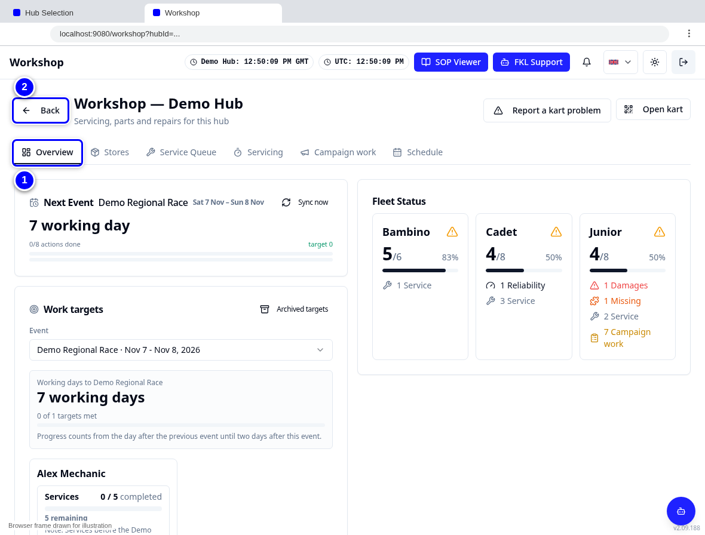{ loading=lazy }

!!! tip "Tip"
    Keep the **Select your Hub** tab open. When you want another area, switch back to it and tap the next card. Close tabs you no longer need so the tablet stays quick.

!!! note "Remember"
    Hub managers, FKL Central, admins and remote support see extra buttons under the cards: **Admin Access**, **FKL Central**, **Remote Support** and **Hub Manager**. You only see the buttons for your own permissions.

    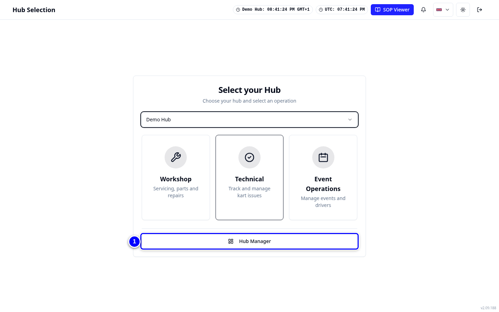{ loading=lazy }

## The Workshop tab strip

1. Look at the row of tabs under the page title. This is how you move around the Workshop.

    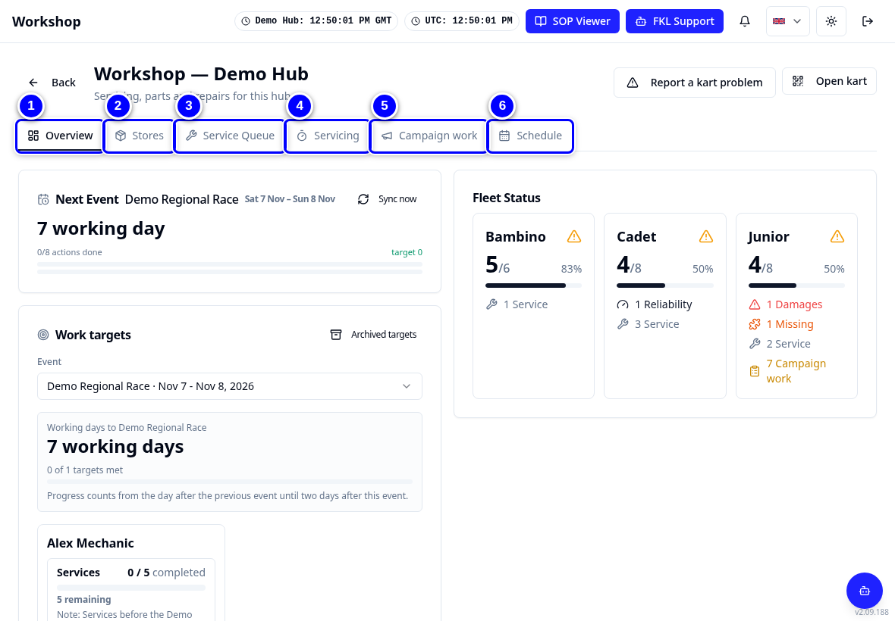{ loading=lazy }

2. On a narrow screen, swipe the tab strip sideways to see the rest.

    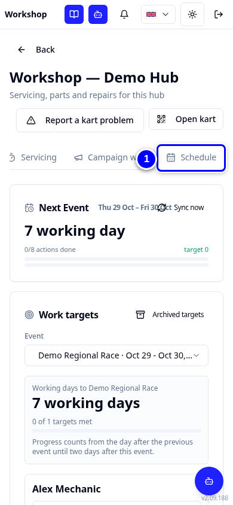{ loading=lazy }

3. Hub managers also see **Workshop Manager** at the end of the strip.

    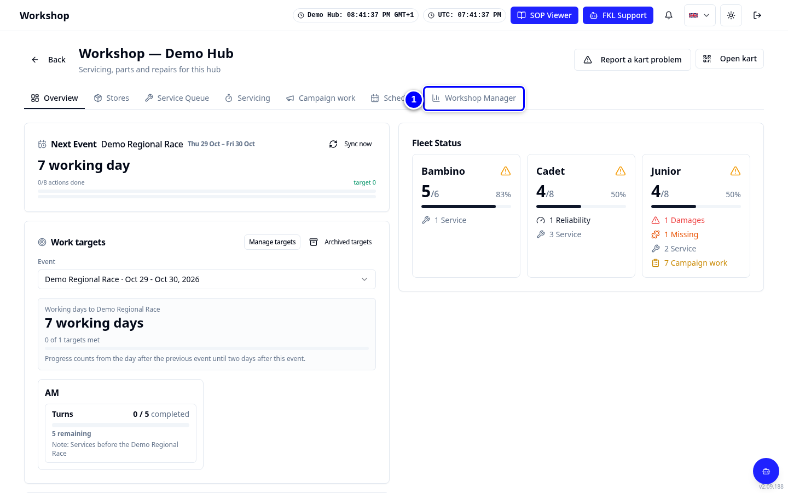{ loading=lazy }

## The header buttons

1. Look at the buttons at the top right of most pages.

    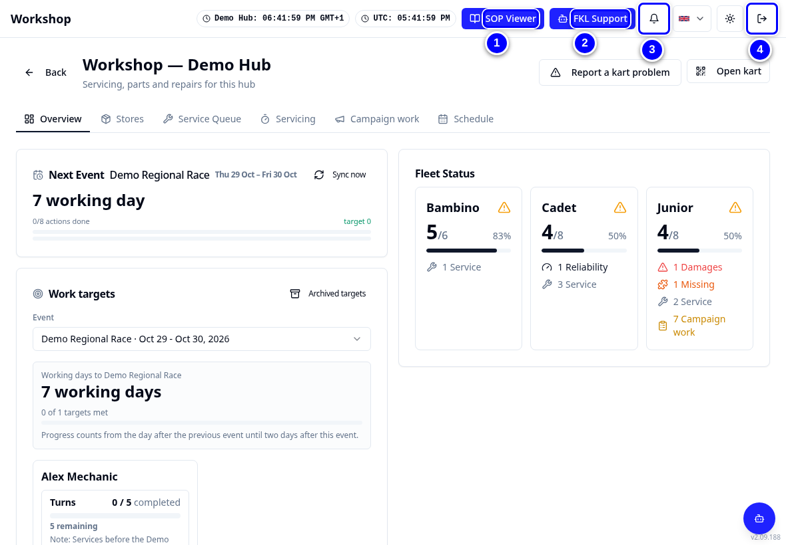{ loading=lazy }

2. To sign out, tap the sign-out icon at the far right.

    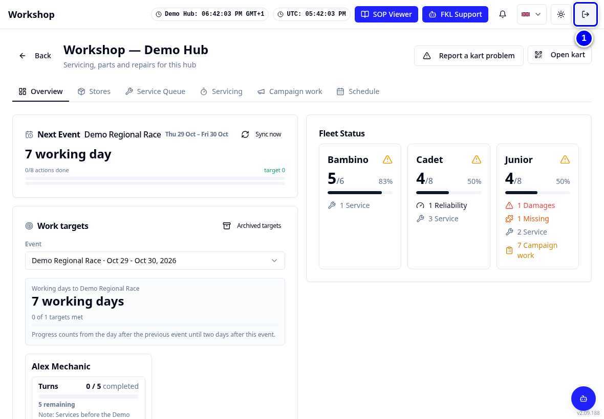{ loading=lazy }

## Back buttons

1. Most pages have a **Back** button at the top left. Tap it to go back one step.

    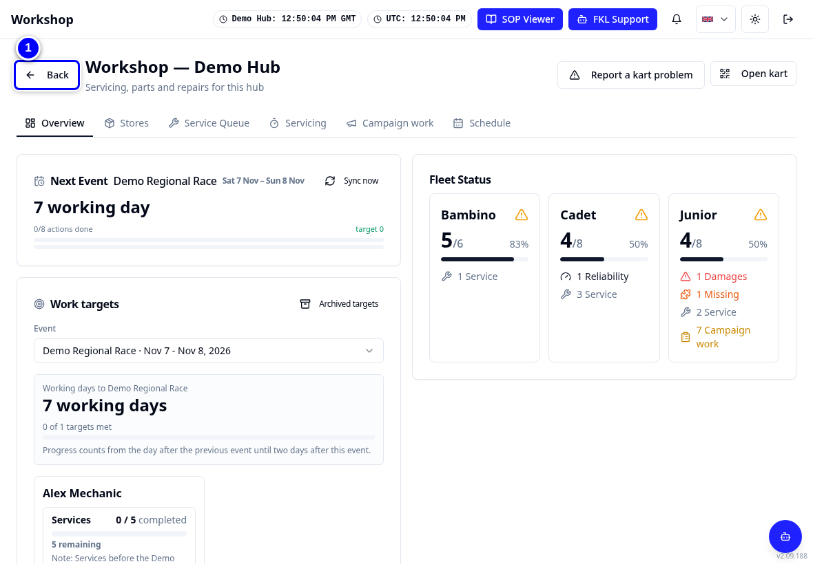{ loading=lazy }

!!! warning "Watch out"
    Do not use the browser's own back arrow in the middle of a dialog. Close the dialog with **Cancel** first, then go back.

## Using a tablet or phone

1. On a phone the header buttons show as icons only, and the cards sit one under the other.

    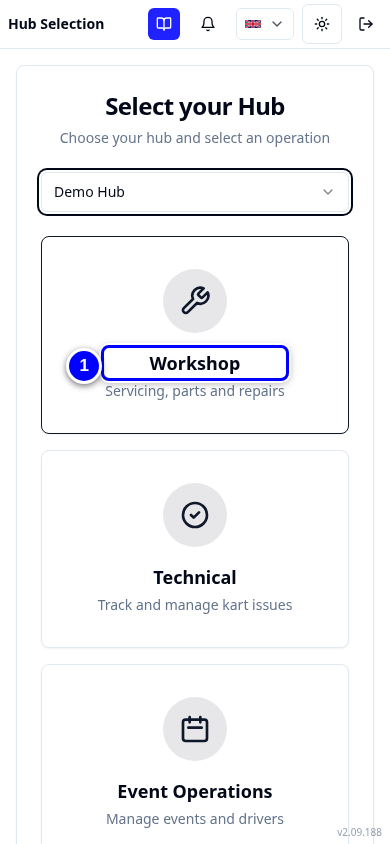{ loading=lazy }

2. Turn the tablet sideways (landscape) for the Service Queue, Servicing and Race to Chassis. You see more columns at once.

    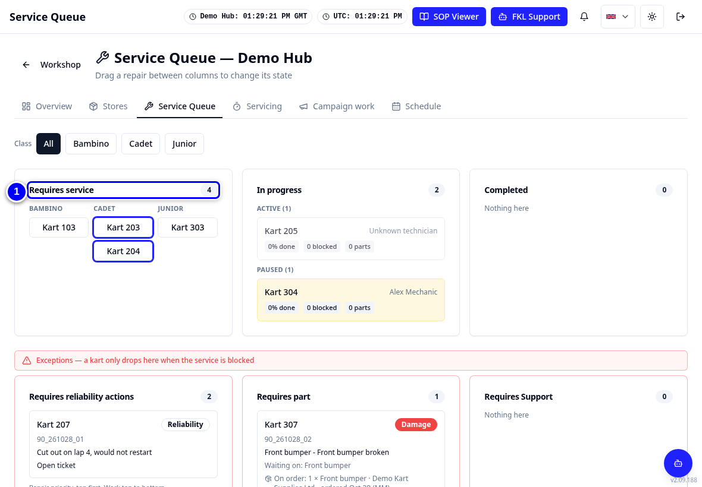{ loading=lazy }

## Adding KART to your home screen

KART can be added to the home screen of a tablet or phone. The icon is called **FKL**.

1. Open KART in the browser and sign in.

    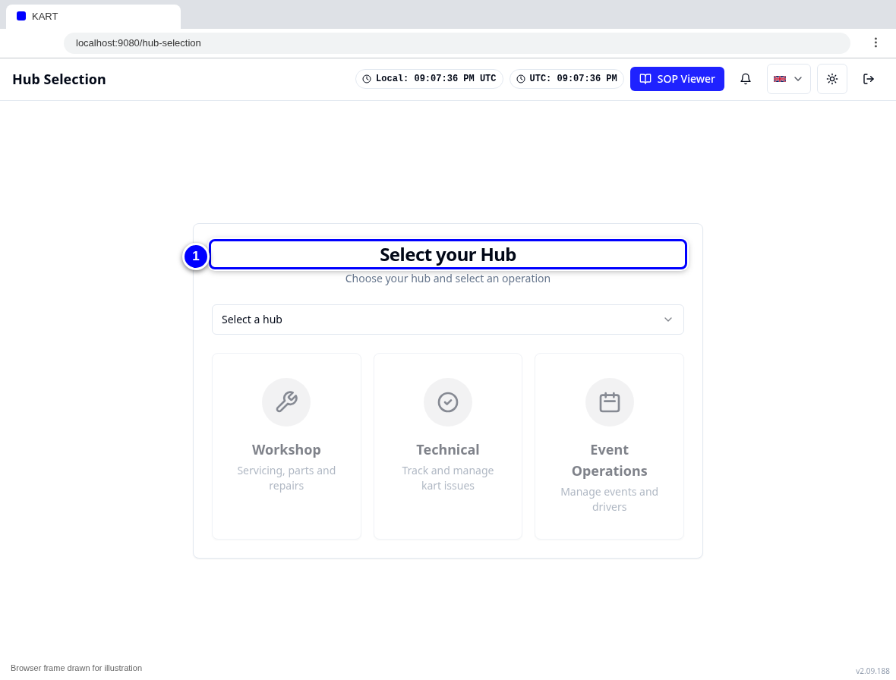{ loading=lazy }

2. Open the browser's share or menu button and choose **Add to Home Screen** (the wording depends on the browser).

    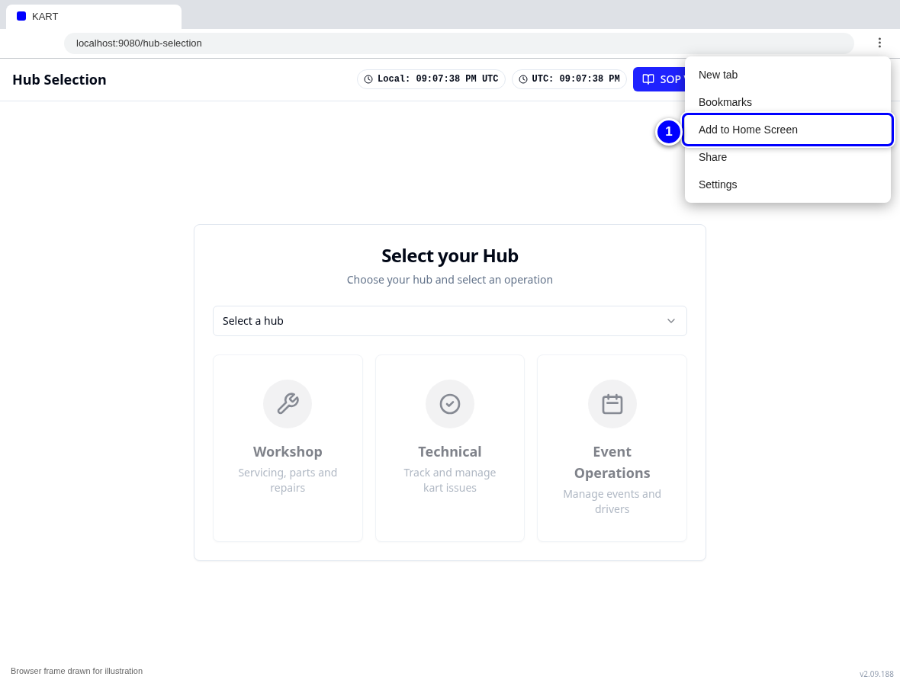{ loading=lazy }

!!! warning "Watch out"
    The home-screen icon opens KART on **FKL Support** (the help chat) if you have it, otherwise on **Select your Hub**. A browser bookmark of the hub selection page is often quicker for workshop work.
