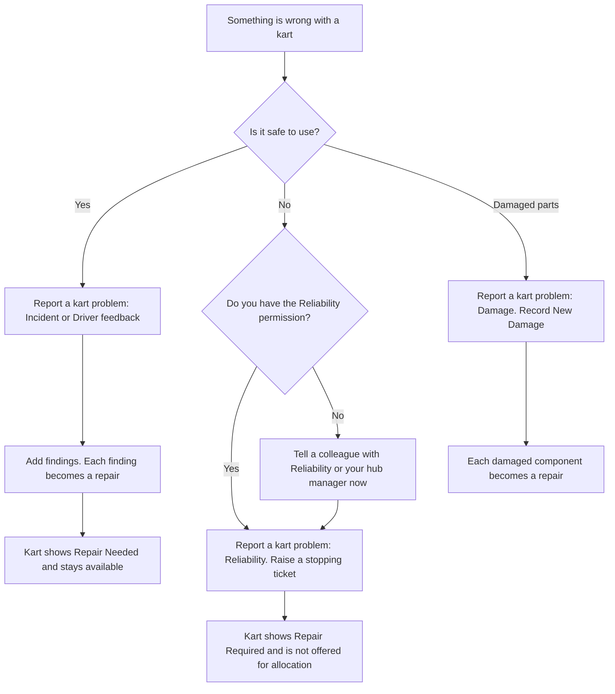
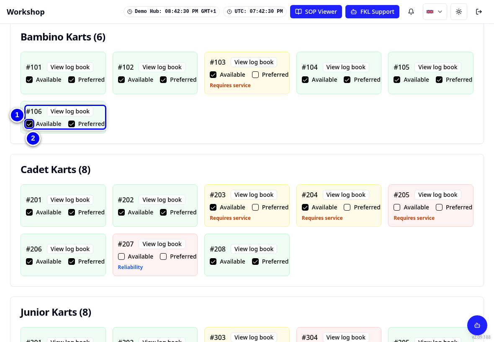
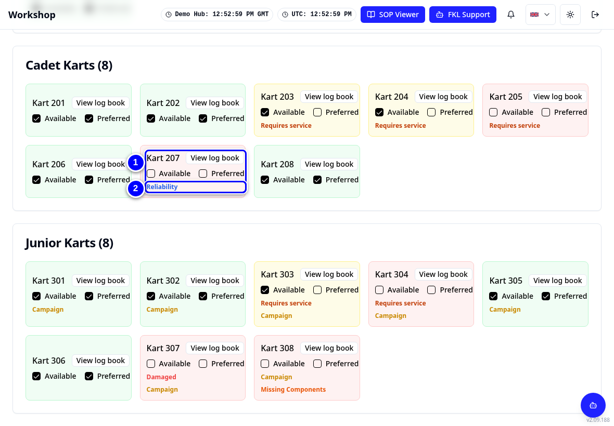
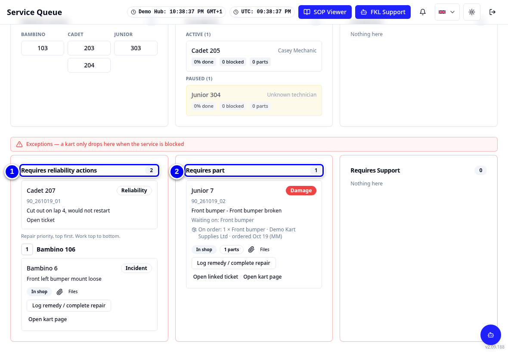

# Incidents, tickets and repairs

KART uses three words for problems with a kart. Knowing the difference saves you from taking good karts out of use, or leaving unsafe karts in.

!!! info "What changed from the Workshop App"
    - In the Workshop App an incident could make a kart Repair Required. **In KART, incidents are information only.** They never make a kart Repair Required or unavailable.
    - **Only a stopping reliability ticket (or a blocking open repair) takes a kart out of use.**
    - "Create New Kart Report" is now **Report a kart problem**.

## The three words

| | What it is | Who raises it | Does it stop the kart? | Example at Demo Hub |
|---|---|---|---|---|
| **Incident** | Something that happened to the kart or what a driver reported. Information for the workshop. | Anyone with the Workshop permission | **No, never** | 106 hit the barrier; the finding was a loose bumper mount |
| **Reliability ticket** | A fault for engineering to investigate. It has an effect, such as "Cut out not restarted". | Mechanics with the **Reliability** permission | **Yes**, when the effect is anything other than **Performance** | 207 cut out and would not restart |
| **Repair** | The work to fix something. Every finding and every damaged component becomes a repair. | Created by KART from findings, damage or tickets | Only when it belongs to a stopping ticket or is marked as blocking | 307 broken front bumper, waiting on parts |

## Stopping or not stopping

- A **stopping** ticket makes the kart **Repair Required**. It is not offered for allocation until the ticket is resolved and its repair is completed. Cadet **207** is the example.
- A **non-stopping** problem leaves the kart available. An open repair without a stopping ticket shows as **Repair Needed (usable)**, like Bambino **106**.
- A **Performance** ticket never stops the kart.

!!! warning "Watch out"
    When you log a finding, KART asks **Would this stop the kart from being used?** Answering **Yes, it should not be used** does **not** stop the kart by itself. KART reminds you: **This answer does not stop the kart: it stays available. If it must not be used, raise a reliability ticket for it.**

## Which one do I raise?

## See the difference on screen

1. Open **Overview** and look at Bambino **106**. It shows **Repair Needed (usable)**: the incident found a loose bumper mount, and the kart can still be used.

    { loading=lazy }

2. Look at Cadet **207**. It shows **Repair Required** because of a stopping reliability ticket: it cut out and would not restart.

    { loading=lazy }

3. Open the **Service Queue**. The repairs for 106, 207 and 307 are cards in the exception lanes.

    { loading=lazy }

!!! note "Remember"
    Root cause (why it failed) stays on the reliability ticket. The remedy (what you did) goes on the repair. Engineering closes the ticket.

## Where next

- [Report a problem](../mechanic/report-a-problem.md) for incidents, findings and driver feedback.
- [Reliability tickets](../mechanic/reliability-ticket.md) to stop a kart.
- [Repairs and parts used](../mechanic/repairs-and-parts.md) to fix it.
