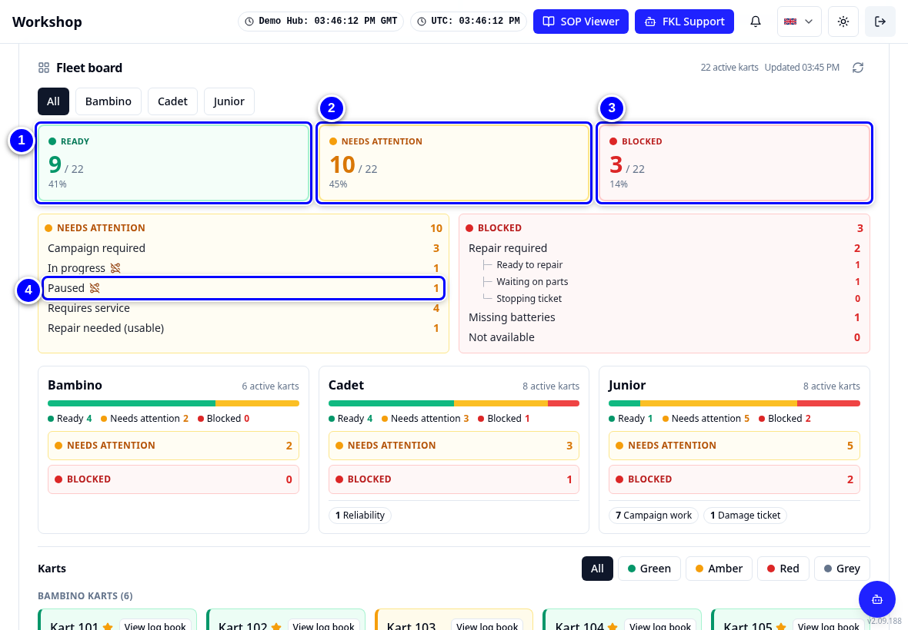
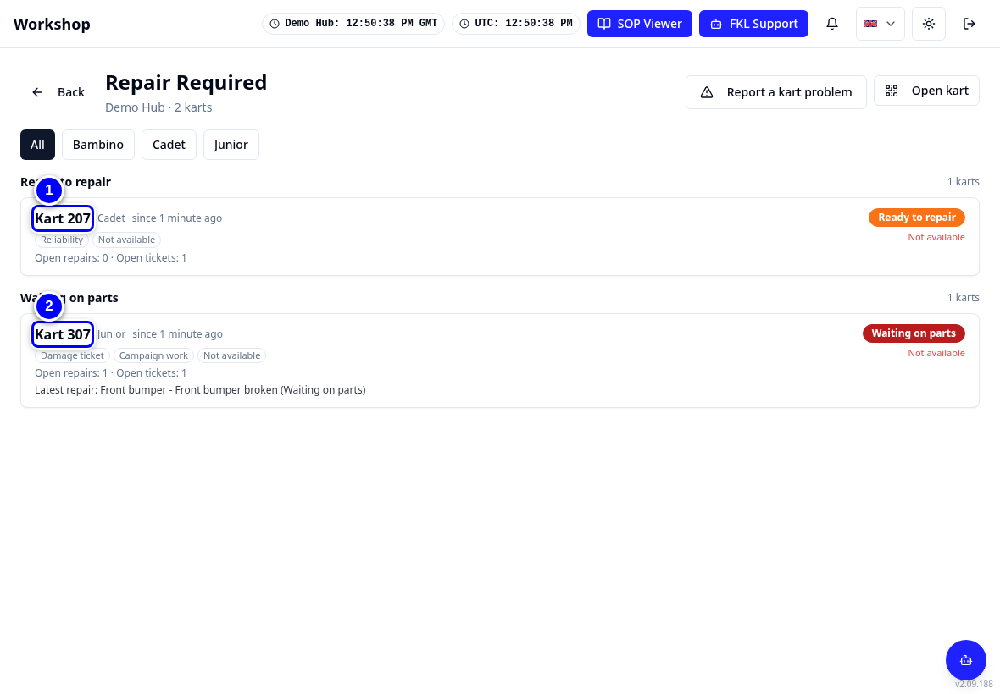
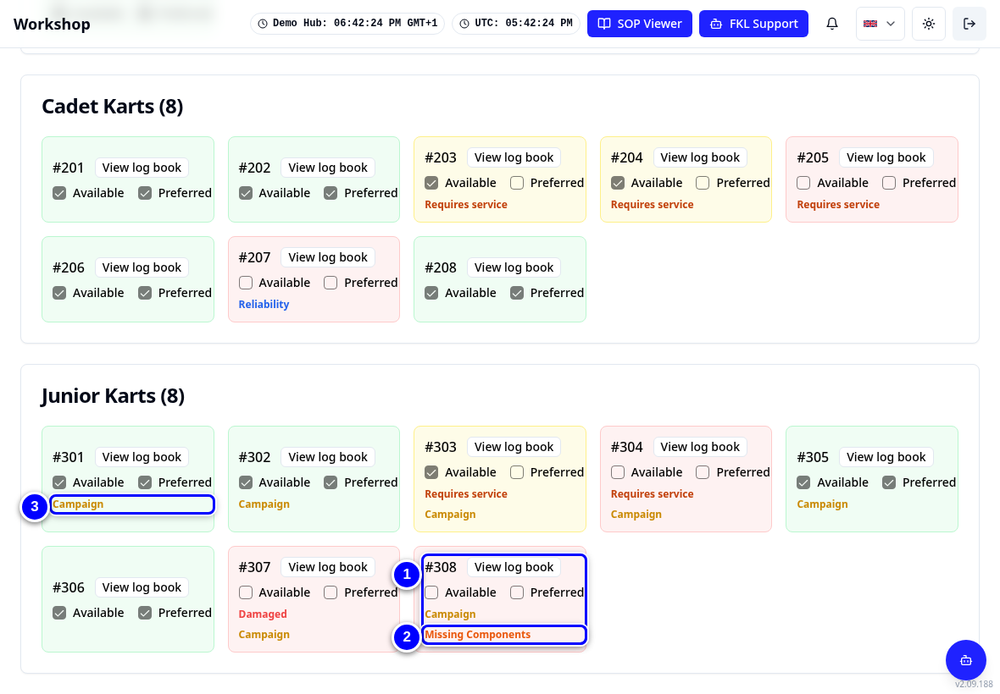
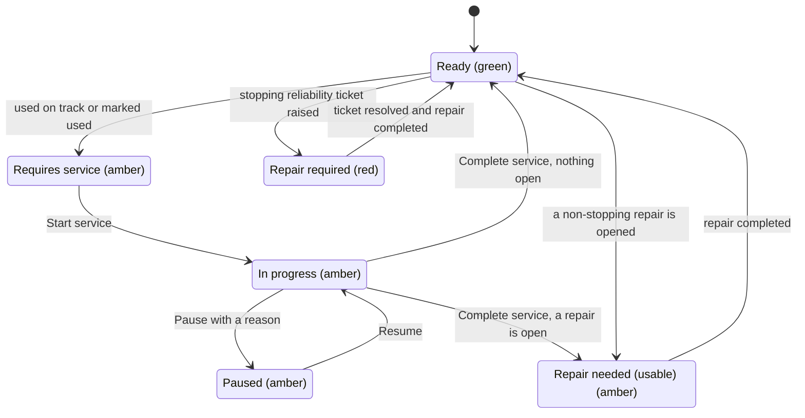

# Kart statuses

Every kart in KART has one colour: **green**, **amber** or **red** (grey for karts that are written off or off site). The colour tells you at a glance whether the kart can race. The words next to it tell you why. You see the same colour on the **Fleet board** on **Overview**, on the kart tiles, in every list you open from the board, on the kart page, on **Kart Availability** and in **Race to Chassis**.

!!! info "What changed from the Workshop App"
    - **Three colours instead of nine.** Green is Ready, amber needs attention, red is blocked. The reason (for example **Paused** or **Waiting on parts**) is written next to the colour.
    - **"Turn Required" is now "Requires service".** Same meaning: the kart has been used since its last service and needs one. KART never shows the words "Turn Required".
    - **One colour for status and availability.** A red kart is blocked: **Race to Chassis** refuses it. Ticking **Available** on a kart that is not available asks for a reason and gives it a **track use override**: the tile shows the override with its expiry and the kart keeps its colour (a red kart stays red until it is fixed) (a kart with an open stopping ticket cannot be ticked). An amber kart in a service or paused carries a small **Not on track** marker.
    - Logging an incident no longer makes a kart Repair required on its own. See [Incidents, tickets and repairs](problems-explained.md).

## The colours at a glance

| Colour | On the board | What it means | The reasons under it |
|---|---|---|---|
|  green | **Ready** | Serviced and nothing open. The kart can race. | Ready |
|  amber | **Needs attention** | The kart needs work, but nothing stops it for good. | **Campaign required**, **In progress**, **Paused**, **Requires service**, **Repair needed (usable)** |
|  red | **Blocked** | The kart must not be used. **Race to Chassis** refuses it. Ticking **Available** asks for a reason and gives a track use override until the time shown; the kart stays red. | **Repair required** (**Ready to repair**, **Waiting on parts** or **Stopping ticket**), **Missing batteries**, **Not available** |
|  grey | **Written off / off site** | The kart is written off or not at a hub. It is not counted in the hub's active karts. Shown only when there is one. | **Written off**, **Off site** |

A kart is counted once, under the first reason that applies, in the order of the list below. The numbers on the board always add up to the number of active karts.

## Every reason

| Reason | Colour | What it means | What makes it change | Workshop App name |
|---|---|---|---|---|
| **Written off** | grey | An open ticket says the kart is written off. | Only your hub manager or FKL Central changes it. | Written off |
| **Off site** | grey | The kart is not assigned to a hub (kart page only). | Assigning it to a hub. | (none) |
| **Repair required: Waiting on parts** | red | A blocking repair waits for parts. Once ordered, the card says **On order**. | The parts are received in Goods In, then it becomes Ready to repair. | Waiting on Parts |
| **Repair required: Ready to repair** | red | A blocking repair can be done now. | Completing the repair, with the ticket resolved. | Ready to Repair |
| **Repair required: Stopping ticket** | red | An open reliability or damage ticket stops the kart, for example while it is paused in a service. | Resolving the ticket. | Repair Required |
| **Missing batteries** | red | Fewer batteries fitted than the class needs (Bambino 1, Cadet 2, Junior 3). | Fitting the batteries. | (Missing Components in KART before) |
| **Not available (locked)** | red | Someone with Reliability unticked **Available**. | Ticking **Available** again. | (none) |
| **Not available** | red | KART does not offer the kart for any other reason. | Tell your hub manager. | (none) |
| **In progress** | amber, **Not on track** | A mechanic has started the service. | **Start service**. It ends with **Complete service**. | In Progress |
| **Paused** | amber, **Not on track** | The service was paused with a reason (shown under the label). | **Pause**. It ends when someone resumes the service. | Paused |
| **Requires service** | amber | The kart has been used and needs a service; the service has not started. | It goes on track (Race to Chassis on the event day), or a hub manager marks it used. Completing the service ends it. | Turn Required (Ready to Turn) |
| **Repair needed (usable)** | amber | An open repair that does not stop the kart, or an open **Performance** ticket. The kart stays available. | Completing the repair. | Repair Needed (Usable) |
| **Campaign required** | amber | An open task in an active campaign, and nothing else is open. The kart stays usable. | Completing the task, or the kart is excluded. | (new) |
| **Ready** | green | Nothing open. | Any of the above. | Ready |

!!! note "Remember"
    **Event usable** has not changed: Ready or Repair needed (usable), and available. Only those karts count towards your readiness targets, on the separate **Event readiness** card. So **Event usable** also counts amber karts that are **Repair needed (usable)** or **Campaign required**: it can be higher than the board's green **Ready**. That is by design.

## Markers and tags

The colour comes only from the kart's condition. Markers and tags add detail; they never change the colour.

- **Not on track** (a struck-through track icon): the kart is in a service or paused, so it is not available for track use. Shown on amber karts only.
- **Star**: the kart is preferred for allocation. No star: not preferred. In Race to Chassis an empty star means **Unpreferred**.
- **Lock** next to **Preferred**: someone set it by hand. Next to **Available** only on an older manual setting (ticking **Available** now gives a track use override instead).
- **Track use override**: the kart may run until the time shown, even if it is not available. The colour stays as it is.
- **Manual override**: someone set Available or Preferred by hand.
- **Campaign**: an open campaign task. Shown on any colour, so a red kart with campaign work shows red with the Campaign tag.
- **Performance**: an open performance ticket. It does not stop the kart: the kart is amber **Repair needed (usable)** (unless another reason comes first) and not preferred.
- **Reliability** or **Damage**: the kind of open ticket on a red kart.
- **Missing batteries**: shown as a tag when the kart is red for another reason too.
- **Requires service**: the kart also needs (or is in) a service while it shows another reason, for example red with a stopping ticket.

## Where you see the colour

1. Open **Overview**. The **Fleet board** shows how many karts are green, amber and red, with the reasons under amber and red.

    { loading=lazy }

2. Tap a number to list those karts, for example **Repair required** under red.

    { loading=lazy }

3. Scroll further down to the kart tiles. Each tile has the kart's colour, its reason and its tags, for example **Missing batteries** on Junior 308.

    { loading=lazy }

## How a kart moves between reasons

!!! warning "Watch out"
    Do not change a kart's status by hand to make the board look right. If a colour looks wrong, tell your hub manager (hub lead), with the kart number. See [Troubleshooting](../troubleshooting.md).

!!! tip "Tip"
    A kart in a service or paused still counts as needing service everywhere in KART, including the Requires service list and its Preferred tick. On the board it is amber with **Not on track**, not red: nothing stops it once the service is finished.

!!! note "Remember"
    You cannot complete a service while a reliability ticket on the kart is still open. A kart with a stopping ticket stays red (**Repair required**) until the ticket is resolved and its repair is completed.
