# Switch-over day for your hub

On your hub's switch-over day, your workshop stops recording in the Workshop App and starts recording everything in KART. This page explains what happens, what you need to do before and on the day, and what comes later.

!!! warning "Watch out"
    **No hub that uses the Workshop App has switched yet.** Dates are proposed and still waiting for approval. **Your hub lead confirms the date and time at least 24 hours before.** Do not plan around a date until your hub lead has confirmed it.

!!! info "What changed from the Workshop App"
    - After the switch time, the Workshop App is for looking things up only. Everything new goes into KART.
    - There is no going back: once your hub works in KART, nothing is copied back to the Workshop App.
    - A few hubs never used the Workshop App and already run their workshop in KART. Past records from some hubs (old services, repairs, incidents and finished campaigns) have already been copied into KART as history. That changes nothing for your hub until its own switch-over.

## The plan at a glance

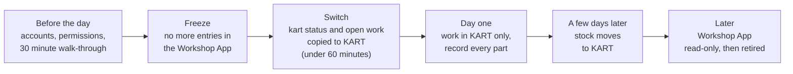

!!! abstract "Coming with your hub's switch-over"
    Everything below happens when **your** hub switches. Your hub lead tells you the date and time at least 24 hours before, and goes through this page with you.

## Before the day: accounts first

!!! abstract "Coming with your hub's switch-over"
    You need a **KART account** with the **Workshop** permission and **access to your hub** before the day. Without the Workshop permission you can see the karts but cannot start services, raise or update repairs, or record parts.

1. Sign in to KART (see [Signing in and access](../start/sign-in-and-access.md)).

    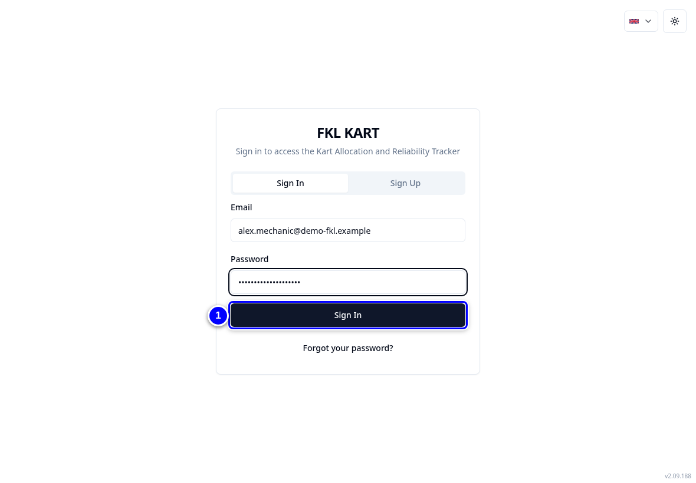{ loading=lazy }

2. Choose your hub and check you see the **Workshop** card.

    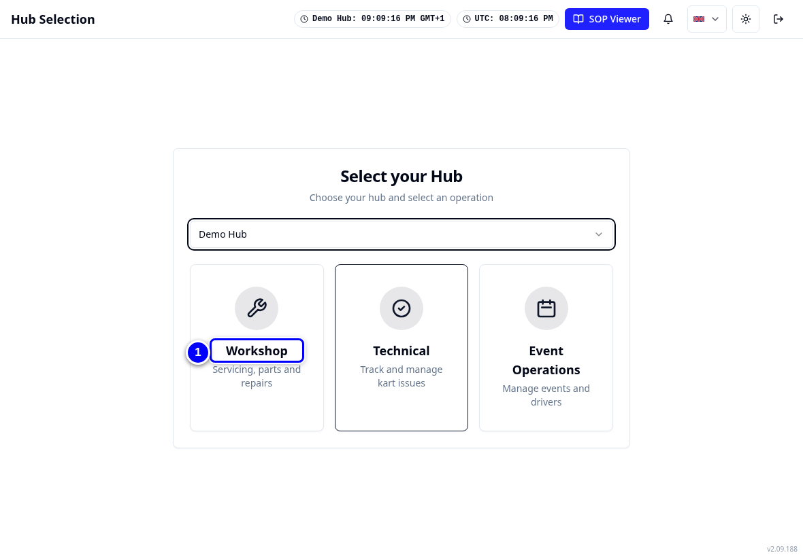{ loading=lazy }

3. Tap **Workshop** and check you see the **Service Queue** tab. If anything is missing, tell your hub lead **now**, not on the day.

    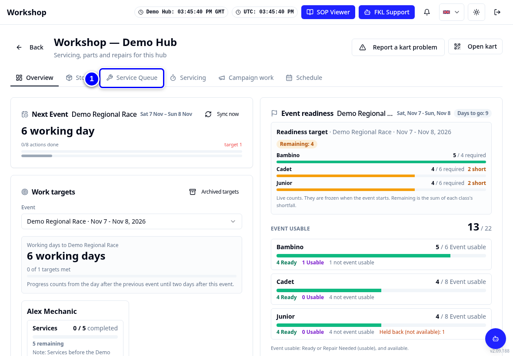{ loading=lazy }

!!! tip "Tip"
    Your hub lead runs a 30 minute walk-through before day one, on a test kart where possible. Bring your questions.

## The cut-off and the Workshop App freeze

!!! abstract "Coming with your hub's switch-over"
    - **From the switch time, nobody enters or changes anything in the Workshop App for your hub.** You can still open it to look things up.
    - **Anything typed in the Workshop App after the switch time is not copied to KART.**
    - Campaign work stops in the Workshop App at the same time.
    - The freeze while records are copied lasts under 60 minutes.
    - **There is no going back.** If something looks wrong in KART afterwards, it is fixed in KART.

## What carries over

!!! abstract "Coming with your hub's switch-over"
    | Carries over at the switch | How it looks in KART |
    |---|---|
    | **Kart status** | Each kart takes its Workshop App status. Karts that are already Repair Required in KART stay that way until their KART ticket or repair is closed, whatever the Workshop App says. Changes someone made in KART after the kart's last Workshop App change are kept. |
    | **Open services** | Moved with **0 active time**: their timer starts from zero at the switch. Finish or cancel them in KART. |
    | **Open repairs and incidents** | Moved as open repairs and incidents, in the Service Queue and on the ICU board (the list of an event's open incidents, in **Event Operations**). |
    | **Open campaigns** | Continue in **Campaign work**. |
    | **Typed notes** | **Not copied.** Only system texts and short labels come across. Note anything important on paper before the switch. |

## What moves later

!!! abstract "Coming with your hub's switch-over"
    - **Stock, a few days after the switch.** KART sets each part to **the Workshop App count minus what you used in KART since the switch**. So **record every part you use in KART from day one.** Until the stock moves, **Parts needed may list parts that are on the shelf: check the shelf before ordering.**
    - **Open orders** in the Workshop App are not copied. Re-enter each one in KART (**Stores**) so it can be received there. Order history is not moved now.
    - **Checklist answers** of old services move later. Until then, old services show "0 of N checks" in reports.

## Day-one checklist

Print this list, or the [switch-over day card](../cards/index.md).

!!! abstract "Coming with your hub's switch-over"
    Use this checklist on your hub's first day in KART.

1. Before the day: check you can sign in to KART and see Workshop for your hub. If not, tell the hub lead now.

    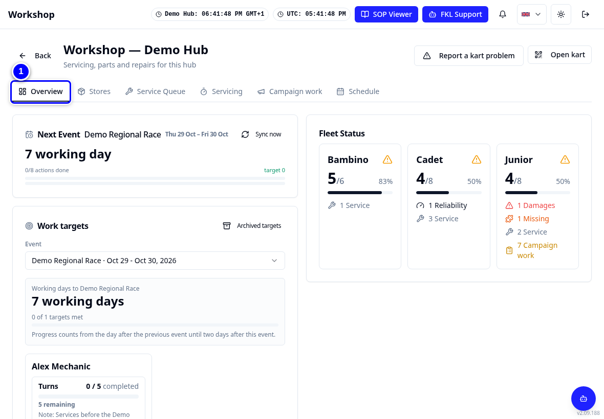{ loading=lazy }

2. From the switch time: do not open the Workshop App to record anything.

    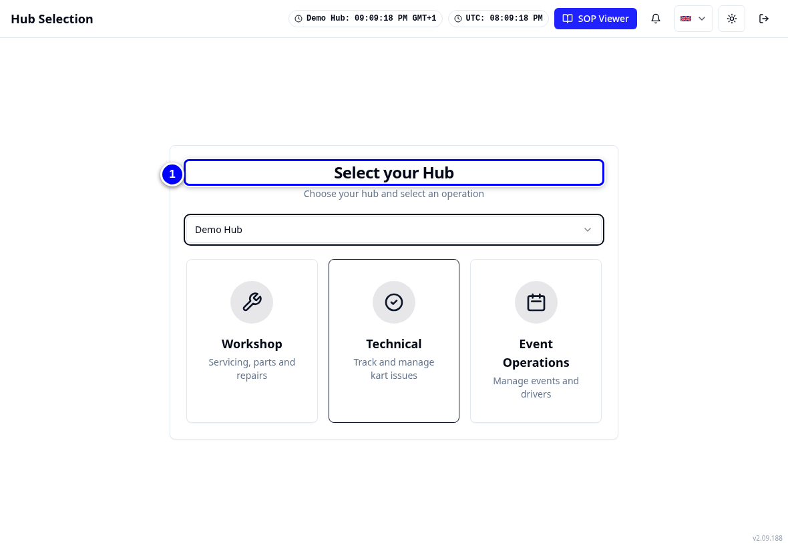{ loading=lazy }

3. Open KART > Workshop and check the fleet board against the karts in front of you. Report anything wrong through KART Comms support, with the kart number (see [Getting help](../start/finding-your-way.md#getting-help)).

    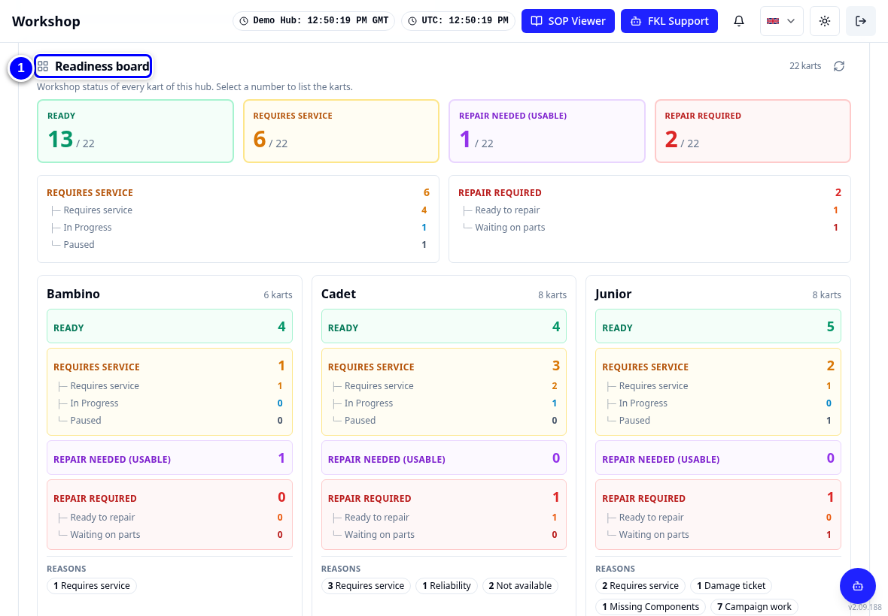{ loading=lazy }

4. Open **Servicing** and pick up the carried-over services: complete or cancel each one.

    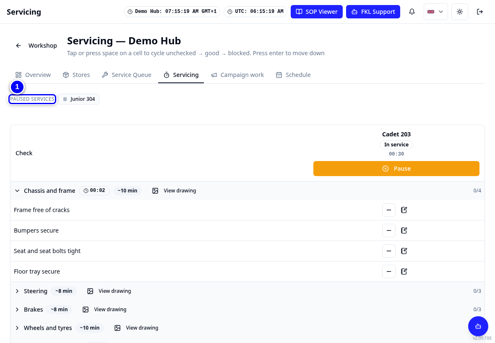{ loading=lazy }

5. Work the **Service Queue** for karts showing **Requires service** (the Workshop App said Turn Required).

    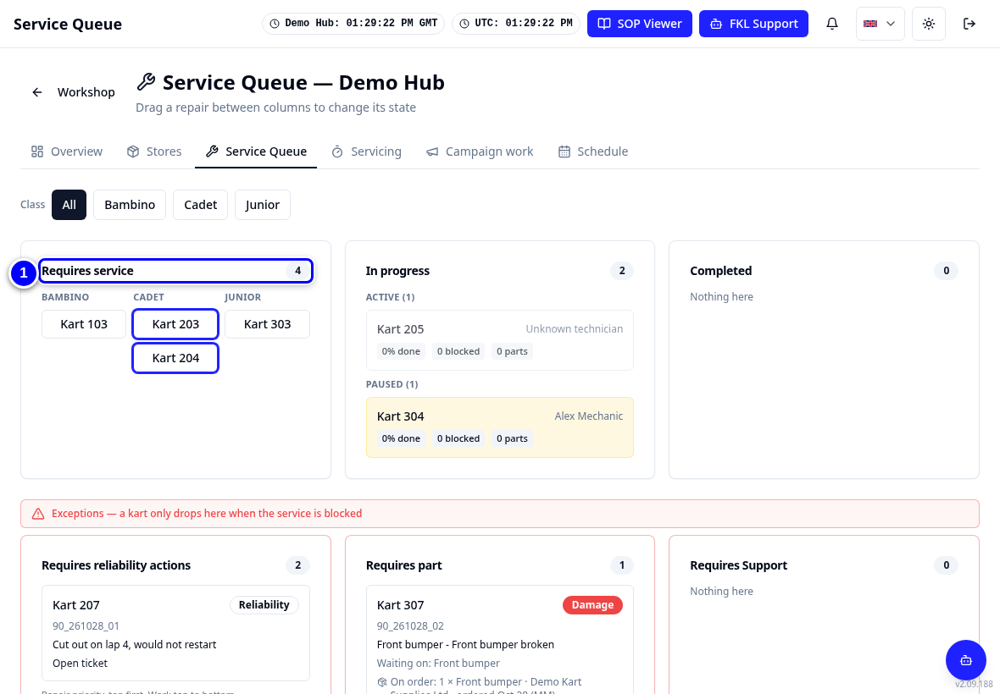{ loading=lazy }

6. Work the open repairs, and record the parts used on each repair.

    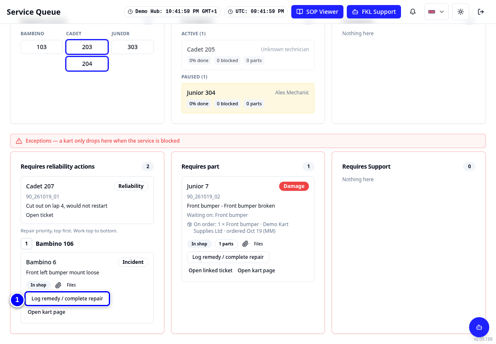{ loading=lazy }

7. Close any KART stopping ticket whose fault is already fixed.

    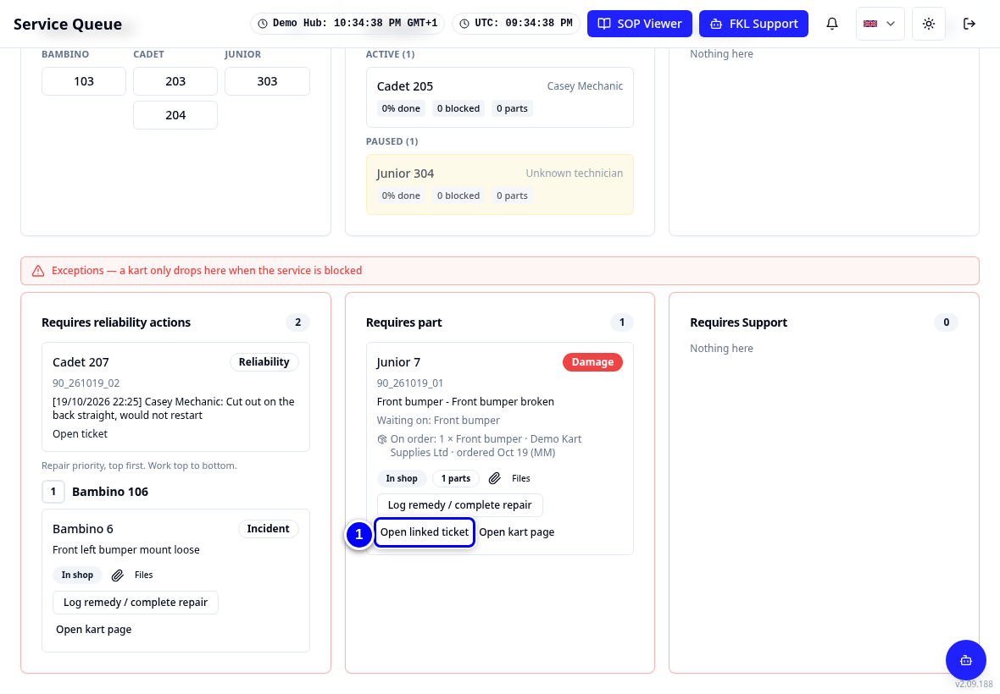{ loading=lazy }

8. Carry on any open campaign in **Campaign work** and record the fitted parts on the task.

    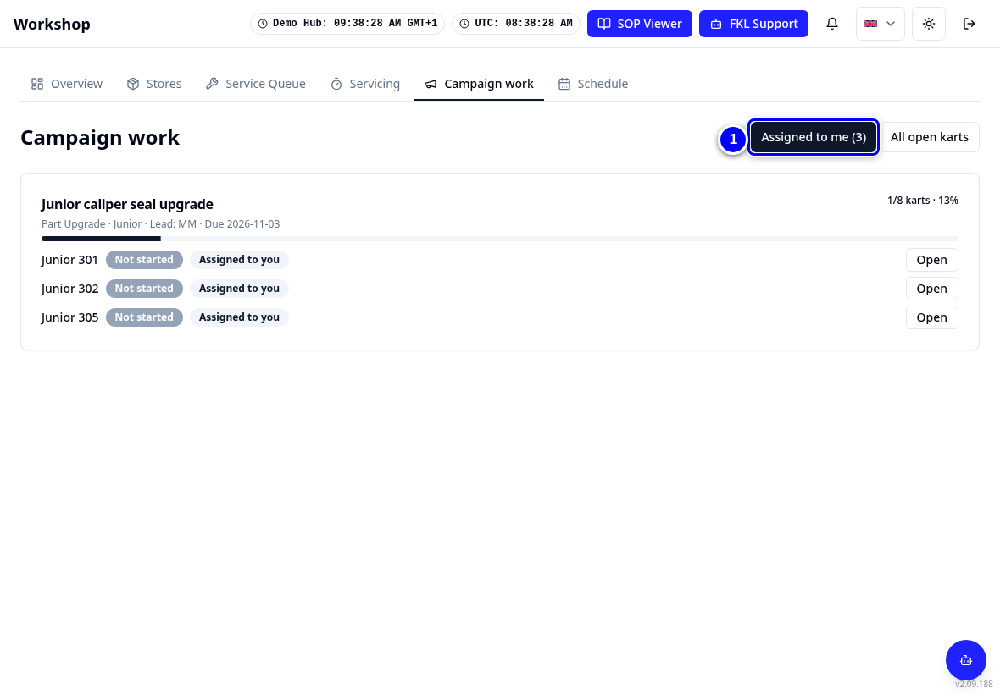{ loading=lazy }

9. New fault on a kart: tap **Report a kart problem**. Choose **Incident** if the kart can still be used, or **Reliability** (a stopping ticket) if it must not be used.

    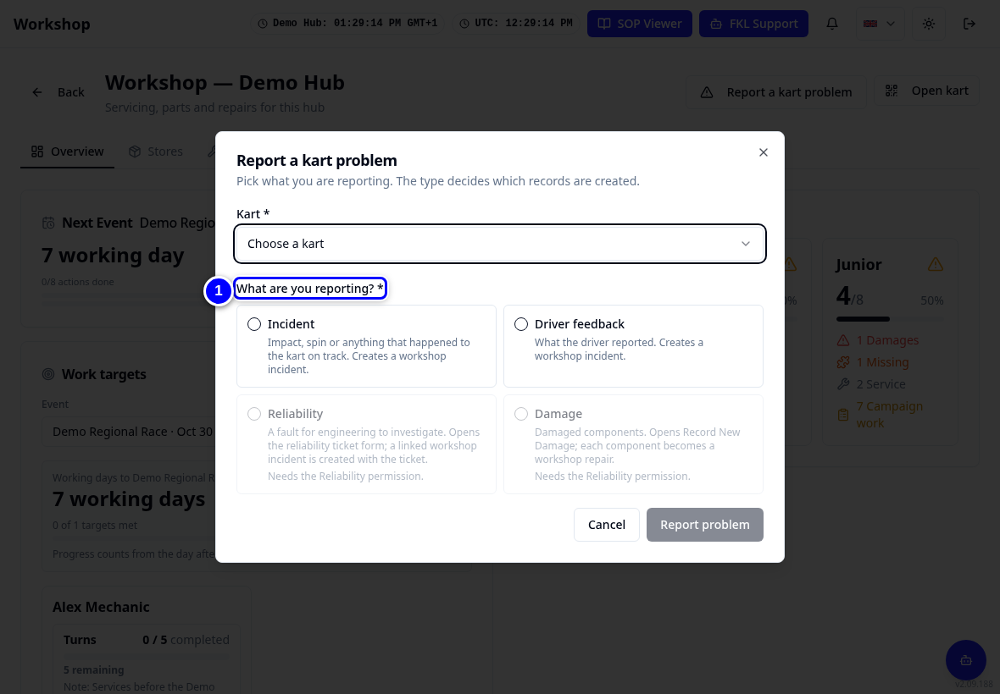{ loading=lazy }

10. Re-enter any open Workshop App order in **Stores**.

    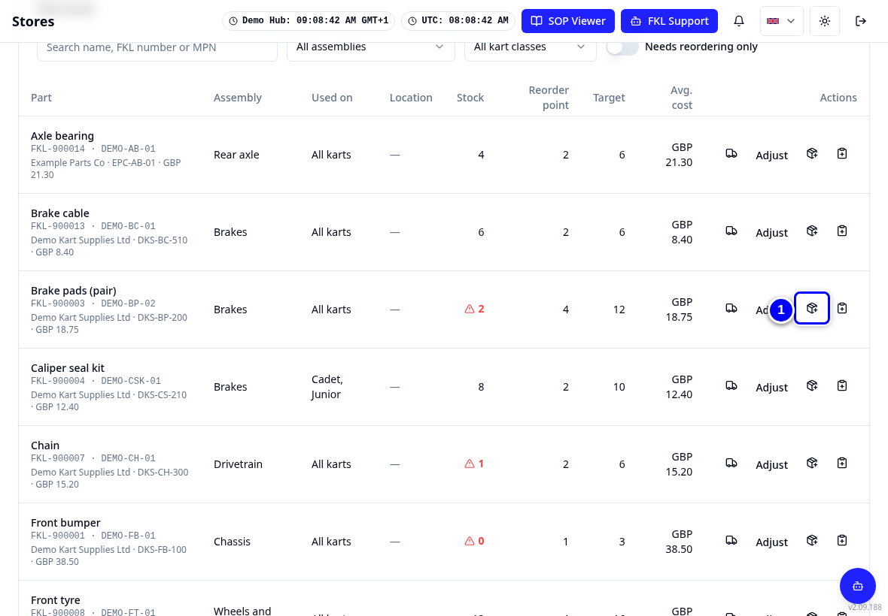{ loading=lazy }

## If KART is down

!!! warning "Watch out"
    **Write it on paper; enter it in KART when it is back. Do not use the Workshop App.** Note the kart number, what you did, the parts you used, the time and your initials.

## Who to contact

| Question | Ask |
|---|---|
| Cannot sign in, no Workshop access, wrong hub | Your **hub lead**, who asks a KART admin to give the Workshop permission and hub access |
| Fleet board or kart status looks wrong, a moved record is missing | **KART Comms support** (remote support). Include the kart number |
| Part missing from the parts list, wrong part number, supplier | **FKL Central** (parts catalogue), through your hub lead |
| Process questions, the SOP (your hub's written procedures) | Your **hub lead**, then the **KART product owner** (the person responsible for KART across the league; your hub lead passes it on) |
| KART unavailable | Paper, then enter it in KART later. Never the Workshop App |

## Later: the Workshop App is retired

!!! abstract "Coming with your hub's switch-over"
    After every hub has switched, the Workshop App becomes read-only and is later switched off. Old kart QR labels will be redirected to KART. Your hub lead tells you when.

!!! note "Remember"
    Record every part in KART from day one, check the shelf before ordering until the stock moves, and never use the Workshop App to record anything after your switch time.
